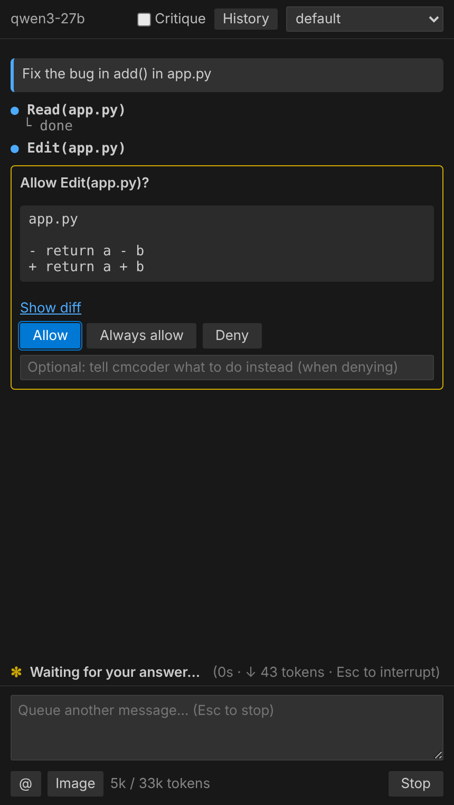

# cmcoder in VS Code: install and set up

For developers. You need **VS Code 1.90 or newer** and the file `cmcoder-<platform>.vsix`
that your team gives you (`cmcoder-win32-x64.vsix` on Windows). No Python, Node.js or
administrator rights are needed: VS Code installs extensions for you alone.
On Windows, install [Git for Windows](https://git-scm.com/download/win) too (cmcoder's
Bash tool uses it).

> **About the pictures.** The four screenshots below are the real cmcoder chat panel,
> showing what cmcoder itself sent for these steps, with VS Code's dark colours. They
> are not photographs of VS Code's own windows (Extensions view, file picker), which look
> a little different between VS Code versions; those steps are described in words.

## 1. Check the file (optional, 30 seconds)

Your team gives you the file's SHA256 (the Release build prints it and lists it in the
checksums file). Compare:

```powershell
Get-FileHash .\cmcoder-win32-x64.vsix -Algorithm SHA256
```

If it differs, don't install it: ask your team for the file again.

A file from a download or a zip may be marked "from the internet", which Windows can
use to block or warn. Remove the mark once, after the check above:

```powershell
Unblock-File .\cmcoder-win32-x64.vsix
```

## 2. Install: do not double-click the file

**The .vsix is not signed, and double-clicking it can fail.** On a PC that also has
Visual Studio, Windows often hands `.vsix` files to Visual Studio's own *VSIX
Installer*, which is for Visual Studio extensions and rejects this one with an error.
Install from inside VS Code instead: it installs a `.vsix` file you give it directly,
and doesn't need cmcoder's file to be signed (extension signatures are a Marketplace
matter, and cmcoder isn't distributed through the Marketplace).

**Way A: from the Extensions view (point and click)**

1. Open VS Code.
2. Press **Ctrl+Shift+X** to open the **Extensions** view.
3. Click the **`…`** (*Views and More Actions*) at the top right of that view.
4. Choose **Install from VSIX…**
5. Pick `cmcoder-win32-x64.vsix` and click **Install**.
6. A notification says the extension was installed. If it offers **Reload**, click it.

**Way B: from the Command Palette**

Press **Ctrl+Shift+P**, type `Extensions: Install from VSIX…`, press Enter and pick the file.

**Way C: from a terminal**

```powershell
code --install-extension "C:\path\to\cmcoder-win32-x64.vsix"
```

If `code` isn't found, use its full path:
`"$env:LOCALAPPDATA\Programs\Microsoft VS Code\bin\code.cmd"`.
(On macOS or Linux, use the file for your platform: `cmcoder-darwin-arm64.vsix` or
`cmcoder-linux-x64.vsix`.)

<!-- Add your own screenshots here when you take them (see the team's notes):


-->

To check: the Extensions view lists **cmcoder**, and the activity bar (the icon column
at the left) now has a **cmcoder** icon.

## 3. Open a project and the chat

1. **File → Open Folder…** and choose your project's folder. If VS Code asks whether you
   trust its authors, choose **Yes, I trust the authors** for your own projects.
2. Click the **cmcoder** icon in the activity bar, or press **Ctrl+Alt+K**.

## 4. First start: the gateway and your key

The first time, cmcoder doesn't know your model gateway yet. The panel says so:


This is expected. Your team may already have set it up for you: some builds put a ready
`~/.cmcoder/settings.json` on first use, and then you only need your API key (step 4b).
Otherwise:

### 4a. The gateway and model

**Quickest:** in a terminal (VS Code's own: **Ctrl+`**) run cmcoder's setup. It asks for
the gateway address, your key and the models, and writes the file for you:

```powershell
& "$env:USERPROFILE\.cmcoder\bin\cmcoder.exe" setup
```

> That path exists after cmcoder has started once from the extension, because it copies
> itself there. If it isn't there yet, run the copy inside the extension instead; the
> folder name starts with your extension's publisher and name:
>
> ```powershell
> $exe = Get-ChildItem "$env:USERPROFILE\.vscode\extensions" -Recurse -Filter cmcoder.exe |
>        Select-Object -First 1 -ExpandProperty FullName
> & $exe setup
> ```

**Or edit the file yourself:** press **Ctrl+Shift+P**, choose **cmcoder: Open Settings
File** and put in your gateway (the example shows the main settings):

```json
{
  "providers": {
    "corp": {
      "baseUrl": "https://ai-gateway.example.com/v1",
      "auth": { "type": "apiKey" },
      "caCertPath": null
    }
  },
  "model": "corp:qwen3-27b",
  "smallFastModel": "corp:qwen3-7b"
}
```

- `baseUrl` is your gateway's OpenAI-compatible address (LiteLLM or Open WebUI).
- `caCertPath`: if your company's gateway uses an internal certificate authority, put the
  path to its `.pem` file here (or install the CA in Windows, which cmcoder also trusts).
- `smallFastModel` is optional: a smaller model for titles and summaries.
- Every setting is listed in `~/.cmcoder/settings.example.json`.

### 4b. Your API key

Store it in the Windows credential store (not in a file), in a terminal:

```powershell
& "$env:USERPROFILE\.cmcoder\bin\cmcoder.exe" login
```

It asks for the key without showing it. (For a scripted setup, the `CMCODER_API_KEY`
environment variable works too.)

### 4c. Check it

```powershell
& "$env:USERPROFILE\.cmcoder\bin\cmcoder.exe" doctor
```

`doctor` checks the gateway address, the certificate, the proxy, your key, the model and
that the model can call tools, and says what to fix. When it is all fine, go back to the
panel and click **Restart** (or reload the window: **Ctrl+Shift+P → Developer: Reload
Window**).

## 5. Use it

The panel is ready: it shows the model's name at the top and the box to type in.


Type a request and press **Enter** (**Shift+Enter** for a new line). For example:
*Fix the bug in add() in app.py*.

cmcoder reads files and, **before it changes anything, asks you**. For an edit it shows
what would change:



| Button | Does |
|---|---|
| **Show diff** | opens VS Code's diff editor for the proposed change |
| **Allow** | makes this change |
| **Always allow** | allows this kind of change in this project from now on |
| **Deny** | refuses; the turn stops. The box lets you tell cmcoder what to do instead |

After you allow it, cmcoder finishes and tells you what it did:


### Handy things

| Do | How |
|---|---|
| Ask about code | select it, then **Ctrl+Alt+L** (or right-click → **Ask cmcoder About Selection**) |
| Mention a file | the **@** button |
| Stop | **Esc** or **Stop** |
| Earlier conversations | **History** at the top; **Continue Last Conversation** in the view's `…` menu |
| Safer or freer | the mode picker at the top (`default` asks before edits and commands) |
| A second opinion | the **Critique** box makes a reviewer check each answer first |
| Look at the agents | **cmcoder: Open Agent Navigator** |
| Use the terminal version | **cmcoder: Open in Terminal** |
| Search code by meaning | **cmcoder: Set Up Code Search** (needs an embedding model on the gateway) |

## If something goes wrong

| You see | Do |
|---|---|
| Double-click gives an error | Don't double-click: install as in step 2 |
| *No model configured. Run `cmcoder setup`* | Step 4a |
| The panel says it can't reach the gateway, or a certificate error | `cmcoder doctor` (step 4c); the certificate: `caCertPath` (step 4a) |
| *"…" was not found on PATH. Set cmcoder.executable* | Leave `cmcoder.executable` empty (the bundled program is used); remove the setting if you set it |
| Nothing happens after installing | **Ctrl+Shift+P → Developer: Reload Window** |
| Anything else | **Ctrl+Shift+P → cmcoder: Show Log**, and send the log to your team |

## Update or remove

- **Update:** install the new `.vsix` the same way (step 2). Your settings and
  conversations are kept.
- **Remove:** Extensions view → **cmcoder** → **Uninstall**. Your settings and
  conversations stay in `%USERPROFILE%\.cmcoder` until you delete that folder.
