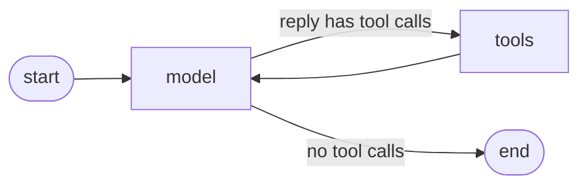
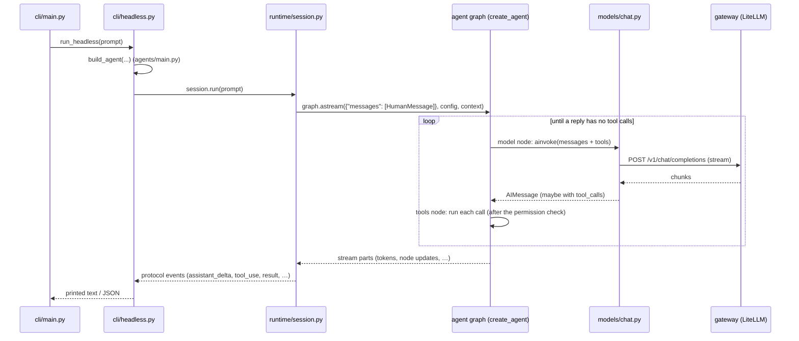

# 01 · The big picture

[← Index](00-index.md) · Next: [02 Settings and the IDE contract →](02-settings-and-protocol.md)

**You will learn:** how cmcoder's package is laid out, what LangChain and
LangGraph each contribute, the *Runnable* interface they share, and the path
one prompt takes from your keyboard to the model and back.

## Why this chapter

cmcoder is about 20,000 lines of Python. Only some of it is LangChain or
LangGraph code. Before reading any module it helps to know which layer does
what, and where the framework stops and cmcoder's own code begins.

## The concepts

### Three libraries, three jobs

| Library | What it gives you | In cmcoder |
|---|---|---|
| **`langchain-core`** | The building blocks and their interfaces: messages (`HumanMessage`, `AIMessage`, `ToolMessage`), chat models (`BaseChatModel`), tools (`BaseTool`), embeddings, vector stores, callbacks, and the **Runnable** interface they all share | Everywhere |
| **`langgraph`** | A runtime for **stateful graphs**: nodes, edges, a typed state, checkpoints after every step, `interrupt()`, streaming, time travel | The agent loop, sessions, permission prompts, the team workflow |
| **`langchain`** (v1) | Ready-made agents on top of LangGraph: **`create_agent`** and **middleware** to customise it | `agents/main.py`, `middleware/` |

Plus integrations: `langchain-openai` (a chat model for any OpenAI-compatible
server), `langgraph-checkpoint-sqlite` (durable checkpoints) and
`langchain-mcp-adapters` (MCP servers as tools). See
[pyproject.toml](../../../pyproject.toml#L9-L13).

> **LangChain v1 changed a lot.** Older tutorials build agents with
> `AgentExecutor`, `initialize_agent` or LCEL chains of prompts and parsers.
> In v1 an agent is `create_agent(...)`, which returns a **compiled LangGraph
> graph**, and you customise it with middleware instead of subclassing. This
> course uses only the v1 way.

### The Runnable interface

Almost everything in LangChain is a `Runnable`: something you call with one
input and get one output from, in four ways:

| Method | What it does |
|---|---|
| `invoke(input, config)` | run, return the result |
| `ainvoke(...)` | the same, `async` |
| `stream(...)` / `astream(...)` | run, yield the result in pieces as it's produced |
| `batch(...)` / `abatch(...)` | run on several inputs |

A chat model takes messages and returns an `AIMessage`. A tool takes a dict of
arguments and returns its result. A compiled graph takes its state (here
`{"messages": [...]}`) and returns the final state. Same methods, same
`config` (callbacks, `thread_id`, …). cmcoder is async throughout, so you'll
see `ainvoke` and `astream`.

A minimal standalone example (any OpenAI-compatible server; with the mock
server keep `streaming=True`, because it always answers with a stream):

```python
from langchain_openai import ChatOpenAI
from langchain_core.tools import tool

model = ChatOpenAI(
    base_url="http://127.0.0.1:8765/v1", api_key="x", model="qwen3-27b", streaming=True
)
print(model.invoke("Say hello").content)      # an AIMessage

@tool
def word_count(text: str) -> int:
    """Count the words in a text."""
    return len(text.split())

print(word_count.invoke({"text": "one two three"}))   # 3
```

### An agent is a graph

`create_agent(model, tools, middleware=[...], checkpointer=...)` builds a
LangGraph `StateGraph` with two main nodes, `model` and `tools`, and
compiles it:



Each middleware adds hooks to that graph: some become nodes of their own
(`before_model`, `after_model`, `before_agent`, `after_agent`), others wrap
the work *inside* the `model` and `tools` nodes (`wrap_model_call`,
`wrap_tool_call`). Chapter 06 opens this up; the lab below prints cmcoder's
real graph.

## How cmcoder is laid out

```
src/cmcoder/
├── config/      settings: layered JSON files, env vars, managed settings      (ch. 02)
├── protocol/    the JSON-lines contract with the IDEs: events and messages    (ch. 02)
├── models/      the chat model, gateways, model profiles, context windows      (ch. 03)
├── providers/   auth (API keys), the HTTP transport (TLS, proxy), model profiles (ch. 03)
├── tools/       Read, Write, Edit, Grep, Bash, … and their LangChain adapter   (ch. 04)
├── core/        permissions, risk rules, prompts, hooks, commands, skills      (ch. 05, 10, 11)
├── sandbox/     the Bash sandbox                                               (ch. 05)
├── agents/      build_agent (create_agent), subagents, the team graph          (ch. 06, 12)
├── middleware/  everything that customises the agent loop                      (ch. 07, 08, 10)
├── runtime/     sessions: streaming, checkpoints, /rewind, slash commands      (ch. 09)
├── mcp/         MCP servers as tools                                           (ch. 11)
├── rag/         code search: chunks, embeddings, vector stores, the index      (ch. 13)
├── cli/         the terminal, -p, the IDE server (stdio), doctor               (ch. 14)
├── testing/     the mock OpenAI-compatible server                              (ch. 14)
└── telemetry.py metrics through a LangChain callback handler                   (ch. 14)
```

Roughly: `config`, `protocol`, `core`, `sandbox` and most of `cli` are plain
Python (reused from cmcoderagent). `models`, `tools`, `agents`,
`middleware`, `runtime`, `mcp` and `rag` are where LangChain and LangGraph
live.

## One prompt, end to end

Follow `cmcoder -p "fix add"`:



1. [`cli/main.py` `main()`](../../../src/cmcoder/cli/main.py#L81) reads the
   options; with `-p` it hands over to
   [`run_headless`](../../../src/cmcoder/cli/main.py#L183) (the REPL and
   the IDE server are the other two front ends).
2. [`run_headless`](../../../src/cmcoder/cli/headless.py#L29)
   [builds the agent](../../../src/cmcoder/cli/headless.py#L47) and a
   `Session`, then
   [iterates `session.run(prompt)`](../../../src/cmcoder/cli/headless.py#L73).
3. [`build_agent`](../../../src/cmcoder/agents/main.py#L263) makes the chat
   model, the tools, the middleware list, and finally calls
   [`create_agent(...)`](../../../src/cmcoder/agents/main.py#L404): the
   compiled graph.
4. [`Session.run`](../../../src/cmcoder/runtime/session.py#L180) sends the
   message into the graph with
   [`graph.astream(...)`](../../../src/cmcoder/runtime/session.py#L411) and
   turns what streams out into protocol events
   ([`protocol/events.py`](../../../src/cmcoder/protocol/events.py)).
5. Inside the graph, the model node calls the chat model from
   [`build_chat_model`](../../../src/cmcoder/models/chat.py#L201), and the
   tools node runs cmcoder's tools, each wrapped by middleware.

The front ends never touch LangGraph directly: they only see protocol events.
That's what lets the terminal, `-p` and five IDEs share one engine.

## Lab: one interface everywhere

[`labs/01_runnables.py`](labs/01_runnables.py) calls a chat model, a tool and
the whole cmcoder agent with the same `ainvoke`, then prints the graph
`create_agent` built, as Mermaid. Script: [`labs/01_two_replies.json`](labs/01_two_replies.json).

```bash
uv run python -m cmcoder.testing.mock_server --script docs/learn/modules/labs/01_two_replies.json --port 8765
uv run python docs/learn/modules/labs/01_runnables.py http://127.0.0.1:8765/v1 /tmp/lab-project
```

You'll see:

```text
model  : CmcoderChatModel is a Runnable: True
         -> AIMessage 'Hello!'
tool   : StructuredTool is a Runnable: True
         -> 3
agent  : CompiledStateGraph is a Runnable: True
         -> 2 messages; last: 'Hi, how can I help?'
```

then a Mermaid graph with `model`, `tools` and nodes like
`PermissionMiddleware.before_model` and `CriticMiddleware.after_agent`. Paste
it into any Mermaid viewer (GitHub renders ```` ```mermaid ```` blocks).

Notice what's **not** in it: `PermissionMiddleware`'s tool wrapper and the
`ModelProfileMiddleware` model wrapper. `wrap_*` hooks run inside the
`model` and `tools` nodes, so they aren't nodes themselves.

## Exercises

1. **Count the layers.** Pick five files from the layout above and say for
   each whether it imports `langchain`, `langgraph`, both or neither
   (`grep -n "^from lang" <file>`).
2. **Runnable everything.** In the lab, add `await model.abatch([...])` with
   two prompts (give the script two more replies). What comes back?
3. **Stretch: your own graph, no LLM.** Write a two-node `StateGraph` with a
   state `{"count": int}` where node `a` adds 1 and node `b` doubles it;
   compile and `invoke({"count": 1})`. You've just used the runtime that
   every cmcoder agent runs on. (Chapter 12 does this for real.)

## Check yourself

1. Which library gives you `create_agent`, which `StateGraph`, which `BaseTool`?
2. What do a chat model, a tool and a compiled graph have in common?
3. Why does nothing in `cli/headless.py` mention LangGraph's stream format?
4. Why aren't `wrap_tool_call` hooks nodes in the drawn graph?

<details><summary>Answers</summary>

1. `create_agent`: `langchain`. `StateGraph`: `langgraph`. `BaseTool`:
   `langchain-core`.
2. They are all Runnables: `invoke` / `ainvoke` / `stream` / `astream` /
   `batch`, with the same `config`.
3. `Session` turns the stream into cmcoder's protocol events; front ends only
   see those, so all of them (terminal, `-p`, IDEs) share one engine.
4. They wrap the work done *inside* the `tools` node (around each tool call),
   rather than being a step between nodes.

</details>

[← Index](00-index.md) · Next: [02 Settings and the IDE contract →](02-settings-and-protocol.md)
