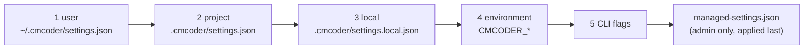
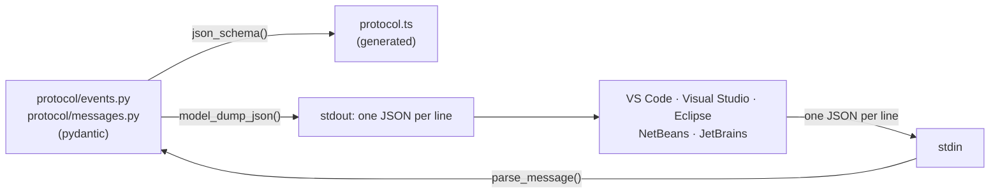

# 02 · Settings and the IDE contract

[← 01 The big picture](01-big-picture.md) · [Index](00-index.md) · Next: [03 Talking to the model →](03-models.md)

**You will learn:** how cmcoder reads its settings from several layers and
keeps a cloned repository from taking over, and how the agent and the five
IDEs talk through one JSON-lines protocol whose types are pydantic models,
checked on both sides, with TypeScript generated from them. And why none of
this is LangChain code.

## Why this chapter

Every LangChain object cmcoder builds (the chat model, the tools, the agent
graph) is built *from settings*: which gateway, which model, which
permissions. And everything the graph does reaches the user *as protocol
events*. These two modules sit under and around the graph, so you meet them
before anything else.

Both are plain Python with pydantic: run
`grep -n "^from lang" src/cmcoder/config/*.py src/cmcoder/protocol/*.py` and
you get nothing. That is a design choice, not an accident:

* **The protocol is a contract with code in other languages** (TypeScript,
  C#, Java). It must not change when LangChain does. LangChain's own
  message classes stay inside the engine; the front ends see only cmcoder's
  events.
* **Settings decide security** (which gateway receives your API key, which
  commands run without asking). That logic should be readable on its own,
  testable without a model, and owned by cmcoder.
* **Startup speed.** `cmcoder --help`, `cmcoder doctor` and the settings code
  load without importing LangChain at all (chapter 03 shows how
  `models/__init__.py` helps).

## The concepts

There's no LangChain concept in this chapter. The one library idea worth
learning here is pydantic's **discriminated union**, because the protocol is
built from it, and you'll see the same pattern in LangChain's own message
types (`"type": "ai"`, `"type": "tool"`).

A discriminated union is "one of these models, chosen by the value of one
field". Pydantic reads that field first and validates against the right
model only:

```python
from typing import Annotated, Literal
from pydantic import BaseModel, Field, TypeAdapter

class Ping(BaseModel):
    type: Literal["ping"] = "ping"

class Say(BaseModel):
    type: Literal["say"] = "say"
    text: str

Message = Annotated[Ping | Say, Field(discriminator="type")]
adapter = TypeAdapter(Message)

print(adapter.validate_json('{"type": "say", "text": "hi"}'))   # a Say
print(Say(text="hi").model_dump_json())                          # back to one line
try:
    adapter.validate_json('{"type": "shout"}')
except Exception as e:
    print(type(e).__name__, e.errors()[0]["type"])
```

```text
type='say' text='hi'
{"type":"say","text":"hi"}
ValidationError union_tag_invalid
```

One `TypeAdapter` gives you parsing (`validate_json`), serialising
(`model_dump_json`) and a JSON Schema (`json_schema()`) for the whole set.

## How cmcoder uses it

### Settings: five layers and a lid

[`config/settings.py`](../../../src/cmcoder/config/settings.py#L1) explains
the layers in its first lines. Later layers override earlier ones:



* **The schema.** Every setting is a field on a pydantic model:
  [`ProviderConfig`](../../../src/cmcoder/config/settings.py#L37) (a
  gateway: `baseUrl`, `caCertPath`, timeouts, retries),
  [`PermissionsConfig`](../../../src/cmcoder/config/settings.py#L236), and
  the top-level [`Settings`](../../../src/cmcoder/config/settings.py#L252).
  The files use camelCase (`smallFastModel`), Python uses snake_case:
  `Field(alias=...)` plus `populate_by_name=True` in the shared base
  [`_Model`](../../../src/cmcoder/config/settings.py#L29) handle both, and
  `extra="ignore"` means an unknown key doesn't stop cmcoder.
* **The merge.** [`load_settings`](../../../src/cmcoder/config/settings.py#L712)
  reads each file as plain JSON and
  [merges them in order](../../../src/cmcoder/config/settings.py#L732),
  adds the [environment layer](../../../src/cmcoder/config/settings.py#L752)
  ([`env_layer`](../../../src/cmcoder/config/settings.py#L487): `CMCODER_BASE_URL`
  becomes a provider called `default`), puts the
  [managed settings on top](../../../src/cmcoder/config/settings.py#L763),
  and only then
  [validates the result](../../../src/cmcoder/config/settings.py#L782)
  into one `Settings`. Validating once, at the end, means a value can be set
  in one layer and refined in another.
* **Merge rules that only tighten.**
  [`deep_merge`](../../../src/cmcoder/config/settings.py#L434) merges dicts
  key by key, but two keys are special:
  [a `"deny"` for high-risk commands can't be relaxed](../../../src/cmcoder/config/settings.py#L439)
  by a later layer, and
  [allow/deny rule lists accumulate](../../../src/cmcoder/config/settings.py#L443)
  instead of replacing each other.
* **Choosing the model.**
  [`Settings.resolve_model`](../../../src/cmcoder/config/settings.py#L313)
  turns `"corp:qwen3-27b"` into `("corp", "qwen3-27b")`, but only treats the
  prefix as a provider when one by that name exists, because model names
  like `qwen3:8b` contain colons too.

### Project trust: a repository is not you

A project's `.cmcoder/settings.json` is written by whoever made the
repository. The comment block at
[*Project trust*](../../../src/cmcoder/config/settings.py#L550) lists what
that could do: an `env` entry such as `BASH_ENV` runs a script before every
shell command; allow rules and permissive modes let commands run without
asking; a `providers` entry would send your API key to a URL of the
repository's choosing. So:

* `providers` is **never** read from a project
  ([`_PROJECT_NEVER`](../../../src/cmcoder/config/settings.py#L566)), trusted
  or not.
* [`_filter_project_layer`](../../../src/cmcoder/config/settings.py#L655)
  drops `env`, hooks, sandbox and telemetry settings, MCP servers, allow
  rules and the permissive modes (`acceptEdits`, `auto`, `bypassPermissions`)
  until you run `cmcoder trust` (or pass `--trust-project`).
* What was dropped is kept in `settings.ignored_project_settings`, so cmcoder
  can tell you instead of failing silently.

### Managed settings: the organisation's lid

[`managed_settings_path`](../../../src/cmcoder/config/settings.py#L347) is a
fixed, admin-only location (`C:\Program Files\cmcoder\`,
`/Library/Application Support/cmcoder/`, `/etc/cmcoder/`), deliberately *not*
configurable by an environment variable or flag. The file is applied last,
and:

* [`read_managed_settings`](../../../src/cmcoder/config/settings.py#L386)
  **fails closed**: a file that exists but can't be read or parsed stops
  cmcoder rather than being ignored.
* Some keys only count there
  ([`_strip_managed_only`](../../../src/cmcoder/config/settings.py#L376)):
  `lockProviders`, `allowedMcpServers`, `disableBypassPermissionsMode`, …
  In any other file they'd let a user or a project speak for the
  organisation.
* With `allowManagedPermissionRulesOnly`, the
  [allow list becomes the managed one](../../../src/cmcoder/config/settings.py#L767);
  with `lockProviders`, [only the managed gateways remain](../../../src/cmcoder/config/settings.py#L769).

The API key is not a setting at all: it comes from `CMCODER_API_KEY` or the
OS keychain (chapter 03).
[`env_api_key_source`](../../../src/cmcoder/config/settings.py#L531) only
uses `OPENAI_API_KEY` when the endpoint also came from `OPENAI_BASE_URL`, so
an unrelated OpenAI key is never sent to the company gateway.

### The protocol: one JSON object per line

Front ends (the terminal's `-p --output-format stream-json`, and the IDEs
through `cmcoder --protocol stdio`) see cmcoder only through two sets of
pydantic models:

| File | Direction | Union | Parse / schema |
|---|---|---|---|
| [`protocol/events.py`](../../../src/cmcoder/protocol/events.py#L1) | agent → client (stdout) | [`Event`](../../../src/cmcoder/protocol/events.py#L403), 32 models | [`parse_event`](../../../src/cmcoder/protocol/events.py#L442), [`protocol_json_schema`](../../../src/cmcoder/protocol/events.py#L446) |
| [`protocol/messages.py`](../../../src/cmcoder/protocol/messages.py#L1) | client → agent (stdin) | [`ClientMessage`](../../../src/cmcoder/protocol/messages.py#L190), 16 models | [`parse_message`](../../../src/cmcoder/protocol/messages.py#L213), `messages_json_schema` |

Each model has a `type: Literal[...]` field with a default, so constructing
one in Python never needs it, and it's always on the wire. A few to know:

* [`SystemInit`](../../../src/cmcoder/protocol/events.py#L22): the first
  event, with a [`PROTOCOL_VERSION`](../../../src/cmcoder/protocol/events.py#L15)
  and `features`, so an older client and a newer agent can tell what the
  other supports.
* [`AssistantDelta`](../../../src/cmcoder/protocol/events.py#L39) /
  [`AssistantMessage`](../../../src/cmcoder/protocol/events.py#L49): the
  streamed text, then the finished reply. They come from LangChain's
  `AIMessageChunk`s and `AIMessage`s (chapter 09).
* [`PermissionRequest`](../../../src/cmcoder/protocol/events.py#L127) and
  its answer [`PermissionResponse`](../../../src/cmcoder/protocol/messages.py#L72):
  on the LangGraph side this round trip is an `interrupt()` and a
  `Command(resume=...)` (chapter 08).
* [`Result`](../../../src/cmcoder/protocol/events.py#L390): the last event of
  every turn: `success`, `error`, `max_turns` or `interrupted`.

The stdio server
[writes each event as one line](../../../src/cmcoder/cli/stdio.py#L110)
(`model_dump_json()`) and
[parses each incoming line](../../../src/cmcoder/cli/stdio.py#L201) with
`parse_message`; a bad line becomes an `error` event, never a crash.

### TypeScript from the same models

The chat panel shared by every IDE is TypeScript. Rather than writing its
types by hand, [`protocol/typescript.py`](../../../src/cmcoder/protocol/typescript.py#L1)
generates them from the JSON Schema of both unions:
[`generate_typescript`](../../../src/cmcoder/protocol/typescript.py#L90)
turns each model into an `interface` and each union into a `type`
(`AgentEvent`, `ClientMessage`). One subtlety: in client messages, fields
with defaults become optional (`remember?: boolean`), because the client
may leave them out; in events they're required, because the agent always
sends them. `cmcoder protocol-schema --typescript` prints the file, and
[a test fails](../../../tests/test_protocol_ts.py#L13) when
`clients/web-panel/src/protocol.ts` is out of date. The Python models are the
single source of truth.



## Lab: layers, trust and the wire

[`labs/02_settings_protocol.py`](labs/02_settings_protocol.py) writes a user
settings file and a hostile-looking project settings file, loads them
untrusted and trusted, shows `deep_merge`'s strict rules, round-trips
protocol messages, and finally runs one real turn and prints the events an
IDE would receive. Script: [`labs/02_one_reply.json`](labs/02_one_reply.json).
It uses its own temporary config folder, but it writes
`<project dir>/.cmcoder/settings.json` (and removes it again): use a scratch
project.

```bash
uv run python -m cmcoder.testing.mock_server --script docs/learn/modules/labs/02_one_reply.json --port 8765
uv run python docs/learn/modules/labs/02_settings_protocol.py http://127.0.0.1:8765/v1 /tmp/lab-project
```

```text
== 1. Layered settings
sources       : ['<config>/settings.json', '<project>/.cmcoder/settings.json', 'environment']
maxTurns      : 20 (user 40, project 20: the later layer wins)
providers     : ['default'] (only the environment's 'default')
allow rules   : ['Bash(npm test:*)'] / mode: default
left out      : ['settings.json: providers', 'settings.json: permissions.allow (Bash(rm:*))', 'settings.json: permissions.defaultMode (bypassPermissions)']
resolve_model : ('default', 'qwen3-27b')
trusted       : ['Bash(npm test:*)', 'Bash(rm:*)'] / mode: bypassPermissions

== 2. deep_merge: the strict rules
{'permissions': {'allow': ['Read', 'Edit'], 'highRiskCommands': 'deny'}}

== 3. The protocol: one JSON object per line, checked by pydantic
parsed        : PermissionResponse {'type': 'permission_response', 'request_id': 'r1', 'allow': False, 'remember': False, 'feedback': 'no'}
rejected      : 2 errors, first: ('permission_response', 'request_id')
event on wire : {"type":"tool_use","id":"c1","name":"Read","input":{"file_path":"app.py"},"label":"Read(app.py)","parent_tool_use_id":null}
parsed back   : ToolUse
TypeScript    :
export interface PermissionResponse {
  type: "permission_response";
  request_id: string;
  allow: boolean;
  remember?: boolean;
  feedback?: string | null;
}

== 4. A real turn, as the events an IDE receives
{"type":"assistant_delta","text":"Hello from t"}
{"type":"assistant_delta","text":"he mock gate"}
{"type":"assistant_delta","text":"way."}
{"type":"usage","prompt_tokens":4458,"completion_tokens":7,"estimated":false,"context_window":32768}
{"type":"assistant_message","text":"Hello from the mock gateway.","reasoning":"","tool_calls":[],"model":"qwen3-27b"}
{"type":"result","subtype":"success","is_error":false,"result":"Hello from the mock gateway.","num_turns":1,"duration_ms":53,"usage":{"prompt_tokens":4458,"completion_tokens":7},"session_id":"ffdcd0ce8ec3432f9cb9dcadc586a47f"}
```

(`duration_ms` and `session_id` differ on every run.) Things to notice:

* Untrusted, the project's `maxTurns` is used but its gateway, its allow rule
  and its `bypassPermissions` mode are left out, and *listed*. Trusted, the
  rule and the mode come in; the gateway never does.
* A `permission_response` with a non-boolean `allow` and no `request_id` is
  rejected with two errors before any cmcoder code sees it.
* In part 4, a LangChain stream (chunks, then a finished `AIMessage`) has
  become cmcoder's own events: `assistant_delta` per chunk, `usage`, the
  `assistant_message`, and the `result`. No IDE needs to know LangChain.

## Exercises

1. **Read the layers.** Run `uv run cmcoder doctor` in a project and find
   the settings sources it lists. Which layer would you put a team-wide
   allow rule in, and why must the team then `cmcoder trust` the project?
2. **A new setting.** Add `"greeting": str | None` to `Settings` (with a
   camelCase alias) and check that `load_settings` picks it up from
   `~/.cmcoder/settings.json` and from an env var you add to `env_layer`.
   Then remove it again.
3. **A new event.** Add a `Ping` event to `protocol/events.py` (remember the
   `Event` union), run `uv run cmcoder protocol-schema --typescript` and find
   the generated interface. Run `uv run pytest tests/test_protocol_ts.py`:
   why does it fail, and what fixes it? Undo the change.
4. **Stretch: break trust on purpose.** Write a test that commits a
   `.cmcoder/settings.local.json` with an allow rule into a fresh git repo
   and shows it's ignored, then that an "Always allow" answer cmcoder writes
   itself ([`add_local_allow_rule`](../../../src/cmcoder/config/settings.py#L830))
   *is* used. What stops a repository from shipping a file that looks like
   cmcoder's own?

## Check yourself

1. Why does `grep "^from lang"` find nothing in `config/` and `protocol/`?
2. A project's settings set `"providers"` and `"maxTurns"`. Which is used, untrusted and trusted?
3. Your user settings say `"highRiskCommands": "deny"` and the project says `"ask"`. What's in force?
4. Why is the managed settings path not configurable by an environment variable?
5. How does pydantic know which model to validate `{"type": "interrupt"}` against?
6. Why are `remember` and `feedback` optional in the TypeScript `PermissionResponse` but every field required in events?

<details><summary>Answers</summary>

1. They're deliberately framework-free: the protocol is a contract with
   TypeScript, C# and Java code and must not move with LangChain; settings
   decide security and should be testable on their own; and the CLI starts
   faster without importing LangChain.
2. `maxTurns` is used either way. `providers` is never read from a project
   (`_PROJECT_NEVER`), trusted or not.
3. `deny`: `deep_merge` never lets a later layer relax it.
4. Then a user (or a script in a repository) could point cmcoder at a file of
   their own and escape the organisation's rules. A fixed, admin-only
   location can't be swapped.
5. The unions are discriminated on `type`
   (`Field(discriminator="type")`): pydantic reads `type`, picks
   `Interrupt`, and validates against that model only.
6. The generator marks fields with defaults optional for client messages (a
   client may leave them out) but not for events (the agent always sends
   every field).

</details>

[← 01 The big picture](01-big-picture.md) · [Index](00-index.md) · Next: [03 Talking to the model →](03-models.md)
