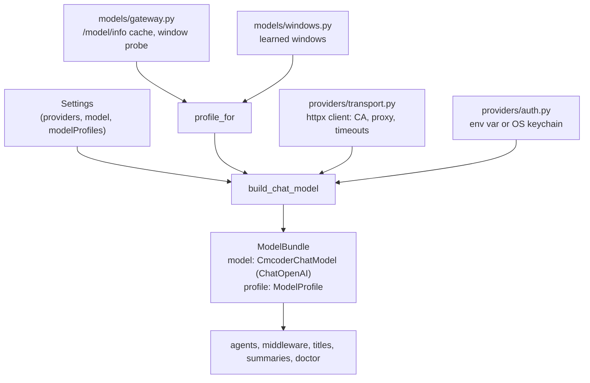

# 03 · Talking to the model

[← 02 Settings and the IDE contract](02-settings-and-protocol.md) · [Index](00-index.md) · Next: [04 Tools →](04-tools.md)

**You will learn:** what a LangChain chat model is, how messages and
streaming chunks work, how cmcoder subclasses `ChatOpenAI` to keep Qwen3's
reasoning and LiteLLM's cost, `bind` vs. `model_copy` for a variant of a
model, where token counts and response headers end up, how cmcoder learns a
model's real context window, and how provider errors become friendly
messages.

## Why this chapter

Everything an agent does starts with a model call. cmcoder talks to
self-hosted models (Qwen3 behind LiteLLM or Open WebUI) through a company
network, so the plain library defaults aren't enough: a company CA, a proxy,
an API key in the OS keychain, reasoning text in a non-standard field, a cost
in a response header, and a context window nobody wrote down. This chapter
is how cmcoder bridges that to LangChain's standard chat-model interface, so
the rest of the engine (the agent, middleware, summarisation) never has to
care.

## The concepts

### Chat models and messages

A **chat model** (`BaseChatModel`) takes a list of **messages** and returns
an `AIMessage`:

| Message | Who | Notable fields |
|---|---|---|
| `SystemMessage` | instructions | `content` |
| `HumanMessage` | the user | `content` (text, or a list of blocks: text, images) |
| `AIMessage` | the model | `content`, `tool_calls`, `usage_metadata`, `response_metadata`, `additional_kwargs` |
| `ToolMessage` | a tool's result | `content`, `tool_call_id`, `status` |

Every provider has its own subclass (`ChatOpenAI`, `ChatAnthropic`, …). Code
written against `BaseChatModel` works with any of them.
`langchain_openai.ChatOpenAI` speaks the OpenAI Chat Completions format,
which LiteLLM, vLLM, Open WebUI and Ollama all serve, so `ChatOpenAI` with a
`base_url` is the usual way to reach a self-hosted model.

### Streaming: chunks you can add

`stream()` / `astream()` yield **`AIMessageChunk`**s. Chunks support `+`:
LangChain concatenates their text, joins partial tool-call arguments, merges
`additional_kwargs` (string values are concatenated) and adds up usage. Add
them all and you have the full message.

```python
from langchain_openai import ChatOpenAI
from langchain_core.messages import SystemMessage, HumanMessage

# streaming=True: the mock server always answers with a stream (as cmcoder
# always asks for one); without it, ChatOpenAI fails with "Unexpected response type".
model = ChatOpenAI(base_url="http://127.0.0.1:8765/v1", api_key="x",
                   model="qwen3-27b", streaming=True)
reply = model.invoke([SystemMessage("Be brief."), HumanMessage("What is 2+2?")])
print(type(reply).__name__, repr(reply.content))
print(reply.additional_kwargs)

full = None
for chunk in model.stream("Give me a title"):
    print(repr(chunk.content), end=" ")
    full = chunk if full is None else full + chunk
print("\n", type(full).__name__, repr(full.content))
```

With [`labs/03_models.json`](labs/03_models.json) as the mock server's script:

```text
AIMessage 'The answer is 4.'
{}
'' 'Fix the logi' 'n bug' '' '' ''
 AIMessageChunk 'Fix the login bug'
```

Note the `{}`: the script's first reply carries reasoning text
(`reasoning_content`), and plain `ChatOpenAI` **dropped it**. That's the
first thing cmcoder's subclass fixes.

### Where provider extras live

* **`additional_kwargs`**: provider-specific fields of a message. cmcoder
  keeps Qwen3's reasoning there. `ChatOpenAI` doesn't send unknown
  `additional_kwargs` back in later requests, which is what Qwen asks for:
  reasoning must not be fed back.
* **`usage_metadata`**: standard token counts (`input_tokens`,
  `output_tokens`, `total_tokens`). With streaming, servers only send them if
  asked (`stream_usage=True`).
* **`response_metadata`**: everything else about the response: the model
  name, the finish reason, and (with `include_response_headers=True`) the
  HTTP response headers.
* **`profile`** (`BaseChatModel.profile`): LangChain's description of the
  model's limits, `max_input_tokens` and friends. Built-in middleware reads
  it: `SummarizationMiddleware(trigger=("fraction", 0.8))` means 80% of
  `max_input_tokens`.

### A variant of a model: `bind` or `model_copy`

* `model.bind(max_tokens=40)` returns a **`Runnable`** that adds those
  arguments to every call. It is *not* a chat model any more.
* `model.model_copy(update={...})` returns a **new chat model** with
  different fields (chat models are pydantic models).
* A third way, for one call only: `model.ainvoke(messages, max_tokens=40)`.

Use `bind` for a chain; use a copy when an API wants a real `BaseChatModel`.

### Errors

LangChain doesn't invent its own HTTP errors for OpenAI-compatible servers:
what `ChatOpenAI` raises *is* the OpenAI SDK's exception. In current
versions it's a subclass that is also a LangChain error
(`OpenAIAuthenticationError` is both `openai.AuthenticationError` and
`langchain_core`'s `ModelAuthenticationError`), so checking against the
`openai` types keeps working.

## How cmcoder uses it



### `build_chat_model`: one function makes every model

[`build_chat_model(settings, ref)`](../../../src/cmcoder/models/chat.py#L201)
is the only place a chat model is made (the main model, the small/fast one,
the vision one, subagents' models). Step by step:

1. [`resolve_model`](../../../src/cmcoder/models/chat.py#L203) picks the
   provider and the model name (chapter 02).
2. [`profile_for`](../../../src/cmcoder/models/chat.py#L212) works out the
   model's **profile**: window, output limit, tool calling, thinking switch…
   (below).
3. [`build_client`](../../../src/cmcoder/models/chat.py#L216) makes an
   `httpx.AsyncClient` with the company's TLS trust, proxies and timeouts
   ([`providers/transport.py`](../../../src/cmcoder/providers/transport.py#L46)).
   LangChain is handed this ready client (`http_async_client`), so all of
   that applies to every request without LangChain knowing.
4. The [constructor arguments](../../../src/cmcoder/models/chat.py#L225):
   * `api_key` from [`api_key_for`](../../../src/cmcoder/models/chat.py#L191):
     `CMCODER_API_KEY`, else the OS keychain where `cmcoder login` put it
     ([`load_stored_api_key`](../../../src/cmcoder/providers/auth.py#L75);
     a 0600 file only when there's no keychain).
   * [`streaming=True`](../../../src/cmcoder/models/chat.py#L238) even for
     `ainvoke`: one code path, and a slow first token can't trip a
     whole-response timeout.
   * [`stream_usage`](../../../src/cmcoder/models/chat.py#L240): ask for
     token counts in the stream.
   * [`include_response_headers=True`](../../../src/cmcoder/models/chat.py#L243):
     for LiteLLM's cost header.
   * [`profile`](../../../src/cmcoder/models/chat.py#L247): LangChain's
     `ModelProfile`, from ours
     ([`_langchain_profile`](../../../src/cmcoder/models/chat.py#L178)).
   * `extra_body`: extra JSON in every request; for an Ollama model behind
     Open WebUI, [`options.num_ctx`](../../../src/cmcoder/models/chat.py#L253),
     because Ollama silently drops the start of a prompt longer than its own
     window.
5. It returns a [`ModelBundle`](../../../src/cmcoder/models/chat.py#L135):
   the LangChain model plus what the rest of cmcoder needs (profile,
   provider, name, base URL).

### `CmcoderChatModel`: subclassing a provider class

[`CmcoderChatModel(ChatOpenAI)`](../../../src/cmcoder/models/chat.py#L57)
overrides three of `ChatOpenAI`'s internal hooks, each time calling the
original first and adjusting the result. This is the standard way to support
a server's non-standard fields; LangChain's own `ChatDeepSeek` does the same.

* [`_convert_chunk_to_generation_chunk`](../../../src/cmcoder/models/chat.py#L84)
  (streaming): reads `reasoning_content` (or `reasoning`) from the chunk's
  delta and [stores it in `additional_kwargs`](../../../src/cmcoder/models/chat.py#L100).
  When chunks are added, the pieces concatenate into the full reasoning.
* [`_create_chat_result`](../../../src/cmcoder/models/chat.py#L104)
  (non-streaming): the same for a whole response.
* [`_get_request_payload`](../../../src/cmcoder/models/chat.py#L75): newer
  `ChatOpenAI` sends `max_completion_tokens`; many self-hosted servers only
  read `max_tokens`, so it's renamed when the profile says so.

Both response hooks pass the generation info through
[`_cost_only`](../../../src/cmcoder/models/chat.py#L119), which keeps one
header, LiteLLM's [`x-litellm-response-cost`](../../../src/cmcoder/models/chat.py#L116),
as `response_metadata["cost"]` and drops the rest: `response_metadata` is
saved with the conversation, and headers don't belong there.

Some servers put the reasoning inside the text instead, as
`<think>…</think>` (or only a closing `</think>`).
[`models/reasoning.py`](../../../src/cmcoder/models/reasoning.py#L1) handles
those with no LangChain code at all:
[`split_think`](../../../src/cmcoder/models/reasoning.py#L24) for a complete
reply and [`ThinkSplitter`](../../../src/cmcoder/models/reasoning.py#L48) for
a stream, which holds back text that could be half a tag (`"<thi"`). The
session uses both: [per chunk](../../../src/cmcoder/runtime/session.py#L666)
it turns `additional_kwargs["reasoning_content"]` and think-tag text into
`reasoning_delta` events, and for the finished message it
[splits once more](../../../src/cmcoder/runtime/session.py#L698).

### Token counts and cost

Because `stream_usage` is on, the last chunk carries the counts, and the
model node's `AIMessage` has `usage_metadata`. The session reads it after
every model call and emits a `usage` event with the
[tokens and the cost](../../../src/cmcoder/runtime/session.py#L478) (what
`/cost` adds up).

### `quick()`: `model_copy`, not `bind`

Titles and summaries don't need Qwen3's thinking.
[`ModelBundle.quick()`](../../../src/cmcoder/models/chat.py#L148) returns the
same model with thinking switched off, the way the server understands it
(`chat_template_kwargs.enable_thinking=false` for vLLM, `options.think=false`
for Ollama), as a [`model_copy`](../../../src/cmcoder/models/chat.py#L167)
with a new `extra_body`. Its docstring says why not `bind`: LangChain's
`SummarizationMiddleware` wants a real chat model, and a bound runnable isn't
one. For a single call with a smaller limit, cmcoder uses the per-call way
instead: `make_title` calls `model.ainvoke(..., max_tokens=40)`.

### Model profiles: what each model can do

[`ModelProfile`](../../../src/cmcoder/providers/profiles.py#L12) is
cmcoder's description of a model: `contextWindow`, `maxOutput`,
`toolCalling` (`native`, `prompted`, …), `parallelToolCalls`,
`thinkingSwitch`, `temperature`, `backend`, `vision`, and more.
[`resolve_profile`](../../../src/cmcoder/providers/profiles.py#L114) builds
it from several sources, most trusted last:

1. [built-in profiles](../../../src/cmcoder/providers/profiles.py#L59)
   matched by name (`*qwen3*`: 32K window, parallel tool calls, the thinking
   switch);
2. your `modelProfiles` in settings;
3. what the gateway reports (LiteLLM's `/model/info`);
4. for the window: a [learned value](../../../src/cmcoder/providers/profiles.py#L159),
   and finally an [explicit `contextWindow` in settings](../../../src/cmcoder/providers/profiles.py#L161),
   which is how you correct a wrong one.

`context_window_source` records which one won; `cmcoder doctor` shows it.

### Learning the real context window

Gateways often don't publish the window. cmcoder learns it three ways:

* **From the gateway.** [`models/gateway.py`](../../../src/cmcoder/models/gateway.py#L1)
  is plain `httpx` on purpose (its docstring: LangChain's model classes cover
  inference, not a gateway's admin endpoints).
  [`Gateway.model_info`](../../../src/cmcoder/models/gateway.py#L100) reads
  LiteLLM's `/model/info` (or Open WebUI's model list), and
  [`prepare_models`](../../../src/cmcoder/models/gateway.py#L233) caches it
  for a day *before* the agent is built
  ([`prepare_agent`](../../../src/cmcoder/agents/main.py#L166)), because
  building the agent is synchronous and the cache read isn't
  ([`cached_model_info`](../../../src/cmcoder/models/gateway.py#L205)).
* **By probing.** When nothing better is known,
  [`probe_context_window`](../../../src/cmcoder/models/gateway.py#L149) sends
  a one-word prompt with an impossibly large `max_tokens`; vLLM refuses it
  before generating anything and states its limit.
* **From an error.** If a real request is too long, the server says so, in
  its own words: "maximum context length is N tokens" (OpenAI, vLLM),
  "prompt is too long: ... > N maximum" (Anthropic through a gateway), "input
  token count ... exceeds the maximum number of tokens allowed (N)" (Gemini).
  [`is_context_overflow`](../../../src/cmcoder/models/overflow.py#L49)
  recognises all of them, and
  [`parse_context_window`](../../../src/cmcoder/models/windows.py#L38)
  reads N when there is one. [`ModelProfileMiddleware`](../../../src/cmcoder/middleware/model.py#L94)
  then [updates the model everywhere](../../../src/cmcoder/models/chat.py#L169)
  ([`set_context_window`](../../../src/cmcoder/models/chat.py#L169): our
  profile *and* LangChain's), saves it per gateway and model
  ([`save_window`](../../../src/cmcoder/models/windows.py#L87)), and retries
  with less in the request. Chapter 07 covers the middleware side.

### Errors become events with hints

[`models/errors.py`](../../../src/cmcoder/models/errors.py#L1)
[`classify`](../../../src/cmcoder/models/errors.py#L21) maps the OpenAI SDK's
exceptions to protocol `error` events with a `kind` and a hint: `auth`,
`rate_limit` / `budget`, `context_length`, `tls` (it follows the exception
chain down to the `ssl` error, through `__cause__` *and* `__context__`,
because on macOS and Windows the TLS error is only linked as context),
`connection`, `server`, `internal`. The session
[calls it](../../../src/cmcoder/runtime/session.py#L332) when a turn fails,
and `cmcoder doctor` uses it too.

### Lazy imports

[`models/__init__.py`](../../../src/cmcoder/models/__init__.py) imports
nothing, so `from cmcoder.models.gateway import ...` (used by `cmcoder
models`, `doctor` and the code-search setup) doesn't pull in LangChain.
Only `models/chat.py` imports `langchain_openai`.

## Lab: the chat model up close

[`labs/03_models.py`](labs/03_models.py) builds cmcoder's model from settings,
prints its profile, streams a reply and adds the chunks, compares `quick()`
with `bind()`, parses a vLLM error, and turns a wrong API key into a
protocol error. Script: [`labs/03_models.json`](labs/03_models.json). Start
the mock server **with a key**:

```bash
uv run python -m cmcoder.testing.mock_server --script docs/learn/modules/labs/03_models.json --port 8765 --api-key x
CMCODER_API_KEY=x uv run python docs/learn/modules/labs/03_models.py http://127.0.0.1:8765/v1 /tmp/lab-project
```

```text
== 1. What cmcoder knows about the model (its profile)
ref mock:qwen3-27b: window 32768 (built-in default),
  thinking switch chat_template_kwargs, output limit sent as max_tokens
LangChain's own profile: {'max_input_tokens': 32768, 'max_output_tokens': 8192, 'tool_calling': True}

== 2. Streaming: AIMessageChunks, added together
7 chunks; text pieces: ['The answer i', 's 4.']
text          : 'The answer is 4.'
reasoning     : '2+2: add two and two.'
usage_metadata: {'input_tokens': 13, 'output_tokens': 4, 'total_tokens': 17, 'input_token_details': {}, 'output_token_details': {}}
cost (header) : 0.00042

== 3. A variant for quick jobs: model_copy vs. bind
quick() extra_body: {'chat_template_kwargs': {'enable_thinking': False}} | a chat model: True
bind()            : _ChatModelBinding | a chat model: False
bound reply       : 'Fix the login bug'

== 4. Learning the context window from a server's error
parse_context_window -> 40960

== 5. Errors: the OpenAI SDK's exceptions, turned into protocol events
OpenAIAuthenticationError -> kind='auth', hint='Check your API key: run `cmcoder login`, or set CMCODER_API_KEY.'
```

Things to notice:

* Part 2: the reasoning that plain `ChatOpenAI` dropped (see *The concepts*)
  is now in `additional_kwargs`, built up from the chunks, and the cost from
  the response header is in `response_metadata`.
* Part 3: `quick()` is still a chat model, with thinking switched off in
  `extra_body`; `bind()` is a wrapper that isn't one, but you can still call
  it.
* Part 5: the exception's class is LangChain's subclass, yet `classify`
  recognises it as an `openai.AuthenticationError`.

## Exercises

1. **Watch the request.** Restart the mock server with
   `--record /tmp/requests.jsonl` and run the lab again. Find the request
   `quick()` would make (or make one: `await quick.ainvoke("hi")` with one
   more script reply) and check that `chat_template_kwargs` is in its body.
   Is `max_tokens` or `max_completion_tokens` sent?
2. **Profiles from settings.** In the lab's `Settings`, add
   `"modelProfiles": [{"match": "qwen3-27b", "contextWindow": 65536}]`. What
   do the window and its source become? Then try `"toolCalling": "prompted"`
   and check LangChain's profile.
3. **Think tags.** Feed `ThinkSplitter` the chunks `["Hi <thi", "nk>plan</th",
   "ink> there"]` and print what `feed` and `flush` return. Why does it hold
   text back?
4. **Stretch: a new error kind.** Make `classify` return `kind="timeout"`
   with its own hint for `openai.APITimeoutError` (careful: it's a subclass
   of `APIConnectionError`, so order matters). Write a test with a fake
   exception, then undo the change.

## Check yourself

1. Why does cmcoder pass its own `httpx.AsyncClient` to `ChatOpenAI`?
2. Where does Qwen3's reasoning live on an `AIMessage`, and why isn't it sent back to the model?
3. What happens when you add two `AIMessageChunk`s?
4. Why is `quick()` a `model_copy` and not a `bind`?
5. Name the three ways cmcoder learns a model's context window, and what wins over all of them.
6. Why does `models/__init__.py` import nothing?

<details><summary>Answers</summary>

1. It carries the company CA trust (truststore / `caCertPath`), the proxy
   settings and the timeouts; handing LangChain a ready client means every
   request uses them, with no LangChain-specific TLS code.
2. In `additional_kwargs["reasoning_content"]`, put there by
   `CmcoderChatModel`'s hooks. `ChatOpenAI` doesn't serialise unknown
   `additional_kwargs` into requests, so it never goes back, as Qwen asks.
3. You get one chunk with the text concatenated, tool-call pieces joined,
   `additional_kwargs` merged (strings concatenated) and usage combined.
   Adding all chunks of a stream gives the full message.
4. `bind` returns a runnable that isn't a `BaseChatModel`, and
   `SummarizationMiddleware` needs a real chat model; `model_copy` returns
   one, with a different `extra_body`.
5. The gateway's model info (`/model/info`), a probe with an impossible
   `max_tokens`, and the "maximum context length" error of a real request.
   An explicit `contextWindow` in `modelProfiles` wins over all of them.
6. So code that only needs `models.gateway` (`cmcoder models`, `doctor`,
   code-search setup) loads without importing LangChain, keeping the CLI
   fast.

</details>

[← 02 Settings and the IDE contract](02-settings-and-protocol.md) · [Index](00-index.md) · Next: [04 Tools →](04-tools.md)
