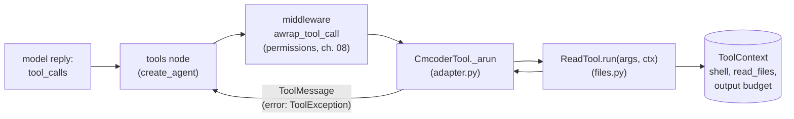

# 04 · Tools

[← 03 Talking to the model](03-models.md) · [Index](00-index.md) · Next: [05 The safety layer →](05-safety.md)

**You will learn:** what a LangChain tool is (`BaseTool`, `StructuredTool`,
the `@tool` decorator), how a pydantic `args_schema` becomes the JSON schema
the model sees, how a tool reports an error to the model instead of crashing
the run, how `ToolRuntime` hands a tool the run it's part of, and why
cmcoder keeps live resources (a shell, the files read so far) *out* of the
graph state.

## Why this module exists

A model can only produce text. Everything cmcoder *does* (reading a file,
editing it, running the tests) happens because the model's reply contains a
**tool call** (a tool name plus JSON arguments) and something runs it.
`tools/` is that something: Read, Write, Edit, Glob, Grep, Bash and
CodeSearch, plus the small adapter that makes them LangChain tools so
`create_agent`'s tools node can run them.

## The concepts

### A tool is a name, a description, a schema and a function

The model never sees your Python function. It sees three things, sent with
every request:

| Part | Where it comes from | What the model uses it for |
|---|---|---|
| `name` | the tool | to call it |
| `description` | the docstring, or `description=` | to decide *when* to call it (write it like advice) |
| parameters (JSON Schema) | the type hints, or a pydantic `args_schema` | to build the arguments; field `description`s are shown too |

LangChain's base class is `BaseTool` (in `langchain_core.tools`). You rarely
subclass it; the usual ways to make one are:

* **`@tool`** on a function: name from the function, description from the
  docstring, schema from the type hints.
* **`StructuredTool.from_function(func, args_schema=Model, ...)`**: the same,
  with an explicit pydantic model for richer schemas (descriptions,
  `ge=`/`le=` limits, enums).

A tool is a Runnable (chapter 01): `invoke` it with a dict of arguments and
you get the result; invoke it with a **`ToolCall`** (`{"name", "args", "id",
"type": "tool_call"}`, exactly what `AIMessage.tool_calls` holds) and you get
a **`ToolMessage`** back, ready to append to the conversation. The tools node
of an agent does the second.

### Errors go to the model, not up the stack

If a tool raises **`ToolException`** and was made with
`handle_tool_error=True`, LangChain catches it and returns the message as the
tool's result (a `ToolMessage` with `status="error"`). The model reads it and
can try again ("old_string not found, re-read the file"). Any other exception
propagates and fails the run. Bad *arguments* are different: they fail
pydantic validation before your function runs.

A standalone example (no model needed):

```python
from langchain_core.tools import StructuredTool, ToolException, tool
from langchain_core.utils.function_calling import convert_to_openai_tool
from pydantic import BaseModel, Field


@tool
def word_count(text: str) -> int:
    """Count the words in a text."""
    return len(text.split())


class DivideInput(BaseModel):
    a: float = Field(description="The dividend.")
    b: float = Field(description="The divisor (not zero).")


def divide(a: float, b: float) -> float:
    if b == 0:
        raise ToolException("b must not be zero")
    return a / b


divide_tool = StructuredTool.from_function(
    divide, name="Divide", description="Divide a by b.", args_schema=DivideInput,
    handle_tool_error=True,
)

print(convert_to_openai_tool(divide_tool))                    # what the model is shown
print(word_count.invoke({"text": "one two three"}))           # 3
print(divide_tool.invoke({"a": 1, "b": 0}))                   # the error, as text
msg = divide_tool.invoke({"name": "Divide", "args": {"a": 6, "b": 3}, "id": "call_1", "type": "tool_call"})
print(repr(msg))                                              # a ToolMessage
```

```text
{'type': 'function', 'function': {'name': 'Divide', 'description': 'Divide a by b.', 'parameters': {'properties': {'a': {'description': 'The dividend.', 'type': 'number'}, 'b': {'description': 'The divisor (not zero).', 'type': 'number'}}, 'required': ['a', 'b'], 'type': 'object'}}}
3
b must not be zero
ToolMessage(content='2.0', name='Divide', tool_call_id='call_1')
```

`convert_to_openai_tool` is the same conversion `ChatOpenAI.bind_tools` does
before each request: that dict is literally what goes over the wire.

### `ToolRuntime`: when a tool needs the run it's part of

Sometimes a tool needs more than its arguments: the id of the call that
started it, the graph state, a way to stream progress. Declare a parameter
typed **`ToolRuntime`** (from `langchain.tools`) and LangChain **injects** it
when the tool runs. It is left out of the schema, so the model never sees or
fills it. It gives you `runtime.tool_call_id`, `runtime.state`,
`runtime.context` (chapter 06), `runtime.stream_writer` (writes to the
graph's `custom` stream) and `runtime.store`.

### State is data; live objects stay outside

LangGraph saves the graph state after **every step** with the checkpointer,
and loads it back on resume (chapter 09). So state must be serialisable
data. A running bash process, an open HTTP client, or a dict of "files read
in this session, with their timestamps" tied to that session are not data
you want saved and restored. They belong to the *session*: plain Python
objects the tools hold on to.

## How cmcoder uses it

### Two layers: cmcoder `Tool`s and one adapter

cmcoder's tools came from cmcoderagent, where they were already hardened and
tested. Rather than rewrite each as a `BaseTool`, they keep their own small
interface and one adapter makes all of them LangChain tools.



**The cmcoder side** ([`tools/base.py`](../../../src/cmcoder/tools/base.py)):

* [`Tool`](../../../src/cmcoder/tools/base.py#L127) has a `name`, a
  `description` and an `Input` pydantic model, an async
  [`run(args, ctx)`](../../../src/cmcoder/tools/base.py#L139), and three
  hooks the permission layer uses (chapter 05):
  [`permission_target`](../../../src/cmcoder/tools/base.py#L141) (a path for
  file tools, the command line for Bash),
  [`describe`](../../../src/cmcoder/tools/base.py#L145) (the `Read(app.py)`
  label) and [`proposed_change`](../../../src/cmcoder/tools/base.py#L149)
  (the before/after a diff review shows).
* Every `Input` derives from
  [`ToolInput`](../../../src/cmcoder/tools/base.py#L27), which sets
  `extra="ignore"`: a model that adds a stray key still gets its call run.
* A tool returns a [`ToolResult`](../../../src/cmcoder/tools/base.py#L33)
  (`content`, `is_error`, a one-line `summary` for the UI), never raises on
  ordinary failures.

**The adapter** ([`tools/adapter.py`](../../../src/cmcoder/tools/adapter.py),
whose header explains both decisions above):

* [`CmcoderTool(BaseTool)`](../../../src/cmcoder/tools/adapter.py#L42) takes
  the cmcoder tool's name and description, and its `Input` model
  [as `args_schema`](../../../src/cmcoder/tools/adapter.py#L56). LangChain
  turns that into the JSON schema and validates the model's arguments
  against it.
* [`handle_tool_error=True`](../../../src/cmcoder/tools/adapter.py#L60):
  failures go back to the model as error `ToolMessage`s.
* [`_run`](../../../src/cmcoder/tools/adapter.py#L64) raises: cmcoder is
  async end to end, and LangGraph calls
  [`_arun`](../../../src/cmcoder/tools/adapter.py#L69) when the graph runs
  with `astream`.
* `_arun` rebuilds the pydantic object
  ([line 73](../../../src/cmcoder/tools/adapter.py#L73)), runs the tool,
  turns *any* exception from a tool bug into an error result (a bug must not
  end the session), truncates the output, and
  [raises `ToolException`](../../../src/cmcoder/tools/adapter.py#L82) for
  an error result. `asyncio.CancelledError` is let through: that's the user
  pressing Esc or Ctrl+C.
* [`as_langchain_tools`](../../../src/cmcoder/tools/adapter.py#L86) wraps a
  list, all sharing one `ToolContext`.

### `ToolContext`: the session's live state

[`ToolContext`](../../../src/cmcoder/tools/base.py#L41) holds the working
folder and project root, `read_files` (path → modification time when the
agent last read it), the persistent `shell`, the sandbox, the output budget,
the todo list and the code index. The adapter captures it when the agent is
built; it is never in graph state.
[`build_agent`](../../../src/cmcoder/agents/main.py#L306) makes one per
session, and
[wraps the tools with it](../../../src/cmcoder/agents/main.py#L357).

That's also why `read_files` survives only as long as the session: after
`--resume` the agent has to Read a file again before editing it, which is
the safe choice.

### Read before write

The single most useful guard against a model clobbering code it hasn't
seen: [`ReadTool.run`](../../../src/cmcoder/tools/files.py#L72) calls
[`ctx.mark_read(path)`](../../../src/cmcoder/tools/files.py#L77), and Write
and Edit call
[`ctx.check_fresh(path)`](../../../src/cmcoder/tools/base.py#L91) first
([Write](../../../src/cmcoder/tools/files.py#L143),
[Edit](../../../src/cmcoder/tools/files.py#L235)). It refuses an existing
file that was never read, or that changed on disk since (you edited it in
your editor meanwhile). The error text tells the model what to do: "Read it
first before writing to it."

Edit adds help for a weak model:
[`_replace`](../../../src/cmcoder/tools/files.py#L281) is shared by the
edit and its diff preview, so the two can never disagree, and when
`old_string` isn't found it points at the
[closest matching lines](../../../src/cmcoder/tools/files.py#L293).

### Output limits

A 27B model with a 32K window can't take a 200 KB test log. Three limits:

* [`output_budget_chars`](../../../src/cmcoder/tools/base.py#L22): about a
  fifth of the context window, between 4,000 and 30,000 characters,
  [set per session](../../../src/cmcoder/agents/main.py#L307) from the
  model's profile.
* The adapter applies it to every result with
  [`truncate_middle`](../../../src/cmcoder/tools/base.py#L154): it keeps the
  start *and* the end (where a test failure's summary usually is) and says
  how much was cut.
* Read stops at a [line boundary](../../../src/cmcoder/tools/files.py#L88)
  instead, and tells the model the `offset` to continue from.

### The tools, briefly

| Tool | File | Notes |
|---|---|---|
| Read | [`files.py`](../../../src/cmcoder/tools/files.py#L56) | `cat -n` style lines, `offset`/`limit`, refuses binaries and huge files |
| Write, Edit | [`files.py`](../../../src/cmcoder/tools/files.py) | read-before-write, CRLF kept, a diff preview for approval |
| Glob, Grep | [`search.py`](../../../src/cmcoder/tools/search.py#L326) | ripgrep when installed, a Python fallback otherwise; [secret files excluded](../../../src/cmcoder/tools/search.py#L390) from results |
| Bash | [`bash.py`](../../../src/cmcoder/tools/bash.py#L34) | a [persistent shell](../../../src/cmcoder/tools/shell.py#L67): `cd` and `export` carry over; stdin closed; [hidden pipe failures](../../../src/cmcoder/tools/bash.py#L81) reported |
| CodeSearch | [`code_search.py`](../../../src/cmcoder/tools/code_search.py#L27) | added only when the project has a code index (chapter 13) |
| TodoWrite | [`todo.py`](../../../src/cmcoder/tools/todo.py) | kept from cmcoderagent, but [left out](../../../src/cmcoder/agents/main.py#L308): the agent uses LangChain's `TodoListMiddleware` instead (chapter 06) |

The default set is [`default_tools()`](../../../src/cmcoder/tools/registry.py#L12).
The Bash tool's description is worth reading: it tells the model *not* to
use the shell for file work (`cat`, `sed -i`), because the file tools are
safer and their results are easier to review.

### Where `ToolRuntime` appears: the tools that run agents

cmcoder's own tools don't need `ToolRuntime` (their context comes from the
adapter). The tools that start *other agents* do:
[`build_task_tool`](../../../src/cmcoder/agents/subagents.py#L361) defines
the Task tool as a function with
[`runtime: ToolRuntime`](../../../src/cmcoder/agents/subagents.py#L367),
made into a tool with
[`StructuredTool.from_function`](../../../src/cmcoder/agents/subagents.py#L378).
The subagent's progress goes to the UI through
[`runtime.stream_writer`](../../../src/cmcoder/agents/subagents.py#L411),
tagged with `runtime.tool_call_id`. The team tool does the same
([`agents/team.py`](../../../src/cmcoder/agents/team.py#L371)). Chapter 12
covers both.

## Lab 1: cmcoder's tools, called by hand

[`labs/04_tools.py`](labs/04_tools.py) needs no server. It wraps the default
tools around a `ToolContext` and calls them the way the tools node does,
with `ToolCall`s:

```bash
uv run python docs/learn/modules/labs/04_tools.py /tmp/lab-project
```

It first prints Edit's JSON schema (what the model is shown), then (your
paths will differ; here the project was in a long scratch folder):

```text
2. Edit before Read -> error | File app.py has not been read yet. Read it first before writing to it.
3. Read -> success |      1	def add(a, b): /      2	    return a - b
   ctx.read_files now holds: ['app.py']
4. Edit after Read -> success | Edited app.py. Result:
5. Read with offset=0 -> ValidationError | Input should be greater than or equal to 1
6. Glob with a 160-char budget -> /tmp/claude-0/-home-user-Vibecoder/9d669d34-7dca-5b4e-82cb-f69ec785826b/scratchp  ... [3139 characters truncated] ...  coder/9d669d34-7dca-5b4e-82cb-f69ec785826b/scratchpad/forkB/proj/many/file00.txt
7. Second Bash call -> hi from /
```

Line by line: the failed Edit came back as an error `ToolMessage`, not an
exception (2); Read filled `ctx.read_files`, outside any graph state (3);
the same Edit then works (4); a bad argument is rejected by pydantic before
the tool runs (5); a long result is cut in the middle (6); `export` and `cd`
from one Bash call are still there in the next (7). The lab puts the bug
back in `app.py` at the end.

## Lab 2: `ToolRuntime` in a plain `create_agent`

[`labs/04_tool_runtime.py`](labs/04_tool_runtime.py) uses only LangChain:
`ChatOpenAI`, `create_agent` and a `@tool` with a `runtime: ToolRuntime`
parameter. Script: [`labs/04_tool_runtime.json`](labs/04_tool_runtime.json).

```bash
uv run python -m cmcoder.testing.mock_server --script docs/learn/modules/labs/04_tool_runtime.json --port 8765
uv run python docs/learn/modules/labs/04_tool_runtime.py http://127.0.0.1:8765/v1
```

```text
The model is shown: {"name": "inspect_run", "description": "Report what the tool can see of the run it is part of.", "parameters": {"properties": {"note": {"type": "string"}}, "required": ["note"], "type": "object"}}
model        : [{'name': 'inspect_run', 'args': {'note': 'first look'}, 'id': 'call_303913d9', 'type': 'tool_call'}]
custom stream: {'tool_says': 'hello from call_303913d9'}
tool result  : note='first look'; call id=call_303913d9; 2 messages in state
model        : The tool saw the conversation so far.
```

The schema has `note` only: `runtime` is injected, not shown. The tool read
the state (the user's message and the model's reply with the call), and what
it wrote with `stream_writer` arrived on the `custom` stream. (The lab sets
`streaming=True` because the mock server always answers as a stream; so do
many gateways.)

## Exercises

1. **Read the schemas.** In lab 1, print the schema of every tool. Which
   fields have limits (`minimum`, `maximum`), and which defaults does the
   model see?
2. **Your own error.** Make a `@tool` that raises `ValueError` and another
   that raises `ToolException`, both with `handle_tool_error=True`, and
   invoke each with a `ToolCall`. Which one comes back as a `ToolMessage`?
3. **A cmcoder tool.** Write a `LineCountTool(Tool)` with an `Input` of
   `file_path`, `read_only = True` and a `permission_target`, wrap it with
   `as_langchain_tools`, and call it as in lab 1. Then pass it to
   `build_agent(..., extra_tools=[LineCountTool()])` and check that the
   first request to the mock server lists it (`--record`).
4. **Stretch: state vs. context.** In lab 2, make the tool *write* to the
   state: return a `Command(update={"messages": [ToolMessage(..., tool_call_id=runtime.tool_call_id)]})`.
   Then explain why cmcoder would never put `ToolContext.shell` in the state
   (think about what the checkpointer does after every step).

## Check yourself

1. What three things about a tool does the model see, and where does each
   come from in cmcoder?
2. A tool fails. When does the model see the error, and when does the run
   fail instead?
3. Why does `CmcoderTool._run` raise `NotImplementedError`?
4. Where is "the files the agent has read" kept, and why not in graph state?
5. How does a tool get the id of the tool call that started it?

<details><summary>Answers</summary>

1. The name, the description, and the JSON schema of its parameters. In
   cmcoder: the `Tool`'s `name` and `description` class attributes, and its
   `Input` pydantic model passed as `args_schema` (field descriptions and
   limits included).
2. With `handle_tool_error=True`, a `ToolException` becomes an error
   `ToolMessage` the model reads. cmcoder's adapter turns every tool failure
   into one (even a bug), so the model always sees it. Invalid arguments are
   rejected by pydantic before the tool runs.
3. cmcoder is async end to end; LangGraph calls `_arun` when the graph is
   run with `ainvoke`/`astream`, so there is no sync path to support.
4. In `ToolContext.read_files`, a session object the adapter holds. Graph
   state is checkpointed after every step and restored on resume; live,
   session-bound things (a shell process, timestamps from this session)
   don't belong there.
5. Declare a `runtime: ToolRuntime` parameter; LangChain injects it (hidden
   from the schema) and `runtime.tool_call_id` is the id.

</details>

[← 03 Talking to the model](03-models.md) · [Index](00-index.md) · Next: [05 The safety layer →](05-safety.md)
