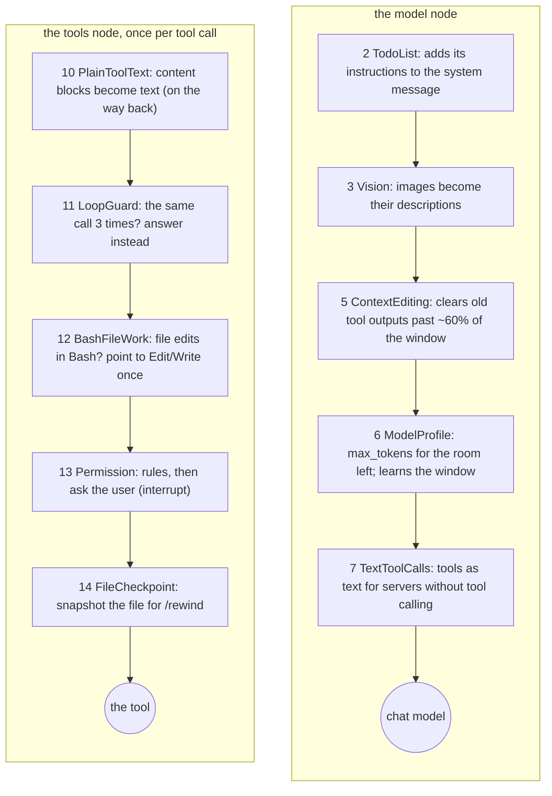

# 06 · Building the agent

[← 05 The safety layer](05-safety.md) · [Index](00-index.md) · Next: [07 Middleware 1: around the model →](07-middleware-model.md)

**You will learn:** what `create_agent` takes and what it gives back, the
graph it generates (which middleware hooks become nodes and which run inside
a node), the order of cmcoder's middleware stack and why it is that order,
and the difference between graph state, runtime context and the live objects
an agent needs.

## Why this module exists

Chapters 03–05 built the parts: a chat model, tools, a permission policy.
[`agents/main.py`](../../../src/cmcoder/agents/main.py) puts them together
into one agent. cmcoderagent did that with a 1,600-line hand-written loop;
here it is one call to LangChain's `create_agent`, plus a list of
middleware that customises the loop. Every front end (terminal, `-p`, five
IDEs) and every subagent gets its agent from the functions in this file.

## The concepts

### `create_agent`: an agent is a compiled graph

```python
from langchain.agents import create_agent

agent = create_agent(
    model=...,            # a chat model (or "provider:model" string)
    tools=[...],          # BaseTools (chapter 04)
    system_prompt="...",  # the system message
    middleware=[...],     # AgentMiddleware instances, outermost first
    context_schema=...,   # the type of per-run context (optional)
    checkpointer=...,     # saves state after every step (optional)
    name="...",
)
```

The result is a `CompiledStateGraph`: a LangGraph graph whose **state** is
`{"messages": [...]}` (plus whatever the middleware adds, such as `todos`).
Two nodes do the work:

* **`model`** sends the messages (and the tool schemas) to the chat model and
  appends its `AIMessage` to the state.
* **`tools`** runs each tool call of that message (in parallel when there are
  several) and appends one `ToolMessage` per call.

A conditional edge after the model decides: tool calls → `tools`, none →
end. From `tools` the graph goes back to the model. That loop is the agent.

### Middleware: hooks on that graph

A middleware is a class that inherits from `AgentMiddleware` and overrides
some of these hooks (each has a sync and an `a`-prefixed async version;
cmcoder uses the async ones):

| Hook | When | Becomes |
|---|---|---|
| `before_agent` | once per run, before anything | **a node** |
| `before_model` | before every model call | **a node** |
| `wrap_model_call` | *around* every model call | code **inside** the `model` node |
| `after_model` | after every model reply | **a node** |
| `wrap_tool_call` | *around* every tool call | code **inside** the `tools` node |
| `after_agent` | once per run, at the end | **a node** |

Node hooks receive the state and return a **state update** (a dict, or
`None` for "no change"). With `@hook_config(can_jump_to=[...])` they may also
return `{"jump_to": "end" | "model" | "tools"}` (chapters 08 and 12 use
this). Wrap hooks receive a request and a `handler` to call: they can change
the request, skip the call, retry it, or change what comes back.

**Order.** For wrap hooks, *the first middleware in the list is the outermost
wrapper*: it sees the request first and the result last. `before_*` nodes run
in list order; `after_*` nodes run in **reverse** list order (so the first
middleware is also the last to see the reply, like a wrapper).

### A standalone example

[`labs/06_plain_agent.py`](labs/06_plain_agent.py): plain LangChain, nothing
of cmcoder's. A `ChatOpenAI` pointed at the mock server, one tool, one
middleware, an in-memory checkpointer:

```python
class CountCalls(AgentMiddleware):
    async def abefore_model(self, state, runtime):
        print(f"  [before_model] {len(state['messages'])} messages")
        return None            # no state change

model = ChatOpenAI(base_url=base_url, api_key="x", model="qwen3-27b", streaming=True)
agent = create_agent(model=model, tools=[word_count], system_prompt="You are a helpful assistant.",
                     middleware=[CountCalls()], checkpointer=InMemorySaver())
config = {"configurable": {"thread_id": "t1"}}
state = await agent.ainvoke({"messages": [HumanMessage("How many words: a b c?")]}, config)
state = await agent.ainvoke({"messages": [HumanMessage("Thanks!")]}, config)   # same thread
```

`streaming=True` matters here: the mock server (like many gateways) always
answers as a stream, and a plain `ChatOpenAI` without it fails with
"Unexpected response type". (cmcoder's own chat model streams already.)

Output (script [`labs/06_plain_agent.json`](labs/06_plain_agent.json)):

```text
run 1:
  [before_model] 1 messages
  [before_model] 3 messages
  HumanMessage 'How many words: a b c?'
  AIMessage    '' [{'name': 'word_count', 'args': {'text': 'a b c'}, 'id': 'call_648f7578', 'type': 'tool_call'}]
  ToolMessage  '3'
  AIMessage    'There are 3 words.'
run 2, same thread_id (only the new message is sent):
  [before_model] 5 messages
  the thread now holds 6 messages
graph nodes: ['__start__', 'model', 'tools', 'CountCalls.before_model', '__end__']
```

Three things to see: the hook became a node named
`CountCalls.before_model`; the model was called twice in run 1 (once for the
tool call, once for the answer); and run 2 started from the 4 saved messages,
because the **checkpointer** keeps the state per `thread_id`.

### State, runtime context and live objects

An agent needs three kinds of data, and LangGraph treats them differently:

| Kind | Example in cmcoder | Where it lives | Saved? |
|---|---|---|---|
| **State** | the messages, the todo list | the graph state | yes: the checkpointer saves it after every step, resume and `/rewind` read it |
| **Runtime context** | which user turn this is, the file-snapshot store | `context=` on each run, declared by `context_schema` | no: given fresh to every run |
| **Live objects** | the shell process, the HTTP client, the code index | held by the middleware and tools themselves (and by the `Agent` object) | no: they live as long as the session |

State must be serialisable (chapter 09). Context and live objects may hold
anything. Middleware reads the context as `runtime.context` (node and model
hooks) or `request.runtime.context` (tool hooks).

## How cmcoder uses it

### `build_agent`, step by step

[`build_agent`](../../../src/cmcoder/agents/main.py#L270) has four numbered
steps, matching the comments in the code:

1. **Tools.** [cmcoder's tools](../../../src/cmcoder/agents/main.py#L308)
   (all of them except its own `TodoWrite`: the todo list comes from
   LangChain's `TodoListMiddleware` instead), `CodeSearch` when the project
   has an index, IDE tools passed in as `extra_tools`, and the `Skill` tool
   when there are skills. They are wrapped as LangChain tools
   [later](../../../src/cmcoder/agents/main.py#L357) (chapter 04), MCP
   tools are added, and finally the
   [`Task` tool](../../../src/cmcoder/agents/main.py#L397) and, with
   `team.enabled`, the [`Team` tool](../../../src/cmcoder/agents/main.py#L400)
   (chapter 12).
2. **System prompt.** [`build_system_prompt`](../../../src/cmcoder/agents/main.py#L325):
   stable instructions first, then the `CMCODER.md` memory, then the
   environment, so the gateway can reuse its prompt cache (chapter 10).
3. **Middleware.** The list is built in
   [several places](../../../src/cmcoder/agents/main.py#L338): two built-in
   LangChain middlewares first, then the optional ones (code context, vision,
   compaction), then [`loop_middleware`](../../../src/cmcoder/agents/main.py#L230),
   then your `extra_middleware`, and the critic
   [last](../../../src/cmcoder/agents/main.py#L408).
4. **The graph.** [`create_agent(...)`](../../../src/cmcoder/agents/main.py#L411)
   with `context_schema=RunContext` and the checkpointer: the caller's
   (`AsyncSqliteSaver` in the CLI and IDEs) or, in tests,
   [`InMemorySaver`](../../../src/cmcoder/agents/main.py#L417) with
   cmcoder's serializer (chapter 09).

### `loop_middleware`: the core every agent shares

[`loop_middleware`](../../../src/cmcoder/agents/main.py#L230) returns the
middleware that *every* cmcoder agent loop has, the main agent and each
subagent alike (subagents call it too, with `stop_event="SubagentStop"`).
Keeping them in one function means a subagent can never skip the permission
check or the loop guard.

### The real stack

This is the list cmcoder passes to `create_agent` for a default setup (the
lab below prints it from the running code), with the hooks each implements:

| # | Middleware | Hooks | From | Chapter |
|---|---|---|---|---|
| 1 | `ModelCallLimitMiddleware` | before_model, after_model | LangChain (stops after `maxTurns` model calls) | 06 |
| 2 | `TodoListMiddleware` | wrap_model_call, after_model | LangChain (the `write_todos` tool, `todos` in state) | 06 |
| 3 | `VisionMiddleware` | wrap_model_call | cmcoder (only when the model can't see images) | 07 |
| 4 | `CompactionMiddleware` | before_model | LangChain's `SummarizationMiddleware`, subclassed | 10 |
| 5 | `ContextEditingMiddleware` | wrap_model_call | LangChain (clears old tool outputs) | 10 |
| 6 | `ModelProfileMiddleware` | wrap_model_call | cmcoder | 07 |
| 7 | `TextToolCallsMiddleware` | wrap_model_call | cmcoder | 07 |
| 8 | `ReasoningMiddleware` | after_model | cmcoder | 07 |
| 9 | `ToolCallRepairMiddleware` | after_model | cmcoder | 07 |
| 10 | `PlainToolTextMiddleware` | wrap_tool_call | cmcoder | 07, 11 |
| 11 | `LoopGuardMiddleware` | wrap_tool_call | cmcoder | 07 |
| 12 | `BashFileWorkMiddleware` | wrap_tool_call | cmcoder | 07 |
| 13 | `PermissionMiddleware` | before_model, wrap_tool_call | cmcoder | 08 |
| 14 | `FileCheckpointMiddleware` | wrap_tool_call | cmcoder | 08 |
| 15 | `CriticMiddleware` | before_agent, after_agent | cmcoder | 12 |

Not in that default list: `AutoContextMiddleware` (before_agent, between 2
and 3, when the project has a code index, chapter 13) and `HooksMiddleware`
(before_agent, wrap_tool_call, after_agent; between 13 and 14, when you
have hooks, chapter 08). Your `extra_middleware`
goes between 14 and 15.

### Why that order

Read the wrap hooks as layers, outermost first:



* **Tool side:** the guards (11, 12) answer *before* anyone is asked, so a
  call that will be refused anyway never pops up a permission prompt. The
  permission check (13) comes next, so the user is asked only about calls
  that would really run. The file snapshot (14) is innermost, so it is taken
  only for calls that every outer layer let through. `PlainToolText` (10) is
  outermost because it works on the *result*: whatever any inner layer
  returns is turned into plain text on the way out.
* **Model side:** `TextToolCalls` (7) is innermost, closest to the server,
  because it changes the wire format (no `tools` parameter, tools described
  in the prompt) without anything outside it having to know. `ModelProfile`
  (6) sets `max_tokens` from the size of the request it receives (system
  message, messages, tool descriptions). `ContextEditing` (5) shrinks the
  request before that size is measured, and `Vision` (3) has already
  replaced images with text.
* **Nodes:** `before_model` nodes run in list order: the call limit (1), then
  compaction (4), then `PermissionMiddleware.before_model` (13), which ends
  the turn after a denial (chapter 08). `after_model` nodes run in reverse:
  `ToolCallRepair` (9) fixes the reply first, then `Reasoning` (8),
  `TodoList` (2) and the call limit (1).

### Runtime context: `RunContext`

[`RunContext`](../../../src/cmcoder/agents/context.py#L27) has two fields:
the user's turn number and the file-snapshot store. The session makes a new
one for every turn ([`runtime/session.py`](../../../src/cmcoder/runtime/session.py#L279))
and passes it as `context=`. `FileCheckpointMiddleware` reads it as
[`request.runtime.context`](../../../src/cmcoder/middleware/checkpoint.py#L60)
to file each snapshot under the right turn; the critic reads it as
[`runtime.context`](../../../src/cmcoder/middleware/critic.py#L196).

Why not state? The snapshot store is a live object, and the turn number is
about *this run*, not something to restore later. And why not a plain
attribute of the middleware? Because subagents and the team run their own
graphs with the same middleware classes, and each run must get its own
context (chapter 12).

### The `Agent` object and the live objects

`create_agent` returns only the graph. [`Agent`](../../../src/cmcoder/agents/main.py#L127)
keeps it together with everything the session needs around it: the model
bundles, the tool context (with the shell processes), the permission policy,
hooks, subagents, the critic, the sandbox, the code index, telemetry. Its
[`close()`](../../../src/cmcoder/agents/main.py#L153) shuts the live ones
down. `spec` records how the agent was built, for the next section.

### A new graph, the same conversation: `rebuild_agent`

A compiled graph has a fixed model and a fixed tool list. Switching the model
(`/model`), adding IDE tools, or turning on code search therefore needs a
*new graph*. [`rebuild_agent`](../../../src/cmcoder/agents/main.py#L181)
builds one from `spec` with the changes, on the **same checkpointer**: the
caller keeps its `thread_id`, so the new graph reads the same saved messages
and the conversation goes on. The permission mode and "always allow"
answers [carry over](../../../src/cmcoder/agents/main.py#L198); so do the
sandbox and the code index. It is used by `/model` in the
[terminal](../../../src/cmcoder/cli/repl.py#L137), by the
[IDE server](../../../src/cmcoder/cli/stdio.py#L334) and by
[`/index`](../../../src/cmcoder/rag/session.py#L109).

### `prepare_agent`: the async part

`build_agent` is synchronous, but learning a model's limits needs network
calls. [`prepare_agent`](../../../src/cmcoder/agents/main.py#L165) asks the
gateway first (cached, best effort) so `build_agent` can read the answers
(chapter 03).

## Lab: cmcoder's stack, from the running code

[`labs/06_middleware_stack.py`](labs/06_middleware_stack.py) wraps
`create_agent` to see the arguments `build_agent` passes, then prints each
middleware with the hooks it overrides, the tools, and the graph's nodes. It
sends nothing to a model, so no mock server is needed:

```bash
uv run python docs/learn/modules/labs/06_middleware_stack.py /tmp/lab-project
```

```text
middleware, in the order given to create_agent (first = outermost):
   1. ModelCallLimitMiddleware   before_model, after_model
   2. TodoListMiddleware         wrap_model_call, after_model
   3. VisionMiddleware           wrap_model_call
   4. CompactionMiddleware       before_model
   5. ContextEditingMiddleware   wrap_model_call
   6. ModelProfileMiddleware     wrap_model_call
   7. TextToolCallsMiddleware    wrap_model_call
   8. ReasoningMiddleware        after_model
   9. ToolCallRepairMiddleware   after_model
  10. PlainToolTextMiddleware    wrap_tool_call
  11. LoopGuardMiddleware        wrap_tool_call
  12. BashFileWorkMiddleware     wrap_tool_call
  13. PermissionMiddleware       before_model, wrap_tool_call
  14. FileCheckpointMiddleware   wrap_tool_call
  15. CriticMiddleware           before_agent, after_agent

tools: Read, Write, Edit, Glob, Grep, Bash, Task
context_schema: RunContext
checkpointer: InMemorySaver

graph nodes: __start__, model, tools, ModelCallLimitMiddleware.before_model, ModelCallLimitMiddleware.after_model, TodoListMiddleware.after_model, CompactionMiddleware.before_model, ReasoningMiddleware.after_model, ToolCallRepairMiddleware.after_model, PermissionMiddleware.before_model, CriticMiddleware.before_agent, CriticMiddleware.after_agent, __end__
```

Check the two rules against the output: every hook named `before_*`,
`after_*` in the list has a node; no `wrap_*` hook does. And `write_todos` is
missing from the tools: `TodoListMiddleware` adds it itself (its `tools`
attribute), which is why the model is offered 8 tools, not 7 (chapter 07's
lab shows it).

## Exercises

1. **Node order.** Run [`labs/01_runnables.py`](labs/01_runnables.py) and
   follow the edges from `model` in its Mermaid output. Confirm that the
   `after_model` nodes run in reverse list order.
2. **Your middleware's place.** In `06_middleware_stack.py`, pass
   `extra_middleware=[...]` with a small middleware of your own to
   `build_agent` (see [`labs/06_plain_agent.py`](labs/06_plain_agent.py)).
   Where does it appear, and which tool wrappers are outside it?
3. **Context per run.** Write a middleware whose `awrap_tool_call` prints
   `request.runtime.context.turn`, and run two turns with
   `context=RunContext(turn=1)` and `turn=2`. Then try a run without
   `context=`: what does the hook get?
4. **Stretch: the same thread, a new graph.** Build an agent on a
   `InMemorySaver` you create yourself, run one turn, then build a second
   agent with `checkpointer=` the same saver and run a turn on the same
   `thread_id`. How many messages does the second graph see?

## Check yourself

1. What does `create_agent` return, and what are its two main nodes?
2. Which middleware hooks become graph nodes, and which don't?
3. In what order do `before_model` nodes run? `after_model` nodes? Wrappers?
4. Why does the loop guard come before the permission check?
5. The file-snapshot store is in the runtime context, not in the state. Why?
6. Why does switching the model need a new graph, and why doesn't the
   conversation get lost?

<details><summary>Answers</summary>

1. A compiled LangGraph graph (`CompiledStateGraph`); `model` (calls the
   chat model, appends an `AIMessage`) and `tools` (runs the tool calls,
   appends `ToolMessage`s).
2. `before_agent`, `before_model`, `after_model`, `after_agent` become nodes.
   `wrap_model_call` and `wrap_tool_call` run inside the `model` and `tools`
   nodes.
3. `before_model`: list order. `after_model` (and `after_agent`): reverse
   list order. Wrappers: the first in the list is the outermost.
4. So a call the guard will refuse anyway never reaches the user as a
   permission prompt. Only calls that will really run are asked about.
5. It is a live object, not data to save, and it belongs to one run (one
   user turn). State is serialised and restored; context is given fresh to
   each run.
6. `create_agent` compiles one model and one tool list into the graph. The
   new graph is built on the same checkpointer and used with the same
   `thread_id`, so it reads the saved messages.

</details>

[← 05 The safety layer](05-safety.md) · [Index](00-index.md) · Next: [07 Middleware 1: around the model →](07-middleware-model.md)
