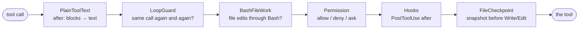

# 08 · Middleware 2: tools and people

[← 07 Middleware 1: around the model](07-middleware-model.md) · [Index](00-index.md) · Next: [09 Runtime: sessions and streaming →](09-runtime.md)

**You will learn:** how `awrap_tool_call` wraps every tool call, how to answer
for a tool without running it, how LangGraph's `interrupt()` pauses a run for
a person's decision and `Command(resume=...)` continues it, why the paused
node runs *again* on resume, how a hook can end a turn or send the agent back
to work (`jump_to`), and how middleware talks to the UI through the custom
stream.

## Why this chapter

A coding agent edits files and runs commands on your machine. Before any of
that happens, cmcoder has to decide: run it, refuse it, or **ask you**. And
asking means the agent must stop mid-turn, wait (seconds or hours, in a
terminal or an IDE), then carry on exactly where it was. In LangGraph that is
`interrupt()`. This chapter covers the middleware that sits between the
model's tool calls and the tools: permissions, file snapshots for `/rewind`,
and your own hook commands.

## The concepts

### `awrap_tool_call`: around every tool call

The `tools` node of a `create_agent` graph runs each tool call the model
asked for. A middleware with `awrap_tool_call(request, handler)` wraps that
call:

```python
class MyMiddleware(AgentMiddleware):
    async def awrap_tool_call(self, request, handler):
        call = request.tool_call            # {"name": ..., "args": {...}, "id": ...}
        # before: check, log, change the request ...
        result = await handler(request)     # run the tool (and the inner middleware)
        # after: look at or change the ToolMessage ...
        return result
```

`request` is a `ToolCallRequest`: the call, the tool, the graph state and
`request.runtime` (with the run's context, chapter 06). Three things you can
do:

| You… | Effect |
|---|---|
| call `await handler(request)` and return its result | the tool runs (normal case) |
| return your own `ToolMessage` **without** calling `handler` | the tool never runs; the model reads your message as its result |
| call `handler`, then return a changed copy (`result.model_copy(update=...)`) | the tool ran; the model sees your version |

Several middleware nest like function calls: the **first** in the list given
to `create_agent` is the **outermost** wrapper.

### `interrupt()` and `Command(resume=...)`

`langgraph.types.interrupt(value)` called inside a node:

1. saves the graph state through the **checkpointer** (no checkpointer, no
   interrupts),
2. stops the run; `value` is now in `graph.get_state(config).interrupts`,
3. later, `graph.invoke(Command(resume=answer), config)` on the **same
   thread** continues it, and this time `interrupt()` **returns** `answer`.

The catch: on resume LangGraph **runs the interrupted node again from its
start**. Everything before `interrupt()` runs twice, so it must be safe to
repeat; side effects belong after it.

A standalone example you can run as is:

```python
from typing import TypedDict
from langgraph.checkpoint.memory import InMemorySaver
from langgraph.graph import END, START, StateGraph
from langgraph.types import Command, interrupt

class State(TypedDict):
    action: str
    result: str

calls = 0

def approve_and_run(state: State) -> dict:
    global calls
    calls += 1
    print(f"  node starts (run #{calls})")
    answer = interrupt({"question": f"Run {state['action']!r}?"})   # pauses here
    print(f"  interrupt() returned {answer!r}")
    return {"result": "ran it" if answer == "yes" else "skipped"}

builder = StateGraph(State)
builder.add_node("approve_and_run", approve_and_run)
builder.add_edge(START, "approve_and_run")
builder.add_edge("approve_and_run", END)
graph = builder.compile(checkpointer=InMemorySaver())   # interrupts need a checkpointer

config = {"configurable": {"thread_id": "t1"}}
graph.invoke({"action": "rm -rf build", "result": ""}, config)
state = graph.get_state(config)
print("paused; next node:", state.next, "| asks:", state.interrupts[0].value)
final = graph.invoke(Command(resume="yes"), config)       # same thread, now with the answer
print("final state:", final)
```

```text
  node starts (run #1)
paused; next node: ('approve_and_run',) | asks: {'question': "Run 'rm -rf build'?"}
  node starts (run #2)
  interrupt() returned 'yes'
final state: {'action': 'rm -rf build', 'result': 'ran it'}
```

"node starts" prints **twice**. Keep that in mind for everything below.

### Hooks that change where the graph goes: `jump_to`

The node-style hooks (`abefore_model`, `aafter_model`, `abefore_agent`,
`aafter_agent`) return a state update. If the hook is decorated with
`@hook_config(can_jump_to=[...])`, the update may also contain `"jump_to"`:

| `jump_to` | Meaning |
|---|---|
| `"end"` | finish the run now |
| `"model"` | go (back) to the model |
| `"tools"` | go to the tools node |

`create_agent` only adds the graph edges a hook declared in `can_jump_to`,
which is why the decorator is required.

### The custom stream: `get_stream_writer()`

Inside a node or middleware, `get_stream_writer()` returns a function. Whatever
you pass to it comes out of `graph.astream(..., stream_mode="custom")`. It
reaches the UI without becoming part of the conversation (chapter 09 shows the
receiving side).

### Why not LangChain's `HumanInTheLoopMiddleware`?

LangChain v1 ships `HumanInTheLoopMiddleware`: you name the tools that need
approval, and it interrupts with approve / edit / reject. cmcoder needs more:
allow / ask / deny **rules** (`Bash(npm test:*)`, `Edit(src/**)`), five
permission modes, protected paths, secret files, high-risk commands that
always ask, hooks that can change the decision, and a non-interactive mode.
That logic already existed (cmcoderagent's `PermissionPolicy`, chapter 05),
so cmcoder writes a small middleware that connects it to `interrupt()`.

## How cmcoder uses it

### The tool wrappers, in order

cmcoder's tool wrappers are in
[`loop_middleware`](../../../src/cmcoder/agents/main.py#L230), outermost
first:



[`PlainToolTextMiddleware`](../../../src/cmcoder/middleware/guards.py#L193),
[`LoopGuardMiddleware`](../../../src/cmcoder/middleware/guards.py#L164) and
[`BashFileWorkMiddleware`](../../../src/cmcoder/middleware/guards.py#L126)
come first ([`loop_middleware`, lines 253–255](../../../src/cmcoder/agents/main.py#L253-L255)),
then [`PermissionMiddleware`](../../../src/cmcoder/agents/main.py#L256), the
hooks and, innermost,
[`FileCheckpointMiddleware`](../../../src/cmcoder/agents/main.py#L266). Each
of the three guards is a short example of one pattern:

* **Answering without running.** The loop guard counts identical calls; at the
  limit it [returns a `ToolMessage` itself](../../../src/cmcoder/middleware/guards.py#L184)
  telling the model to try something else. The Bash guard does the same the
  first time Qwen edits files through the shell
  ([lines 153–158](../../../src/cmcoder/middleware/guards.py#L153)).
* **Post-processing.** `PlainToolTextMiddleware`
  [calls the handler, then turns content blocks into text](../../../src/cmcoder/middleware/guards.py#L206).

All three answer through
[`denied()`](../../../src/cmcoder/middleware/permission.py#L69): a
`ToolMessage` with `status="error"` and the call's id, so the model can tell
it apart from a real result.

### `PermissionMiddleware`: rules, then a person

[`awrap_tool_call`](../../../src/cmcoder/middleware/permission.py#L137) runs
for every call:

1. **Unknown tool or bad arguments**: hand over to the
   [handler](../../../src/cmcoder/middleware/permission.py#L145), so LangChain
   reports them the usual way.
2. **Rules.** [`self.policy.check(...)`](../../../src/cmcoder/middleware/permission.py#L152)
   returns allow, deny or ask (chapter 05).
3. **PreToolUse hooks** may
   [block](../../../src/cmcoder/middleware/permission.py#L170), skip a normal
   prompt or ask for one
   ([lines 176–186](../../../src/cmcoder/middleware/permission.py#L176)).
   A hook never overrides a deny rule or a high-risk command.
4. **Deny** → [`denied(...)`](../../../src/cmcoder/middleware/permission.py#L187);
   **allow** → [the handler runs the tool](../../../src/cmcoder/middleware/permission.py#L189).
5. **Ask, but nobody can answer** (`cmcoder -p`, CI: `interactive=False`, set
   in [`cli/headless.py`](../../../src/cmcoder/cli/headless.py#L39)): no
   interrupt; the call is
   [denied with a hint](../../../src/cmcoder/middleware/permission.py#L196)
   such as `--allowedTools "Edit"`.
6. **Ask**: [`interrupt({...})`](../../../src/cmcoder/middleware/permission.py#L212)
   with everything a UI needs: `kind`, the tool, a label like `Edit(app.py)`,
   the arguments, the suggested rule, the reason, whether "always allow" may
   be offered, and for file edits the **diff** (`change.before` /
   `change.after`; the IDEs open it in their diff viewer).
7. **Resumed.** `interrupt()` returns the answer the session sent:
   `{"allow": bool, "remember": bool, "feedback": str}`.
   * allow → maybe [save the rule](../../../src/cmcoder/middleware/permission.py#L240),
     then run the tool;
   * deny with feedback → the model gets
     ["The user denied this action. Their feedback: …"](../../../src/cmcoder/middleware/permission.py#L230)
     and tries again;
   * deny without feedback → the same message plus
     ["Stop and wait for the user's instructions"](../../../src/cmcoder/middleware/permission.py#L234),
     marked with [`STOP_KEY`](../../../src/cmcoder/middleware/permission.py#L238).

### Running twice, safely

Because LangGraph re-runs the tools node on resume, every wrapper outside the
interrupt runs twice for the same call. cmcoder keeps that harmless:

* the rule check is pure (safe to repeat);
* a PreToolUse hook is a *user's command* and may have side effects, so its
  outcome is [cached per call](../../../src/cmcoder/middleware/permission.py#L159);
* the loop guard [counts each call once](../../../src/cmcoder/middleware/guards.py#L179),
  the Bash guard [remembers calls it let through](../../../src/cmcoder/middleware/guards.py#L149).

All three key their caches with
[`call_key(call)`](../../../src/cmcoder/middleware/permission.py#L86): the
id **plus the name and arguments**, because some model servers reuse ids
(`call_0`, `call_1`, … in every reply).

### A plain "Deny" ends the turn

Returning `Command(goto=END)` from the tools node wouldn't work:
`create_agent` connects tools → model with an edge that always fires, so a
`goto` *adds* a destination. Instead,
[`abefore_model`](../../../src/cmcoder/middleware/permission.py#L131),
decorated with `@hook_config(can_jump_to=["end"])`, runs before the next
model call and returns `{"jump_to": "end"}` when
[`stopped()`](../../../src/cmcoder/middleware/permission.py#L76) finds a
`STOP_KEY` result after the last reply. The denial stays in the conversation;
the model just isn't asked again until you speak. The session then reports
the turn as [`interrupted`](../../../src/cmcoder/runtime/session.py#L341). A
subagent that was denied passes the same mark up through its Task result
([agents/subagents.py](../../../src/cmcoder/agents/subagents.py#L422)), so the
main turn stops too.

### The round trip

```mermaid
sequenceDiagram
    participant U as You (terminal / IDE)
    participant S as Session (runtime/session.py)
    participant G as graph: tools node
    participant P as PermissionMiddleware
    G->>P: awrap_tool_call(Edit app.py)
    P->>P: policy.check → ask
    P-->>G: interrupt({kind, label, input, change, …})
    G-->>S: stream ends; checkpoint saved
    S->>S: aget_state(config).interrupts
    S->>U: permission_request (diff, suggested rule)
    U->>S: answer {allow, remember, feedback}
    S->>G: astream(Command(resume={interrupt_id: answer}))
    G->>P: awrap_tool_call(Edit app.py) again, from the start
    P->>P: policy.check → ask (again: safe)
    P-->>P: interrupt() returns the answer
    alt allow
        P->>G: handler(request) → the tool writes
    else deny
        P-->>G: ToolMessage "The user denied this action…"
    end
```

### File snapshots: the code side of `/rewind`

LangGraph's checkpoints hold the conversation, never your files. So
[`FileCheckpointMiddleware`](../../../src/cmcoder/middleware/checkpoint.py#L48),
the innermost wrapper, sees only calls the others let through. Before a
`Write` or `Edit` it reads the turn number and the snapshot store from
[`request.runtime.context`](../../../src/cmcoder/middleware/checkpoint.py#L60)
(the run's `RunContext`, chapter 06),
[takes a snapshot](../../../src/cmcoder/middleware/checkpoint.py#L69), then
[runs the tool](../../../src/cmcoder/middleware/checkpoint.py#L72). A failed
snapshot never blocks the edit. Chapter 09 shows how `/rewind` puts the two
kinds of checkpoint together.

### Your hook commands as middleware

Hooks are shell commands from your settings (Claude Code's format). The
runner ([core/hooks.py](../../../src/cmcoder/core/hooks.py)) sends the event
as JSON on stdin; **exit 2 blocks** and stderr is the reason; JSON on stdout
can decide too. Where each event lives:

| Hook | Where |
|---|---|
| PreToolUse | inside `PermissionMiddleware` (it changes the decision, see above) |
| PostToolUse | [`HooksMiddleware.awrap_tool_call`](../../../src/cmcoder/middleware/hooks.py#L71): runs the tool first, then appends an objection or extra context to the result ([line 97](../../../src/cmcoder/middleware/hooks.py#L97)) |
| Stop / SubagentStop | [`HooksMiddleware.aafter_agent`](../../../src/cmcoder/middleware/hooks.py#L99) |
| UserPromptSubmit, SessionStart, Notification | `runtime/session.py`, outside the graph |

**Stop, with `jump_to: "model"`.** `aafter_agent` runs when the agent is about
to finish. Decorated with `@hook_config(can_jump_to=["model"])`, a blocking
Stop hook returns a new `HumanMessage` ("[Stop hook] Keep working: …") plus
[`"jump_to": "model"`](../../../src/cmcoder/middleware/hooks.py#L118): the
agent goes back to work. A counter
([`MAX_STOP_BLOCKS`](../../../src/cmcoder/middleware/hooks.py#L40), reset in
[`abefore_agent`](../../../src/cmcoder/middleware/hooks.py#L65)) stops a hook
from keeping a turn alive forever.

**Warnings through the custom stream.** A failing hook shouldn't land in the
conversation, but you should see it.
[`warn()`](../../../src/cmcoder/middleware/hooks.py#L43) writes
`{"type": "warning", ...}` with `get_stream_writer()`; the session turns it
into a `warning` event. Outside a graph run there is no writer
(`RuntimeError`), which `warn()` ignores, so the middleware also works in
plain unit tests.

## Lab: a hook says no, you say no with feedback

[`labs/08_hooks_and_feedback.py`](labs/08_hooks_and_feedback.py) builds
cmcoder's agent with a PreToolUse hook that blocks `rm -rf`, runs it in
interactive mode, and answers the permission interrupt with a denial *plus
feedback*. Script: [`labs/08_feedback.json`](labs/08_feedback.json) (the
model asks for `rm -rf build`, then for an Edit, then answers).

```bash
uv run python -m cmcoder.testing.mock_server --script docs/learn/modules/labs/08_feedback.json --port 8765
uv run python docs/learn/modules/labs/08_hooks_and_feedback.py http://127.0.0.1:8765/v1 /tmp/lab-project
```

```text
PAUSED on Edit(app.py): the user denies, with feedback

What the model was told (the tool results in the state):
  Bash: Permission denied: blocked by a PreToolUse hook: Deleting folders is not allowed here: use git clean
  Edit: The user denied this action. Their feedback: Don't change add(); rename it to sum().

Model calls this turn: 3; last reply: "Understood: I'll rename add() to sum() instead of changing it."
def add(a, b):
    return a - b
```

Read it against the code:

* **Only one pause.** `rm -rf build` is a high-risk command that would always
  ask, but the hook blocked it first: no interrupt, the tool never ran.
* **Feedback keeps the turn going**: 3 model calls. Compare
  [`docs/learn/labs/interrupt.py`](../labs/interrupt.py) with `deny`: a
  denial *without* feedback ends the turn after the second model call.
* `app.py` is unchanged: a denied Edit never reaches the tool.

## Exercises

1. **Allow and remember.** Change the lab's answer to
   `{"allow": True, "remember": True}`. Which rule gets saved
   (`agent.policy`)? Run a second Edit in the same session: does it pause?
2. **Count the re-runs.** Add your own `awrap_tool_call` middleware through
   `build_agent(..., extra_middleware=[...])` that prints every call it sees.
   Where does it sit relative to `PermissionMiddleware`, and how many times
   does it see the Edit? (Hint: `extra_middleware` goes after
   `loop_middleware` in [agents/main.py](../../../src/cmcoder/agents/main.py#L383).)
3. **Stretch: a Stop hook.** Add a Stop hook that exits 2 with
   "run the tests first" unless the last answer mentions "tests". Give the
   mock server a script where the second answer does. How many model calls,
   and which messages, does the turn end with?

## Check yourself

1. What are the three things an `awrap_tool_call` can do with `handler`?
2. Why does the PreToolUse hook's outcome need a cache, and why is its key
   more than the tool call id?
3. What happens to an Edit that needs approval in `cmcoder -p`?
4. Why does a plain "Deny" end the turn through `abefore_model` and not with
   `Command(goto=END)` from the tool?
5. How does a Stop hook send the agent back to work, and what stops it
   looping forever?

<details><summary>Answers</summary>

1. Call it and return the result (the tool runs); don't call it and return
   your own `ToolMessage` (the tool never runs); call it and return a changed
   result.
2. On resume LangGraph re-runs the tools node, so the middleware runs twice
   for the same call; a hook is a user's command with possible side effects,
   so it must run once. Some servers reuse ids like `call_0` in every reply,
   so the key also has the name and arguments (`call_key`).
3. No interrupt (nobody could answer): it is denied with a message saying how
   to allow it (`--allowedTools "Edit"` or a less strict permission mode).
4. `create_agent`'s tools → model edge always fires, so a `goto` would add a
   destination instead of replacing it. A `before_model` hook with
   `can_jump_to=["end"]` can stop the run before the model is called.
5. `aafter_agent` with `@hook_config(can_jump_to=["model"])` returns a new
   message plus `"jump_to": "model"`. `MAX_STOP_BLOCKS` (3) per turn.

</details>

[← 07 Middleware 1: around the model](07-middleware-model.md) · [Index](00-index.md) · Next: [09 Runtime: sessions and streaming →](09-runtime.md)
