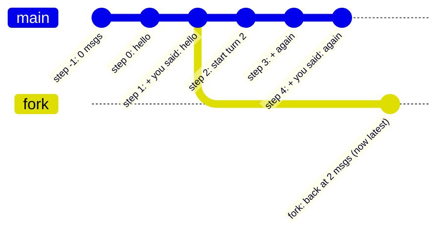

# 09 · Runtime: sessions and streaming

[← 08 Middleware 2: tools and people](08-middleware-tools.md) · [Index](00-index.md) · Next: [10 Long context →](10-long-context.md)

**You will learn:** how cmcoder drives a compiled graph for one user turn:
`astream` with several stream modes at once, the `thread_id` that makes a
conversation, reading paused interrupts and resuming them, checkpointers
(`InMemorySaver` and `AsyncSqliteSaver`), time travel and forking for
`/rewind`, writing to state from outside a run, what a checkpoint may load,
and how slash commands are thin wrappers over all of that.

## Why this chapter

`create_agent` gives you a graph. Something still has to *run* it: send the
user's message in, turn the stream into what a terminal or IDE shows, stop
for permission prompts and carry on, save the conversation so you can come
back tomorrow, and undo a turn. That is `runtime/`, mostly
[`runtime/session.py`](../../../src/cmcoder/runtime/session.py). Every front
end (the terminal, `-p`, five IDEs) goes through it.

## The concepts

### Threads and checkpointers

A **checkpointer** saves the graph state after every step, under the
`thread_id` you pass in the config:

```python
config = {"configurable": {"thread_id": "chat-1"}}
graph.invoke({"messages": [HumanMessage("hello")]}, config)   # turn 1
graph.invoke({"messages": [HumanMessage("again")]}, config)   # turn 2: only the new message
```

The second call doesn't resend the history: the checkpointer has it, and the
`messages` key's **reducer** (`add_messages`) appends the new message to it.
Same `thread_id`, same conversation; a new id, a new conversation.

| Checkpointer | Where it keeps state | Use |
|---|---|---|
| `InMemorySaver` | a dict in the process | tests, `persistSessions: false` |
| `AsyncSqliteSaver` (`langgraph-checkpoint-sqlite`) | a SQLite file | conversations that survive a restart |

Swapping one for the other changes nothing in the agent: it's one argument to
`create_agent` (or `compile`).

### Every step is kept: history and forks

The checkpointer stores **one checkpoint per step**, not just the latest.

* `graph.get_state(config)` → the latest `StateSnapshot`: `.values` (the
  state), `.next` (the nodes still to run; empty when the run finished),
  `.interrupts`, `.config`, `.metadata` (with the `step` number).
* `graph.get_state_history(config)` → every snapshot, newest first.
* `graph.update_state(config, values)` → writes `values` **as if a node had
  returned them** (through the reducers) and saves a new checkpoint. Given an
  *older* snapshot's `.config`, the new checkpoint is built on that one: the
  thread **forks** there. The newer checkpoints stay in the database.

A standalone example you can run as is:

```python
from typing import Annotated, TypedDict
from langgraph.checkpoint.memory import InMemorySaver
from langgraph.graph import END, START, StateGraph
from langgraph.graph.message import add_messages
from langchain_core.messages import AIMessage, HumanMessage

class State(TypedDict):
    messages: Annotated[list, add_messages]   # the reducer: append (or replace by id)

def echo(state: State) -> dict:
    return {"messages": [AIMessage(f"you said: {state['messages'][-1].content}")]}

builder = StateGraph(State)
builder.add_node("echo", echo)
builder.add_edge(START, "echo")
builder.add_edge("echo", END)
graph = builder.compile(checkpointer=InMemorySaver())

config = {"configurable": {"thread_id": "chat-1"}}
graph.invoke({"messages": [HumanMessage("hello")]}, config)
graph.invoke({"messages": [HumanMessage("again")]}, config)
print("now:", [m.content for m in graph.get_state(config).values["messages"]])

for snap in graph.get_state_history(config):          # newest first
    print(f"  step {snap.metadata['step']:>2}  {len(snap.values.get('messages', []))} msgs  next={snap.next}")

after_turn_1 = next(s for s in graph.get_state_history(config)
                    if len(s.values["messages"]) == 2 and not s.next)
graph.update_state(after_turn_1.config, {"messages": []})    # fork: a new checkpoint on top of it
print("after the fork:", [m.content for m in graph.get_state(config).values["messages"]])
print("checkpoints kept:", len(list(graph.get_state_history(config))))
```

```text
now: ['hello', 'you said: hello', 'again', 'you said: again']
  step  4  4 msgs  next=()
  step  3  3 msgs  next=('echo',)
  step  2  2 msgs  next=('__start__',)
  step  1  2 msgs  next=()
  step  0  1 msgs  next=('echo',)
  step -1  0 msgs  next=('__start__',)
after the fork: ['hello', 'you said: hello']
checkpoints kept: 7
```

`update_state` with an empty update (`{"messages": []}` adds nothing) is
enough: what matters is *which* checkpoint it builds on.



### Streaming several things at once

`astream(..., stream_mode=[...], version="v2")` yields **typed parts**,
`{"type": ..., "ns": ..., "data": ...}`, so one loop can handle every mode:

| Mode | `data` | Use |
|---|---|---|
| `"messages"` | `(AIMessageChunk, metadata)` for each token an LLM call produces | live text; `metadata["langgraph_node"]` says which node called the model |
| `"updates"` | `{node_name: what_it_returned}` after each node | finished messages, tool results, todos, compactions; `"__interrupt__"` when a run pauses |
| `"tasks"` | a node starting (and, with `result`, finishing) | know that a node *began*, before it ends |
| `"custom"` | whatever a node wrote with `get_stream_writer()` | side-channel events (warnings, subagent progress) |

LLM calls made *inside* a node (a subagent run inside a tool, a summary inside
a middleware) also stream tokens. Their metadata says where they came from:
`langgraph_node`, and a **namespace** (`langgraph_checkpoint_ns`) that is
nested for subgraphs (`"tools:…|model:…"`).

### Interrupts from the caller's side

When a node calls `interrupt()` (chapter 08), the stream simply ends.
`(await graph.aget_state(config)).interrupts` lists what's waiting, each with
an `.id` and the `.value` the node passed. Resume with
`Command(resume={interrupt_id: answer, ...})`: keyed by id, because several
tool calls of one reply can be waiting at once.

### What a checkpoint may load

Checkpoints are written with `JsonPlusSerializer` (msgpack). A pydantic object
in state is saved as "module + class + data", and loading it imports and
builds that class. `JsonPlusSerializer(allowed_msgpack_modules=[...])` limits
which classes may be built; LangGraph's own safe types (messages, `Send`,
`Interrupt`, …) are always allowed. Since a checkpoint is a file on disk,
that is a security boundary.

## How cmcoder uses it

### One conversation = one thread

A [`Session`](../../../src/cmcoder/runtime/session.py#L100) is one
conversation. [`_use_thread`](../../../src/cmcoder/runtime/session.py#L125)
sets its config: the
[`thread_id`](../../../src/cmcoder/runtime/session.py#L128) and LangGraph's
own [`recursion_limit`](../../../src/cmcoder/runtime/session.py#L131) (a cap
on graph steps; the turn limit itself is `ModelCallLimitMiddleware`). Then:

* [`resume`](../../../src/cmcoder/runtime/session.py#L138) (`--continue`,
  `/resume`) just points at an old thread;
* [`clear`](../../../src/cmcoder/runtime/session.py#L145) (`/clear`) makes a
  new thread id; the old conversation stays saved;
* [`messages()`](../../../src/cmcoder/runtime/session.py#L151) reads them
  with `aget_state`.

### One turn: stream, pause, resume

[`Session.run`](../../../src/cmcoder/runtime/session.py#L180) runs the hooks
that live outside the graph (SessionStart, UserPromptSubmit), builds the
`HumanMessage` (with the turn number in `additional_kwargs`, so it survives
`--resume`) and a
[`RunContext`](../../../src/cmcoder/runtime/session.py#L279), then loops:

```python
while True:
    async for event in self._stream(graph_input, context, state, usage): yield event
    pending = (await self.agent.graph.aget_state(self.config)).interrupts
    if not pending:
        break
    ... ask the user for each one ...
    graph_input = Command(resume=answers)
```

([lines 289–327](../../../src/cmcoder/runtime/session.py#L289)). For each
[pending interrupt](../../../src/cmcoder/runtime/session.py#L294) of kind
`permission` it yields a `permission_request` event and awaits the front
end's `ask()`; anything it can't ask about is answered "no". The answers go
back [keyed by interrupt id](../../../src/cmcoder/runtime/session.py#L327).
The terminal's `ask()` waits for a key; the IDE server's waits for a
`permission_response` message (chapter 14). The graph doesn't care which.

When the loop ends, the turn's `result` event says
[`interrupted` if a plain "Deny" stopped it](../../../src/cmcoder/runtime/session.py#L341),
else success or error.

### Four stream modes in one loop

[`_stream`](../../../src/cmcoder/runtime/session.py#L403) calls
[`graph.astream(..., stream_mode=["messages", "updates", "tasks", "custom"], version="v2")`](../../../src/cmcoder/runtime/session.py#L411)
and dispatches on `part["type"]`:

* **`messages`**: tokens become `assistant_delta` / `reasoning_delta`
  events, but only from the agent's own [`model` node and not from a nested
  namespace](../../../src/cmcoder/runtime/session.py#L426): a subagent's
  tokens (inside the Task tool) and the summariser's don't stream as the
  answer.
* **`custom`**: [warnings and subagent / critic events](../../../src/cmcoder/runtime/session.py#L435)
  written by middleware with `get_stream_writer()`.
* **`tasks`**: [the `tools` node *starting*](../../../src/cmcoder/runtime/session.py#L451)
  means the model's reply is final, so its tool calls are shown now, before
  a long command finishes.
* **`updates`**: [finished node results](../../../src/cmcoder/runtime/session.py#L459):
  todos, compactions (a `RemoveMessage` in the update), `AIMessage`s with
  their `usage_metadata` (tokens; LiteLLM's cost in `response_metadata`) and
  `ToolMessage`s (tool results, and
  [denials](../../../src/cmcoder/runtime/session.py#L494)). `__interrupt__`
  updates are skipped: the loop above handles pauses.

During the turn, `_TurnState` keeps its own copy of the conversation with the
graph's own reducer,
[`add_messages`](../../../src/cmcoder/runtime/session.py#L642), so an
after-model middleware that sends a corrected reply *with the same id*
replaces it there too.

### Keeping the history valid

If a turn is cancelled (Esc, an IDE's stop button) or fails between the
model's tool calls and their results, the saved conversation would end in an
`AIMessage` whose calls have no `ToolMessage`, and OpenAI-style APIs reject
that on the next request.
[`repair_after_interrupt`](../../../src/cmcoder/runtime/session.py#L502)
adds the missing results with
[`aupdate_state`](../../../src/cmcoder/runtime/session.py#L523): writing to
state from outside a run.

`/compact` uses the same trick:
[`compact()`](../../../src/cmcoder/runtime/session.py#L556) calls the
compaction middleware's hook directly (hooks are plain async methods,
[line 565](../../../src/cmcoder/runtime/session.py#L565)) and
[writes the result](../../../src/cmcoder/runtime/session.py#L568) with
`aupdate_state`. Chapter 10 explains the summary itself.

### `/rewind`: a fork plus file snapshots

[`rewind(turn)`](../../../src/cmcoder/runtime/session.py#L589) undoes two
things:

* **Code**: the file snapshots `FileCheckpointMiddleware` took (chapter 08)
  are restored.
* **Conversation**:
  [`_fork_before`](../../../src/cmcoder/runtime/session.py#L614) walks
  [`aget_state_history`](../../../src/cmcoder/runtime/session.py#L616) for
  the newest checkpoint that doesn't contain that turn's message *and* ended
  a run (`not snapshot.next`), then
  [writes to it](../../../src/cmcoder/runtime/session.py#L620): the thread
  forks there. Nothing is deleted. Rewinding the first turn has nothing
  before it, so it starts a fresh thread instead.

### Durable sessions: `runtime/store.py`

[`SessionStore`](../../../src/cmcoder/runtime/store.py#L91) opens one SQLite
file per project, under `~/.cmcoder/projects/<name>-<hash>/sessions.db`
([`sessions_dir`](../../../src/cmcoder/runtime/store.py#L69)):

* [`AsyncSqliteSaver(conn, serde=checkpoint_serde())`](../../../src/cmcoder/runtime/store.py#L191)
  and [`setup()`](../../../src/cmcoder/runtime/store.py#L192) for LangGraph's
  own tables;
* with `persistSessions: false`,
  [an `InMemorySaver`](../../../src/cmcoder/runtime/store.py#L183) and
  nothing on disk;
* **owner-only**: the folder [0700](../../../src/cmcoder/runtime/store.py#L186),
  the database [0600](../../../src/cmcoder/runtime/store.py#L189).
  Checkpoints contain your conversation, and so your code;
* LangGraph doesn't keep a list of threads with titles, so cmcoder adds its
  own [`cmcoder_sessions` table](../../../src/cmcoder/runtime/store.py#L44) in
  the same file: `/resume` and `cmcoder sessions` read it
  ([`list`](../../../src/cmcoder/runtime/store.py#L137)) instead of loading
  every thread;
* deleting a session is
  [`checkpointer.adelete_thread(thread_id)`](../../../src/cmcoder/runtime/store.py#L157)
  plus its index row; [`cleanup`](../../../src/cmcoder/runtime/store.py#L164)
  does that for sessions older than `cleanupPeriodDays`.

Without a store (unit tests), `build_agent` falls back to
[`InMemorySaver`](../../../src/cmcoder/agents/main.py#L417).

### The serializer allow-list: `runtime/serde.py`

[`checkpoint_serde()`](../../../src/cmcoder/runtime/serde.py#L27) allows
exactly the pydantic models cmcoder puts in state: the critic's `Verdict` and
`Issue`, the team's `Stories`, `TestReport` and `Failure`
([line 33](../../../src/cmcoder/runtime/serde.py#L33)). A tampered database
can't make cmcoder build anything else.

### Titles: a direct model call in the background

After the first turn, [`_after_turn`](../../../src/cmcoder/runtime/session.py#L354)
updates the index row and, when a small model is configured, asks it for a
title [in a background task](../../../src/cmcoder/runtime/session.py#L372)
that nothing waits for.
[`make_title`](../../../src/cmcoder/runtime/titles.py#L54) is plain
LangChain, no graph:
[`model.ainvoke([SystemMessage(...), HumanMessage(...)], max_tokens=40)`](../../../src/cmcoder/runtime/titles.py#L56).
The extra keyword is a **per-call option** passed through to the request.
On any error the title is the start of the first message.

### Slash commands: thin wrappers over the thread

[`run_command`](../../../src/cmcoder/runtime/commands.py#L125) is shared by
every front end; each command works on a `Session` and returns lines to show:

| Command | LangGraph underneath |
|---|---|
| [`/clear`](../../../src/cmcoder/runtime/commands.py#L135) | a new `thread_id` |
| [`/resume`](../../../src/cmcoder/runtime/commands.py#L148) | the index table, then an old `thread_id` |
| [`/rewind`](../../../src/cmcoder/runtime/commands.py#L160) | `aget_state_history` + a fork, and file snapshots |
| `/compact` | a middleware hook called directly + `aupdate_state` |
| `/todos` | `aget_state` → `values["todos"]` |

## Lab: a saved thread, its history, and a fork

[`labs/09_threads_and_time_travel.py`](labs/09_threads_and_time_travel.py)
runs two turns through cmcoder's own `Session` on an `AsyncSqliteSaver`,
opens the database again as a restarted cmcoder would, prints the thread's
checkpoint history, then does `/rewind 2` (conversation only). Script:
[`labs/09_two_turns.json`](labs/09_two_turns.json).

```bash
uv run python -m cmcoder.testing.mock_server --script docs/learn/modules/labs/09_two_turns.json --port 8765
uv run python docs/learn/modules/labs/09_threads_and_time_travel.py http://127.0.0.1:8765/v1 /tmp/lab-project
```

```text
database: /tmp/cmcoder-lab/projects/lab-project-…/sessions.db
thread  : a72f3e86 | index row: 2 turns

reopened: ['Human: what does add do?', 'AI: First answer: add() subtracts.', 'Human: how do I fix it?', "AI: Second answer: change '-' to '+'."]

checkpoint history (newest first):
  step  22  4 messages  next=()
  step  21  4 messages  next=('CriticMiddleware.after_agent',)
  step  20  4 messages  next=('ModelCallLimitMiddleware.after_model',)
  …
  step  16  3 messages  next=('model',)
  step  15  3 messages  next=('PermissionMiddleware.before_model',)
  …
  step  11  2 messages  next=('__start__',)
  step  10  2 messages  next=()
  …
  step   0  1 messages  next=('CriticMiddleware.before_agent',)
  step  -1  0 messages  next=('__start__',)

after /rewind 2: ['Human: what does add do?', 'AI: First answer: add() subtracts.']
checkpoints: 24 before the fork, 25 after (none deleted)
old branch still readable: 4 messages
```

Read it against the code:

* **Persistence**: the second `SessionStore.open` is a fresh connection;
  `resume(thread)` alone brings the conversation back.
* **Middleware are steps**: each `before_model` / `after_model` hook is a node
  (chapter 06), so it gets a checkpoint of its own. Step 16, `next=('model',)`,
  is the moment just before the model call.
* **The fork point**: step 10 is the last checkpoint without turn 2's message
  that ended a run (`next=()`). `_fork_before` picked it and wrote to it.
* **Nothing lost**: one more checkpoint, and the old branch's 4-message state
  is still readable.

## Exercises

1. **Read the database yourself.** Open the lab's `sessions.db` with the
   `sqlite3` tool: `.tables`, then `SELECT * FROM cmcoder_sessions;`. Which
   tables are LangGraph's, which is cmcoder's?
2. **Back to the old branch.** In the lab, after the rewind, take the old
   branch's snapshot (`old`) and call `aupdate_state(old.config, {"messages": []})`.
   What does `session.messages()` show now? You have rewound the rewind.
3. **Stretch: see every stream part.** Copy `_stream`'s `astream` call into a
   small script (on the 01 lab's setup) and print `part["type"]`,
   `part["ns"]` and, for `messages`, `metadata["langgraph_node"]`. Which
   parts arrive, in what order, for one model reply? Then run a Task call
   (`docs/learn/labs/subagent.json`) and find the nested namespace.

## Check yourself

1. Why does the second turn send only the new `HumanMessage`?
2. What does `snapshot.next == ()` mean, and why does `_fork_before` require it?
3. Why are interrupt answers keyed by interrupt id?
4. How does the session keep a subagent's tokens out of the streamed answer?
5. What does `repair_after_interrupt` fix, and why is it needed?
6. What would happen without `allowed_msgpack_modules`?

<details><summary>Answers</summary>

1. The checkpointer has the thread's state; the `add_messages` reducer appends
   the new message to the saved history.
2. No nodes are left to run: the checkpoint is the end of a run, a consistent
   resting point. Forking from the middle of a run would resume halfway
   through a step.
3. One model reply can ask for several tool calls; each that needs approval
   pauses with its own interrupt, and all are answered together on resume.
4. It only shows tokens whose `langgraph_node` is `model` and whose namespace
   isn't nested (no `|`); a subagent's model runs inside the `tools` node.
5. An `AIMessage` whose tool calls have no `ToolMessage` (after a cancel or an
   error); OpenAI-style APIs reject such a history. It adds error results with
   `aupdate_state`.
6. Loading a checkpoint could import and build any importable class named in
   it, so a tampered database file could make cmcoder construct arbitrary
   objects.

</details>

[← 08 Middleware 2: tools and people](08-middleware-tools.md) · [Index](00-index.md) · Next: [10 Long context →](10-long-context.md)
