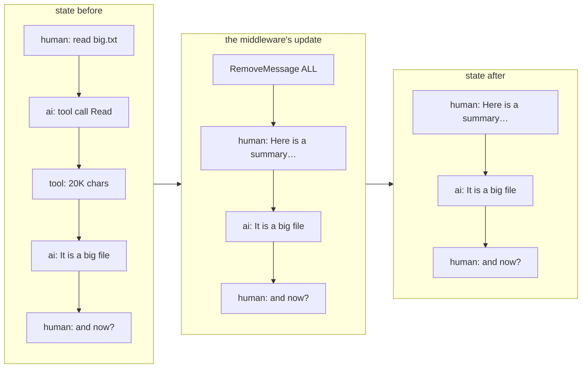

# 10 · Long context

[← 09 Runtime: sessions and streaming](09-runtime.md) · [Index](00-index.md) · Next: [11 Extending: MCP, commands, skills →](11-extending.md)

**You will learn:** how an agent survives a conversation longer than the
model's context window: LangChain's built-in `SummarizationMiddleware` and
`ContextEditingMiddleware`, the `RemoveMessage` trick that lets a node delete
messages, model profiles and token budgets, and how cmcoder builds a system
prompt (with your `CMCODER.md` memory) that stays the same from call to call.

## Why this module exists

Every request to the model carries the whole conversation: the system prompt,
the tool schemas, every message and every tool output. Qwen3 27B on a company
gateway often has a 32K-token window. One big `Read` of a log file can take a
third of it, and a long debugging session fills it in minutes. When the
request no longer fits, the server answers *"maximum context length is N
tokens"* and the turn fails.

cmcoder keeps conversations going with three layers, cheapest first:

1. **Context editing**: past 60% of the window, replace old tool outputs with
   a placeholder.
2. **Summarization**: past `autoCompactThreshold` (80%), the small/fast model
   summarises the older messages, and the summary replaces them.
3. **Learning the real window**: if the server still says "too long", cmcoder
   reads the real limit from the error, remembers it, and retries smaller.

And the system prompt, which is in *every* request, is built so it stays
identical between calls (so the gateway can reuse its prompt cache) and so
its size is known.

## The concepts

### Messages are state, and reducers decide how updates apply

In a `create_agent` graph the conversation is `state["messages"]`, and it
uses the **`add_messages` reducer**: when a node returns
`{"messages": [m]}`, `m` is *appended*, or, if a message with the same `id`
is already there, it *replaces* it. A reducer never deletes, which is a
problem for summarisation: the old messages must go.

### `RemoveMessage`: deleting through the reducer

`RemoveMessage(id=...)` is a marker message: the reducer removes the message
with that id. The special id `REMOVE_ALL_MESSAGES` clears the whole list. So
a summarising node returns:

```python
{"messages": [RemoveMessage(id=REMOVE_ALL_MESSAGES), summary, *recent_messages]}
```

which means "empty the list, then add the summary and the messages we keep".



The old messages are not lost: the checkpointer keeps every earlier
checkpoint, so `/rewind` can still go back to before the compaction
(chapter 09).

### `SummarizationMiddleware`

LangChain's built-in middleware does exactly this in a `before_model` hook:
before each model call it counts the tokens of `state["messages"]`, and when
they pass `trigger`, it asks a model (`summarizer`, or the agent's own model)
to summarise the older part, keeps the newest part (`keep`) and rewrites the
state as above. `trigger` and `keep` can be:

| Form | Means |
|---|---|
| `("messages", n)` | a number of messages |
| `("tokens", n)` | a number of tokens |
| `("fraction", f)` | a share of the model's `profile["max_input_tokens"]` |

The fraction form reads the **model profile**: every LangChain chat model has
a `profile` dict with limits such as `max_input_tokens`. That is how a
middleware written once works for a 32K and a 128K model.

A standalone example with fake models (no server needed):

```python
from langchain.agents import create_agent
from langchain.agents.middleware import SummarizationMiddleware
from langchain_core.language_models.fake_chat_models import FakeMessagesListChatModel
from langchain_core.messages import AIMessage
from langgraph.checkpoint.memory import InMemorySaver

model = FakeMessagesListChatModel(responses=[AIMessage(f"answer {i}") for i in range(3)])
summarizer = FakeMessagesListChatModel(responses=[AIMessage("The user said hi twice.")])

agent = create_agent(
    model,
    middleware=[SummarizationMiddleware(model, summarizer=summarizer,
                                        trigger=("messages", 4), keep=("messages", 2))],
    checkpointer=InMemorySaver(),
)
cfg = {"configurable": {"thread_id": "t"}}
for text in ["hi", "hi again", "and once more"]:
    state = agent.invoke({"messages": [("user", text)]}, cfg)
    print([f"{m.type}: {m.text}" for m in state["messages"]])
```

```text
['human: hi', 'ai: answer 0']
['human: hi', 'ai: answer 0', 'human: hi again', 'ai: answer 1']
['human: Here is a summary of the conversation to date:\n\nThe user said hi twice.', 'ai: answer 1', 'human: and once more', 'ai: answer 2']
```

On the third turn the state had 5 messages (more than 4): the first ones
became one summary message (a `HumanMessage`), the last two stayed.

### `ContextEditingMiddleware`

Also built in, and cheaper: it doesn't call a model. It runs around each
model call (`wrap_model_call`) and applies **edits** to the request.
`ClearToolUsesEdit(trigger=N, keep=k)` replaces the content of all but the
newest `k` tool results with `[cleared]` once the prompt passes `N` tokens.
Old `Read` and `Grep` outputs are usually the bulk of a long session and
rarely needed again word for word.

### What counts against the window

The middleware counts **messages**. But every request also carries the
system prompt and the JSON schema of every tool, and with 15–20 tools that is
a few thousand tokens. On a 128K model you can ignore it; on a 32K model with
an 80% trigger it decides whether compaction comes in time.

## How cmcoder uses it

### The compaction middleware

[`CompactionMiddleware`](../../../src/cmcoder/middleware/compaction.py#L60)
subclasses `SummarizationMiddleware`. Its
[`__init__`](../../../src/cmcoder/middleware/compaction.py#L63):

- uses the small/fast model as `summarizer` (it's passed in as `summarizer`;
  [agents/main.py](../../../src/cmcoder/agents/main.py#L366-L368) gives it
  `small.quick()`, the small model with thinking switched off: a summary needs
  no reasoning);
- triggers at [`("fraction", threshold)`](../../../src/cmcoder/middleware/compaction.py#L86)
  (the `autoCompactThreshold` setting, 0.8 by default) and
  [keeps the newest quarter](../../../src/cmcoder/middleware/compaction.py#L88);
- puts a tag in front of LangChain's default summary prompt
  ([`COMPACTION_TAG`](../../../src/cmcoder/middleware/compaction.py#L77)) so
  the mock server can recognise summary requests in tests, and, for
  `/compact <focus>`, adds
  ["Pay special attention to: …"](../../../src/cmcoder/middleware/compaction.py#L78-L82)
  before the messages.

**The window minus the fixed part.**
[`set_window`](../../../src/cmcoder/middleware/compaction.py#L97) works
around the counting trap above: it changes the profile *of its own copy of
the model* ([`model.model_copy()`](../../../src/cmcoder/middleware/compaction.py#L84))
so that `max_input_tokens` is the window **minus the system prompt and the
tool schemas**. That overhead is measured once by
[`fixed_prompt_tokens`](../../../src/cmcoder/agents/main.py#L224):
the system prompt plus `convert_to_openai_tool(t)` for every tool, divided by
an estimate of characters per token. The profile the fraction reads is
LangChain's own, filled from cmcoder's model profile in
[`_langchain_profile`](../../../src/cmcoder/models/chat.py#L178).

**Keeping your latest request.**
[`abefore_model`](../../../src/cmcoder/middleware/compaction.py#L107) calls
LangChain's version, then adjusts the result:

- if the only message that would be summarised is your current request,
  [it changes nothing](../../../src/cmcoder/middleware/compaction.py#L117-L120)
  (a summary would add tokens, not save them);
- a [`PreCompact` hook](../../../src/cmcoder/middleware/compaction.py#L121-L124)
  may block the compaction (chapter 11);
- if your latest request fell into the summarised part, it is
  [put back word for word](../../../src/cmcoder/middleware/compaction.py#L125-L127)
  right after the summary, so the model never works from a paraphrase of what
  you just asked.

Note the order in `abefore_model`: LangChain's method has already asked the
summarizer by the time the first check runs, so when the check says "change
nothing", that summary request was made and is dropped. The lab shows it.

### Context editing and the window learned from errors

[`loop_middleware`](../../../src/cmcoder/agents/main.py#L246) starts
the middleware every agent loop shares (the main agent's and the
subagents') with
`ContextEditingMiddleware(edits=[ClearToolUsesEdit(trigger=int(context_window * 0.6), keep=3)])`: old tool
outputs go at 60%, before summarising is needed at 80%.

If a request still overflows,
[`ModelProfileMiddleware.awrap_model_call`](../../../src/cmcoder/middleware/model.py#L125-L133)
catches the server's error, reads the real window from it
([`parse_context_window`](../../../src/cmcoder/models/windows.py#L32)),
stores it per gateway and model
([`save_window`](../../../src/cmcoder/models/windows.py#L81), in
`~/.cmcoder/context-windows.json`), tells the compaction middleware through
`on_window` (wired [here](../../../src/cmcoder/agents/main.py#L381)), and
[retries once](../../../src/cmcoder/middleware/model.py#L139-L140) with old
tool outputs cleared. Chapter 07 covers that middleware in full.

### `/compact` by hand

[`Session.compact`](../../../src/cmcoder/runtime/session.py#L556) builds a
`CompactionMiddleware` with `always=True` (trigger at 2 messages, keep the
last exchange), and calls its hook
[directly, outside any graph](../../../src/cmcoder/runtime/session.py#L565):
middleware hooks are plain async methods. It then writes the update into the
checkpoint with
[`graph.aupdate_state(config, update)`](../../../src/cmcoder/runtime/session.py#L568):
the same `RemoveMessage` update a graph run would have made. This manual path
creates the middleware without the hook runner, so `PreCompact` hooks run for
automatic compaction only.

While streaming, [`Session`](../../../src/cmcoder/runtime/session.py#L467-L469)
recognises a compaction by the `RemoveMessage` in a node's update and emits a
`compacted` event (shown in the terminal and the IDE panels).

### The system prompt: stable first, memory included

[`build_system_prompt`](../../../src/cmcoder/core/prompt.py#L137) assembles,
[in this order](../../../src/cmcoder/core/prompt.py#L149-L168):

1. the base instructions:
   [`BASE_PROMPT`](../../../src/cmcoder/core/prompt.py#L19), or the short
   [`COMPACT_PROMPT`](../../../src/cmcoder/core/prompt.py#L42) when the model
   profile says `promptTier: "compact"` (for small windows);
2. your **memory files** under "# Project instructions";
3. the skills list (chapter 11) and any appended text;
4. last, the parts that change: the environment (working directory, date, git
   branch and status), the sandbox note, the code-search note.

Stable content first means the start of every request is byte-for-byte the
same, which servers with a prefix cache (vLLM, LiteLLM in front of it) reuse
instead of reprocessing.

[`load_memory_files`](../../../src/cmcoder/core/prompt.py#L90) collects, in
order: your own `~/.cmcoder/CMCODER.md`; `CMCODER.md` and `AGENTS.md` in each
folder from the project root down to where you started cmcoder; and the
project's `CMCODER.local.md` (yours, not committed). Project files must really
be inside the project (`safe_project_file`), and the total is capped at
[40,000 characters](../../../src/cmcoder/core/prompt.py#L17).

In the terminal, a line starting with `#` adds a note to the project's
`CMCODER.md` ([`add_memory`](../../../src/cmcoder/runtime/commands.py#L116));
the REPL then [rebuilds the agent](../../../src/cmcoder/cli/repl.py#L180-L182),
because the system prompt is fixed when the graph is compiled.

## Lab: watch compaction rewrite the conversation

[`labs/10_compaction.py`](labs/10_compaction.py) runs two turns with a model
profile that claims a 6,000-token window and compaction at 30%. Turn 1 reads
a 20K-character file; turn 2 triggers compaction. Script:
[`labs/10_compaction.json`](labs/10_compaction.json). Start the mock server
with `--record` to see every request it got:

```bash
uv run python -m cmcoder.testing.mock_server --script docs/learn/modules/labs/10_compaction.json \
    --port 8765 --record /tmp/requests.jsonl
uv run python docs/learn/modules/labs/10_compaction.py http://127.0.0.1:8765/v1 /tmp/lab-project /tmp/requests.jsonl
```

```text
after turn 1: 4 messages
   human  'read big.txt'
   ai     ''
   tool   '     1\tline 0: some text to fill the context window up      2\tline 1: '
   ai     'It is a big file of numbered lines.'

COMPACTED (auto): 3 messages summarised, ~1043 -> ~56 tokens

after turn 2: 4 messages
   human  'Here is a summary of the conversation to date:  Summary (mock): the us'
   ai     'It is a big file of numbered lines.'
   human  'and now?'
   ai     'Still here, with a shorter history.'

requests the gateway got:
   agent    2 messages, starts 'You are cmcoder, an agentic coding assistant '
   summary  1 messages, starts '<cmcoder-compaction>\n<role>\nContext Extractio'
   agent    4 messages, starts 'You are cmcoder, an agentic coding assistant '
   summary  1 messages, starts '<cmcoder-compaction>\n<role>\nContext Extractio'
   agent    4 messages, starts 'You are cmcoder, an agentic coding assistant '
```

Things to notice:

- The 20K-character file didn't arrive whole: tool output is capped to
  about a fifth of the window (`output_budget_chars`, chapter 04), so with a
  6,000-token window the Read returned about 4,000 characters.
- **~1043 tokens triggered it**, far below 30% of 6,000 (1,800). The room
  for messages is 6,000 *minus the system prompt and tool schemas*, and the
  fraction applies to that.
- After turn 2 the tool output is gone, the AI's answer survived (`keep`),
  and `and now?` is there word for word.
- **Two summary requests, one compaction.** The first came in turn 1, after
  the big tool result: only your current request would have been summarised,
  so cmcoder dropped that summary (see "Keeping your latest request").
- The summary requests start with `<cmcoder-compaction>` and have no system
  prompt or tools: the summariser is a separate, plain model call.

(The mock server answers summary requests itself without using up the
script, so the script only has the agent's three replies.)

## Exercises

1. **Move the threshold.** Run the lab with `"autoCompactThreshold": 0.8`.
   Does turn 2 still compact? Then raise `contextWindow` to 32768 and explain
   the result with the overhead in mind.
2. **Keep more.** In a scratch copy, change `KEEP_FRACTION` in
   `middleware/compaction.py` to 0.5 and rerun. Which messages survive now?
3. **Context editing only.** Set `"autoCompact": false` and a `contextWindow`
   small enough that 60% is passed. Record the requests and find the
   `[cleared]` placeholder in the tool messages the model saw.
4. **Stretch: a `PreCompact` hook.** Add a hook that writes the trigger
   (from the JSON on stdin) to a file, then exits 2 to block. Confirm that
   automatic compaction is skipped. What does `/compact` do?

## Check yourself

1. Why can't a node delete messages by returning a shorter list?
2. What does `("fraction", 0.8)` refer to, and where does cmcoder set it?
3. Why does cmcoder lower `max_input_tokens` on its own copy of the model?
4. What happens to your latest request when it falls in the summarised part?
5. Why is the environment section at the *end* of the system prompt?
6. Which costs less, context editing or summarisation, and why does cmcoder
   run it at a lower threshold?

<details><summary>Answers</summary>

1. The `add_messages` reducer only appends or replaces by id. Deleting needs
   `RemoveMessage(id=...)` (or `REMOVE_ALL_MESSAGES` for the whole list).
2. 80% of the model profile's `max_input_tokens`. cmcoder fills LangChain's
   profile from its own model profile in `models/chat.py`
   (`_langchain_profile`), and `CompactionMiddleware.set_window` lowers it by
   the system prompt and tool schemas.
3. The middleware counts only messages, but the system prompt and tool
   schemas take room in every request too. Changing a copy leaves the agent's
   model untouched.
4. It is put back word for word right after the summary.
5. Stable content first lets the server reuse its prompt cache; the date,
   git status and so on change, so they go last.
6. Context editing: it doesn't call a model, it just replaces old tool output
   with `[cleared]`. Running it first (60%) often makes summarising (80%)
   unnecessary.

</details>

[← 09 Runtime: sessions and streaming](09-runtime.md) · [Index](00-index.md) · Next: [11 Extending: MCP, commands, skills →](11-extending.md)
