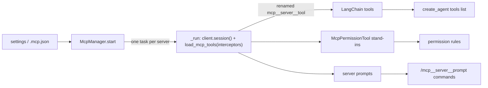

# 11 · Extending: MCP, commands, skills, hooks

[← 10 Long context](10-long-context.md) · [Index](00-index.md) · Next: [12 Many agents →](12-multi-agent.md)

**You will learn:** how cmcoder lets users and teams add to the agent without
changing its code: MCP servers turned into LangChain tools with
`langchain-mcp-adapters` (sessions, naming, tool interceptors, prompts),
custom slash commands, skills that load their instructions only when needed,
hooks that run shell commands on agent events, and the trust rules that keep
a cloned repository from running code on your machine.

## Why this module exists

Every team has its own tools (a ticket system, a database, an internal docs
search), its own routines ("review this the way we do it") and its own rules
("run the formatter after every edit"). cmcoder offers four extension points,
all in files, none needing a rebuild:

| Extension | What it is | Where |
|---|---|---|
| **MCP servers** | External programs that offer tools (and prompts) over the Model Context Protocol | `mcpServers` in settings, or a project's `.mcp.json` |
| **Custom commands** | Markdown files that expand to a prompt: `/review app.py` | `.cmcoder/commands/*.md` |
| **Skills** | Folders of know-how the model loads when a task matches | `.cmcoder/skills/<name>/SKILL.md` |
| **Hooks** | Shell commands on events: before or after a tool, at the end of a turn, … | `hooks` in settings |

Each has a user version (`~/.cmcoder/…`, yours, every project) and a project
version (`.cmcoder/…` in the repository). The project versions are where the
danger is: anyone who can push to a repository could otherwise make your
agent start a program, so each extension decides what a project may do on
its own.

## The concepts

### MCP and `langchain-mcp-adapters`

The **Model Context Protocol** is a standard way for a program (a *server*)
to offer tools, prompts and resources to an AI client, over stdio (a child
process) or HTTP. **`langchain-mcp-adapters`** connects to MCP servers and
turns each server tool into a LangChain `BaseTool`, so an agent can't tell an
MCP tool from its own.

- `MultiServerMCPClient({name: connection, ...})` knows how to reach each
  server (`"transport": "stdio"` with `command`/`args`, or
  `"streamable_http"` / `"sse"` with a `url`).
- `await client.get_tools()` is the quick way: it lists the tools, but each
  tool call later **opens a new session**. For a stdio server that's a new
  process per call.
- `async with client.session(name) as session:` plus
  `await load_mcp_tools(session)` keeps **one session** open; the tools it
  returns use it for every call.

A standalone example against cmcoder's test server
([`tests/mcp_servers/demo_server.py`](../../../tests/mcp_servers/demo_server.py),
a few FastMCP tools), run from the repository root:

```python
import asyncio, sys
from langchain_mcp_adapters.client import MultiServerMCPClient
from langchain_mcp_adapters.tools import load_mcp_tools

client = MultiServerMCPClient(
    {"demo": {"transport": "stdio", "command": sys.executable,
              "args": ["tests/mcp_servers/demo_server.py"]}}
)

async def main():
    tools = await client.get_tools()                 # quick: a session per call
    print([t.name for t in tools])
    async with client.session("demo") as session:    # long-lived: one session
        tools = await load_mcp_tools(session)
        add = next(t for t in tools if t.name == "add")
        print(await add.ainvoke({"a": 2, "b": 3}))

asyncio.run(main())
```

```text
['add', 'shout', 'fail', 'env', 'slow']
[{'type': 'text', 'text': '5', 'id': 'lc_3fd9c381-…'}]
```

The result is a list of **content blocks**, not the string `"5"`: MCP tools
can return text, images and resources. Remember this; chapter 07's
`PlainToolTextMiddleware` turns it into plain text for self-hosted servers.

### Tool interceptors

`load_mcp_tools(..., tool_interceptors=[f])` wraps every MCP tool call, like
`wrap_tool_call` middleware but at the MCP level: `f(request, handler)` can
change the request, call `handler(request)`, and change or replace the
result. A natural use is a timeout that returns an MCP error result
(`isError=True`) instead of raising, because the adapter hands an error
result to the model as an error `ToolMessage`, while an exception would end
the whole agent run.

### Progressive disclosure (skills)

A system prompt that carries every team procedure in full is expensive and
distracting. A **skill** puts only a one-line description in the prompt, and
a tool returns the full instructions when the model decides a task matches.
That pattern is what Claude Code's skills and `deepagents`' `SkillsMiddleware`
do; cmcoder implements it as a plain tool.

### Hooks as a contract

A hook is a shell command with a tiny protocol: it gets the event as **JSON
on stdin**, and answers with its **exit code** (0 fine, 2 block, anything
else a warning) and optionally **JSON on stdout** (a decision, a reason,
extra context). Any language works, and the same hooks work for Claude Code
and cmcoder (same format).

## How cmcoder uses it

### MCP: one long-lived session per server

[`McpManager`](../../../src/cmcoder/mcp/manager.py#L147) reads the servers
from your settings (`"user"`) and from the project (`"project"`):
[your definition wins on a name clash](../../../src/cmcoder/mcp/manager.py#L158-L159),
and servers that are disabled or not allowed by managed settings are
[marked and never started](../../../src/cmcoder/mcp/manager.py#L161-L164).

[`start`](../../../src/cmcoder/mcp/manager.py#L177) gives each server
[its own background task](../../../src/cmcoder/mcp/manager.py#L195), and
[`_run`](../../../src/cmcoder/mcp/manager.py#L210) owns that server's
session for the whole conversation: it opens
[`client.session(...)`](../../../src/cmcoder/mcp/manager.py#L216-L217),
loads the tools with
[`load_mcp_tools(session, ..., tool_interceptors=[_timeout(...)])`](../../../src/cmcoder/mcp/manager.py#L218-L225),
and then [waits until it's told to stop](../../../src/cmcoder/mcp/manager.py#L239).
A task, rather than a plain `async with` around the agent, because the MCP
SDK's context managers must be closed by the task that opened them.

Each tool is then
[renamed and labelled](../../../src/cmcoder/mcp/manager.py#L226-L230):
[`tool_name`](../../../src/cmcoder/mcp/manager.py#L62) gives
`mcp__<server>__<tool>` (characters model APIs reject become `_`, at most 64
long), so a permission rule like `mcp__github` covers a whole server, and the
description starts with `[MCP server <name>]` so the model knows where a tool
comes from. The server's prompts are
[listed too](../../../src/cmcoder/mcp/manager.py#L232-L235), if it has any.

[`_connection`](../../../src/cmcoder/mcp/manager.py#L250) builds the
adapter's connection: for stdio, the
[command resolved to a full path](../../../src/cmcoder/mcp/manager.py#L83)
(never a program planted in the project folder) and `${VAR}` values
expanded from the environment; for HTTP, an
[`httpx_client_factory`](../../../src/cmcoder/mcp/manager.py#L266-L279) that
trusts the company CA, the same way the model gateway's client does.

[`_timeout`](../../../src/cmcoder/mcp/manager.py#L293) is the tool
interceptor: [`asyncio.wait_for(handler(request), seconds)`](../../../src/cmcoder/mcp/manager.py#L305-L313),
and a timeout or a server error becomes an error result
(`toolTimeout`, 120 s by default).

**Into the agent.** [`build_agent`](../../../src/cmcoder/agents/main.py#L360-L364)
adds `mcp.langchain_tools()` to the tool list as they are (they are already
LangChain tools), and registers small stand-ins,
[`McpPermissionTool`](../../../src/cmcoder/mcp/manager.py#L128), so the
permission rules (chapter 05) can see them; the stand-ins never run.



### Commands

[`core/commands.py`](../../../src/cmcoder/core/commands.py#L1-L21) reads
Markdown files from `.cmcoder/commands/` and `~/.cmcoder/commands/`
([yours win](../../../src/cmcoder/core/commands.py#L126-L130));
subfolders become namespaces (`db/migrate.md` → `/db:migrate`), and a file
can't replace a [built-in command](../../../src/cmcoder/core/commands.py#L36-L39).
The frontmatter can give a `description`, an `argument-hint` and
`allowed-tools`.

[`substitute`](../../../src/cmcoder/core/commands.py#L197) fills
`$ARGUMENTS` (everything after the command) and `$1`…`$9` (its words, quotes
group words); a body without placeholders
[gets the arguments appended](../../../src/cmcoder/core/commands.py#L208-L209).
At run time,
[`custom_commands`](../../../src/cmcoder/runtime/commands.py#L76) reloads
the files on each use (edit a command, no restart) and adds MCP prompts, and
[`expand`](../../../src/cmcoder/runtime/commands.py#L90) turns a command
into the prompt to send, with its `allowed-tools` as
[allow rules for that turn only](../../../src/cmcoder/runtime/session.py#L195).
A repository's commands
[lose their `allowed-tools`](../../../src/cmcoder/core/commands.py#L143-L146)
in a project you haven't trusted: a repository can't grant itself tools.

MCP prompts become commands named like tools,
[`/mcp__<server>__<prompt>`](../../../src/cmcoder/core/commands.py#L150);
running one calls the server through
[`prompt_text`](../../../src/cmcoder/mcp/manager.py#L337), which uses the
adapter's `load_mcp_prompt` (LangChain messages back).

### Skills

[`load_skills`](../../../src/cmcoder/core/skills.py#L73) finds
`*/SKILL.md` in `.cmcoder/skills/` and `~/.cmcoder/skills/`; a skill
[needs a description](../../../src/cmcoder/core/skills.py#L66-L68), because
that's how the model finds it.
[`skills_prompt`](../../../src/cmcoder/core/skills.py#L80) lists names and
descriptions in the system prompt (chapter 10), and
[`SkillTool`](../../../src/cmcoder/core/skills.py#L98) is the tool that
[returns the instructions](../../../src/cmcoder/core/skills.py#L113) when
the model asks, plus a list of the skill's other files, each readable with
`file=`. It refuses paths
[outside the skill's folder](../../../src/cmcoder/core/skills.py#L120-L121)
and [secrets files](../../../src/cmcoder/core/skills.py#L122-L123), like
`Read`. [`build_agent`](../../../src/cmcoder/agents/main.py#L315-L319) adds
the tool only when there are skills. A skill is text: it runs nothing and
grants no permissions, which is why project skills need no trust.

### Hooks

[`HookRunner`](../../../src/cmcoder/core/hooks.py#L104) collects hooks from
[managed settings, yours and the project's](../../../src/cmcoder/core/hooks.py#L108-L117)
(only managed ones with `allowManagedHooksOnly`).
[`run`](../../../src/cmcoder/core/hooks.py#L122) runs the hooks of one event
whose `matcher` (a regex on the tool name) fits, and
[stops at the first that blocks](../../../src/cmcoder/core/hooks.py#L135-L136).
[`_run_one`](../../../src/cmcoder/core/hooks.py#L152):

- runs the command with [bash `-c`](../../../src/cmcoder/core/hooks.py#L158-L170)
  (Git Bash on Windows) in the project folder, with the
  [event as JSON on stdin](../../../src/cmcoder/core/hooks.py#L175-L177) and a
  timeout;
- [exit 2](../../../src/cmcoder/core/hooks.py#L190-L194): block, with stderr
  as the reason; [other non-zero exits](../../../src/cmcoder/core/hooks.py#L195-L198)
  are warnings;
- [plain stdout](../../../src/cmcoder/core/hooks.py#L199-L203) from
  `UserPromptSubmit` and `SessionStart` becomes context for the model;
- [JSON stdout](../../../src/cmcoder/core/hooks.py#L204-L219) can allow,
  ask or deny a tool call (the strictest answer wins across hooks), add
  context, or block.

Where each event is wired into the agent is listed at the top of
[`middleware/hooks.py`](../../../src/cmcoder/middleware/hooks.py#L7-L13):
`PreToolUse` in the permission middleware, `PostToolUse` and `Stop` in
`HooksMiddleware` (chapter 08), `UserPromptSubmit`, `SessionStart` and
`Notification` in the session (outside the graph), `PreCompact` in the
compaction middleware (chapter 10). A `PreToolUse` "allow" only skips a
normal prompt: deny rules and high-risk commands are never overridden by a
hook.

### Trust and approval

| | Your files (`~/.cmcoder`) | A project's files |
|---|---|---|
| MCP servers | start | only in a trusted project, and each server is **approved** before it first starts |
| Hooks | run | only in a trusted project, and each hook is **approved** before it first runs |
| Commands | full | usable; `allowed-tools` only in a trusted project |
| Skills | full | full (text only) |

A project is trusted with `cmcoder trust`
([`is_project_trusted`](../../../src/cmcoder/config/settings.py#L605)); an
untrusted project's `.mcp.json` servers are
[left out of the settings](../../../src/cmcoder/config/settings.py#L725-L731)
entirely, and so are the `mcpServers` and `hooks` of its
`.cmcoder/settings.json`
([`_filter_project_layer`](../../../src/cmcoder/config/settings.py#L655)).
(One exception: a `.cmcoder/settings.local.json` that cmcoder knows you
wrote yourself counts as yours.) Approval is per server or hook *as configured*:
[`config_fingerprint`](../../../src/cmcoder/config/settings.py#L621) hashes
the configuration, so a changed command asks again
([check](../../../src/cmcoder/mcp/manager.py#L186-L194) in `McpManager`,
[`_approved`](../../../src/cmcoder/core/hooks.py#L139) in `HookRunner`). In
`-p` mode nobody can approve, so only already-approved project servers start.

## Lab: extensions up close

[`labs/11_extending.py`](labs/11_extending.py) needs no mock server and no
model. It starts the demo MCP server through `McpManager`, calls two of its
tools the way the tools node would, expands its prompt as a command, then
creates a custom command and a skill in a project folder and loads them:

```bash
uv run python docs/learn/modules/labs/11_extending.py /tmp/lab-project
```

(The demo server logs `Processing request …` lines to stderr; add
`2>/dev/null` to hide them.)

```text
start warnings: []

MCP tools, as the agent sees them (LangChain BaseTools):
   mcp__demo__add         StructuredTool  '[MCP server demo] Add two numbers.'
   mcp__demo__shout       StructuredTool  '[MCP server demo] Upper-case some text.'
   mcp__demo__fail        StructuredTool  '[MCP server demo] Always fails (for error handling'
   mcp__demo__env         StructuredTool  '[MCP server demo] Read an environment variable of '
   mcp__demo__slow        StructuredTool  '[MCP server demo] Sleep, then answer (for timeout '

mcp__demo__add(2, 3) -> ToolMessage [{'type': 'text', 'text': '5', 'id': 'lc_39ad…'}] success
mcp__demo__slow(5)   -> ToolMessage [{'type': 'text', 'text': 'The MCP tool timed out after 2s.', 'id': 'lc_049a…'}] error

MCP prompt as a command: /mcp__demo__review <file>
   expands to: 'Please review app.py for bugs.'

custom command /explain (project): 'Explain a file for a new team member'
   /explain app.py -> 'Explain app.py to a new team member: what it does and how it fits in. Focus: app.py'

skills section of the system prompt:
# Skills
Skills are instructions for specific tasks. When a task matches a skill's description, load it with the Skill tool first and follow it.
- release-notes: Writes release notes in our format.

Skill(release-notes) -> '1. Run git log since the last tag.\n2. Group the changes. See template.md.\n\n(The skill\'s other files: template.md. Read one with Skill(skill="release-notes", file="...").)'
```

Things to notice:

- Calling a tool with a **ToolCall dict** (`name`, `args`, `id`,
  `type: "tool_call"`) returns a `ToolMessage`, exactly what the tools node
  gets. With plain args (`{"a": 2, "b": 3}`) you'd get only the content.
- The `slow` call didn't raise: the interceptor turned the timeout into an
  error result, so the `ToolMessage` has `status="error"` and the agent's
  run would go on.
- The custom command's frontmatter never reaches the model; only the
  substituted body does.

## Exercises

1. **Your own MCP server.** Copy `demo_server.py`, add a tool `today()` that
   returns the date, point the lab's `mcpServers` at your copy, and check its
   name and description in the output.
2. **Error, not exception.** Call `mcp__demo__fail` in the lab. What does the
   `ToolMessage` look like? Now remove the interceptor (in a scratch copy of
   `mcp/manager.py`) and call it again: what changes for an agent run?
3. **A command with tools.** Add `allowed-tools: Bash(git log:*)` to the
   lab's command and look at `load_commands(...)["explain"].allowed_tools`.
   Then read `CommandSource.load` and say what happens to it in an untrusted
   project.
4. **Stretch: a PostToolUse hook.** In settings, add a `PostToolUse` hook
   with matcher `Edit|Write` that runs your formatter and prints
   `{"hookSpecificOutput": {"additionalContext": "formatted"}}`. Run an edit
   against the mock server (chapter 08's lab) and find the context in the
   tool result the model saw.

## Check yourself

1. Why does cmcoder keep an MCP session open instead of using
   `client.get_tools()`?
2. Why does each server's session live in its own asyncio task?
3. What does the timeout interceptor return, and why not raise?
4. Why are MCP tools named `mcp__<server>__<tool>`?
5. How does a skill keep the system prompt small?
6. A cloned repository has a `.mcp.json` and a `PostToolUse` hook. What runs
   before you trust it? After `cmcoder trust`?

<details><summary>Answers</summary>

1. `get_tools()` opens a new session for every tool call: for a stdio server
   a new process each time. One session per server, kept open, is faster and
   keeps the server's state.
2. The MCP SDK's context managers must be exited by the task that entered
   them; a task per server opens, holds and closes its own session.
3. An MCP error result (`CallToolResult(isError=True)`), which the adapter
   turns into an error `ToolMessage` the model can react to. An exception
   would end the whole agent run.
4. To avoid clashes with cmcoder's tools and between servers, to let one
   permission rule (`mcp__github`) cover a whole server, and to keep names
   within what model APIs accept (characters and 64 long).
5. Only its name and description are in the prompt; the `Skill` tool returns
   the full instructions (and other files) when the model needs them.
6. Before: neither. Untrusted `.mcp.json` servers are left out of the
   settings, and project hooks aren't loaded. After: each server and each hook
   is asked about (approved) before it first runs, and asked again if its
   configuration changes.

</details>

[← 10 Long context](10-long-context.md) · [Index](00-index.md) · Next: [12 Many agents →](12-multi-agent.md)
