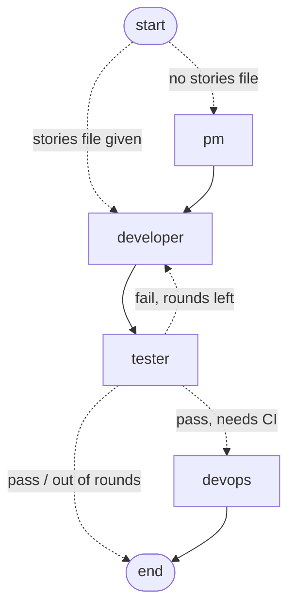

# 12 · Many agents

[← 11 Extending: MCP, commands, skills](11-extending.md) · [Index](00-index.md) · Next: [13 Code search (RAG) →](13-rag.md)

**You will learn:** how to run a whole agent *inside a tool* (subagents), how
an `interrupt()` deep inside nested graphs pauses everything and resumes in the
right place, how to get a typed result instead of prose from an agent
(structured output), how an `after_agent` hook can send the agent back to work
(the critic), and how to write your own `StateGraph` with a typed state, a
reducer and a retry loop (the team). Last, when to use `create_agent` and when
to write the graph yourself.

## Why this chapter

One agent with one conversation runs into two limits. The conversation fills
up: a broad search reads dozens of files the main agent will never need again.
And some work has a fixed *process*: write the stories, implement, test, fix,
test again. A 27B model asked to "follow this process" may skip the tester or
loop forever.

cmcoder answers both with LangGraph:

| Module | What it adds | The idea |
|---|---|---|
| [`agents/subagents.py`](../../../src/cmcoder/agents/subagents.py) | The `Task` tool: hand a job to a fresh agent with its own conversation and tools | A graph inside a tool |
| [`middleware/critic.py`](../../../src/cmcoder/middleware/critic.py) | A reviewer checks the answer before you see it | `aafter_agent` + structured output |
| [`agents/team.py`](../../../src/cmcoder/agents/team.py) | PM → developer → tester (↺) → DevOps | Your own `StateGraph` |

## The concepts

### A compiled graph is just a Runnable, so it can run anywhere

Chapter 01 showed that a compiled graph has `ainvoke` / `astream` like any
Runnable. Nothing stops you from calling one *inside a tool function* or
*inside a node of another graph*. LangGraph notices and treats it as a
**subgraph**:

* **Checkpoints nest.** A graph compiled with no checkpointer, run inside a
  parent that has one, saves its own checkpoints in the parent's checkpointer
  under its own namespace.
* **Interrupts travel up.** An `interrupt()` anywhere inside pauses the
  *whole* run up to the top. On resume, LangGraph re-runs the path down to the
  interrupted node, and the nodes that had finished are not run again.
* **Context comes from the direct parent.** A nested graph's
  `runtime.context` is whatever *its* caller passed with `context=`; pass the
  outer one on explicitly if the inner graph needs it.

### Structured output: a typed result, not prose

`create_agent(..., response_format=ToolStrategy(Schema))` gives the model one
extra tool shaped like your pydantic `Schema`. When the model calls it, the run
ends and the parsed object is in `state["structured_response"]`. Your code then
routes on a field (`verdict == "fail"`), never on parsing text. The schema's
docstring and `Field(description=...)` are what the model reads, so write them
for the model.

A standalone example (plain LangChain, against the mock server; it's
[`labs/12_structured_output.py`](labs/12_structured_output.py)):

```python
from typing import Literal
from langchain.agents import create_agent
from langchain.agents.structured_output import ToolStrategy
from langchain_core.messages import HumanMessage
from langchain_openai import ChatOpenAI
from pydantic import BaseModel, Field, SecretStr

class Verdict(BaseModel):
    """Give your verdict on the code: pass, or fail with the problems."""
    verdict: Literal["pass", "fail"]
    summary: str = Field(description="One sentence: why")
    issues: list[str] = Field(default_factory=list, description="For fail: each problem")

model = ChatOpenAI(base_url="http://127.0.0.1:8765/v1", api_key=SecretStr("x"),
                   model="qwen3-27b", streaming=True)   # the mock server always streams
agent = create_agent(model, tools=[], response_format=ToolStrategy(Verdict))
state = agent.invoke({"messages": [HumanMessage("Review: def add(a, b): return a - b")]})
print(state["structured_response"])
```

```text
Verdict -> verdict='fail' summary='add() subtracts.' issues=['app.py:2 uses a - b']
route on a field: back to the developer
messages: ['HumanMessage', 'AIMessage', 'ToolMessage']
```

One model call, and the run ended: calling the `Verdict` tool *is* the end.

### Your own `StateGraph`

`create_agent` is one particular graph: a loop where **the model decides**
what happens next. When the **order** matters more than the model's judgement,
build the graph yourself:

* **A typed state.** A `TypedDict`. Keys marked `NotRequired` may be missing
  at the start.
* **Nodes return only what they change.** A node is a function
  `(state) -> dict`; LangGraph merges the dict into the state.
* **Reducers decide how a key is merged.** By default a new value replaces the
  old one. `Annotated[list[str], operator.add]` *appends* instead: every round
  adds its entry.
* **Conditional edges.** `add_conditional_edges("tester", route)` calls
  `route(state)` after `tester` and goes to the node name it returns, or to
  `END`. Returning an earlier node makes a loop.

The smallest useful example, with no model at all
([`labs/12_retry_graph.py`](labs/12_retry_graph.py)):

```python
import operator
from typing import Annotated, Literal, NotRequired, TypedDict
from langgraph.graph import START, StateGraph

class State(TypedDict):
    max_rounds: int
    fail_times: int
    round: NotRequired[int]
    changes: NotRequired[Annotated[list[str], operator.add]]   # appended, not replaced
    passed: NotRequired[bool]

def developer(state: State) -> dict:
    round_ = state.get("round", 0) + 1
    return {"round": round_, "changes": [f"change {round_}"]}  # only what changed

def tester(state: State) -> dict:
    return {"passed": state.get("round", 0) > state["fail_times"]}

def route_after_test(state: State) -> Literal["developer", "__end__"]:
    if not state.get("passed") and state.get("round", 0) < state["max_rounds"]:
        return "developer"
    return "__end__"   # = langgraph.graph.END

graph = StateGraph(State)
graph.add_node("developer", developer)
graph.add_node("tester", tester)
graph.add_edge(START, "developer")
graph.add_edge("developer", "tester")
graph.add_conditional_edges("tester", route_after_test)
app = graph.compile()
print(app.invoke({"fail_times": 1, "max_rounds": 3}))
```

```text
developer: round 1
tester   : fail
developer: round 2
tester   : pass
final    : {'round': 2, 'changes': ['change 1', 'change 2'], 'passed': True}
```

`changes` has both rounds' entries: the reducer appended. `round` was simply
replaced.

## How cmcoder uses it

### 1. Subagents: a graph inside the Task tool

**Where the definitions come from.** An
[`AgentDefinition`](../../../src/cmcoder/agents/subagents.py#L109) is a name,
a description (what the main model reads to choose one), a prompt, an
optional tool list and an optional model. Two are
[built in](../../../src/cmcoder/agents/subagents.py#L120): `general-purpose`
(every tool, the main model) and `explore` (read-only, with
[`model="subagent"`](../../../src/cmcoder/agents/subagents.py#L135)). Yours
are Markdown files with front matter, read by
[`_load_dir`](../../../src/cmcoder/agents/subagents.py#L140);
[`load_agents`](../../../src/cmcoder/agents/subagents.py#L168) reads a
project's `.cmcoder/agents/` only
[when the project is trusted](../../../src/cmcoder/agents/subagents.py#L171),
then yours from `~/.cmcoder/agents/` (yours win on a name clash).

**Per-role models.**
[`model_for`](../../../src/cmcoder/agents/subagents.py#L339) maps `inherit`
(or nothing) to the main model, `small` to `smallFastModel`, `subagent` to
`subagentModel` (else `smallFastModel`), and anything else to a
`provider:model` reference.

**Building the subagent's graph.**
[`SubagentRuntime.build`](../../../src/cmcoder/agents/subagents.py#L350) is a
second `create_agent`:

* only the tools the definition allows, and never `Task`, `Team` or
  `write_todos` ([`NOT_FOR_SUBAGENTS`](../../../src/cmcoder/agents/subagents.py#L84)):
  no nesting;
* a step limit with LangChain's built-in
  [`ModelCallLimitMiddleware(run_limit=..., exit_behavior="end")`](../../../src/cmcoder/agents/subagents.py#L376)
  (`subagentMaxTurns`, or the caller's `max_turns`);
* the same loop middleware as the main agent
  ([`loop_middleware`](../../../src/cmcoder/agents/subagents.py#L379)), so the
  same permission rules and hooks apply, with `SubagentStop` instead of `Stop`;
* and, the key line,
  [no checkpointer](../../../src/cmcoder/agents/subagents.py#L396): run inside
  the main graph's tool node, it uses the main graph's.

**The tool.** [`build_task_tool`](../../../src/cmcoder/agents/subagents.py#L438)
wraps an async function with `StructuredTool.from_function`. The function
[asks for `runtime: ToolRuntime`](../../../src/cmcoder/agents/subagents.py#L441):
LangChain injects it (the model never sees that parameter) and it carries the
tool call's id and a `stream_writer`. The id names the run; the writer sends
the subagent's own tool calls to the UI on the main graph's `custom` stream
([`_emit`](../../../src/cmcoder/agents/subagents.py#L469)), each tagged
[`parent_tool_use_id`](../../../src/cmcoder/agents/subagents.py#L634) so the
panel shows them under the Task card.

**Running it.** [`run_agent`](../../../src/cmcoder/agents/subagents.py#L510)
[streams the subagent graph](../../../src/cmcoder/agents/subagents.py#L562)
with `stream_mode=["updates"]` and turns each new message into UI events
([`_follow`](../../../src/cmcoder/agents/subagents.py#L617)); the last text
reply is the report returned to the main agent. A `structured_response` in an
update is
[picked up too](../../../src/cmcoder/agents/subagents.py#L571) (the critic and
the team use that).

**Parallel subagents.** Several Task calls in one model reply are separate
tool calls, and `create_agent` runs them concurrently. A semaphore,
[`slots`](../../../src/cmcoder/agents/subagents.py#L301)
(`maxParallelSubagents`, default 4), caps how many run at once:
[`async with rt.slots`](../../../src/cmcoder/agents/subagents.py#L539).

**Stopping one subagent.** An IDE's agent map has a Stop button per
subagent (`stop_subagent`). Cancelling the subagent's asyncio task would lose
everything it found, so cmcoder stops it the way cmcoderagent did: gracefully,
with a middleware.
[`SubagentRuntime.stop`](../../../src/cmcoder/agents/subagents.py#L318)
marks the run
([`request_stop`](../../../src/cmcoder/agents/subagents.py#L213): "stopping",
or never started if it was still queued), and
[`StopRequestMiddleware`](../../../src/cmcoder/agents/subagents.py#L251), the
outermost middleware of every subagent graph, acts at its next model call:
`awrap_model_call` sends that call **without tools** and with a "write your
report now" reminder, and
[`aafter_model`](../../../src/cmcoder/agents/subagents.py#L277) returns
`{"jump_to": "end"}`. The Task tool then
[hands the main agent the report so far](../../../src/cmcoder/agents/subagents.py#L502),
and the turn, and any other subagents, go on. Compare a *denial* inside a
subagent (section 2), which ends the whole turn. Test:
`test_stopping_one_subagent_lets_it_report_and_the_turn_go_on`.

### 2. Interrupts two graphs deep

A subagent's `Write` needs your permission. Its `PermissionMiddleware` calls
`interrupt()`, which travels up out of the subagent graph, out of the Task
tool, and pauses the main graph. The session asks you exactly as for the main
agent's own calls (chapter 08). On resume, LangGraph runs the main tools node
again, so the Task tool function runs again from its start, and the subagent
graph continues from its own checkpoint.

```mermaid
sequenceDiagram
    participant S as Session
    participant M as main graph (tools node)
    participant T as Task tool
    participant G as subagent graph
    participant P as subagent PermissionMiddleware
    S->>M: astream(user message)
    M->>T: Task(prompt)
    T->>G: astream(prompt)
    G->>P: Write(app.py)
    P--xS: interrupt() → GraphInterrupt travels up
    Note over S: state saved; ask the user
    S->>M: astream(Command(resume={id: allow}))
    M->>T: Task runs again (same call id)
    T->>G: astream: continues from its checkpoint
    G->>P: Write(app.py): interrupt() returns "allow"
    P->>G: the tool runs
    G-->>T: report
    T-->>M: ToolMessage(report)
```

Two things in `run_agent` make that work:

* [`except GraphInterrupt: raise`](../../../src/cmcoder/agents/subagents.py#L579):
  the pause must not be caught as an error.
* Whatever the re-run would *rebuild* has to be kept by you. A subagent's
  `ToolContext` (what it has read, its shell) lives in
  [`rt.contexts`](../../../src/cmcoder/agents/subagents.py#L298) by call id, and
  the re-run
  [takes it back](../../../src/cmcoder/agents/subagents.py#L542) instead of
  starting fresh (else "read before write" would fail on resume). Its
  `SubagentRun` (number, counts) is
  [reused the same way](../../../src/cmcoder/agents/subagents.py#L529).

**A "Deny" inside a subagent stops the main turn too.** The subagent's
permission middleware marks the denial with `STOP_KEY` and ends the subagent's
run. `run_agent` [notices the mark](../../../src/cmcoder/agents/subagents.py#L574),
and [`run_subagent`](../../../src/cmcoder/agents/subagents.py#L491) returns a
`ToolMessage` carrying the same mark, so the *main* agent's
[`abefore_model`](../../../src/cmcoder/middleware/permission.py#L131) ends the
main run too, instead of asking the model again.

### 3. The critic: `aafter_agent` + structured output

[`CriticMiddleware.aafter_agent`](../../../src/cmcoder/middleware/critic.py#L187)
runs when the main agent is about to finish. It is decorated with
[`@hook_config(can_jump_to=["model"])`](../../../src/cmcoder/middleware/critic.py#L186),
which tells `create_agent` to add an edge from this hook back to the model.

1. [Nothing to review](../../../src/cmcoder/middleware/critic.py#L190) if
   critique is off, or the last message isn't a final answer.
2. It runs the read-only `critic` agent
   ([`CRITIC_DEFINITION`](../../../src/cmcoder/middleware/critic.py#L70)) with
   [`response_format=ToolStrategy(Verdict)`](../../../src/cmcoder/middleware/critic.py#L216)
   ([`Verdict`](../../../src/cmcoder/middleware/critic.py#L88): pass/fail, a
   summary, a list of `Issue`s), through the same `run_agent`.
3. Pass, no verdict, or out of rounds: return `None`, and the answer is
   shown.
4. Fail with rounds left:
   [return a new message and `"jump_to": "model"`](../../../src/cmcoder/middleware/critic.py#L254):
   "the agent is done" becomes "one more round", with the issues to fix.

The critic's progress reaches the UI through
[`get_stream_writer()`](../../../src/cmcoder/middleware/critic.py#L192): the
middleware version of the tool's `stream_writer`.

### 4. The team: a `StateGraph` of subagents

The team is enabled with `"team": {"enabled": true}`; the main agent then gets
the [`Team` tool](../../../src/cmcoder/agents/main.py#L401), and `/team <feature>`
asks it to use it.

**The state.** [`TeamState`](../../../src/cmcoder/agents/team.py#L142) is a
`TypedDict`; most keys are `NotRequired`. `changes`
[uses `operator.add`](../../../src/cmcoder/agents/team.py#L148): each developer
round's report is appended, so the tester and the summary can see the latest.

**The nodes.** [`pm`](../../../src/cmcoder/agents/team.py#L221),
[`developer`](../../../src/cmcoder/agents/team.py#L237),
[`tester`](../../../src/cmcoder/agents/team.py#L258) and
[`devops`](../../../src/cmcoder/agents/team.py#L278) are async functions. Each
runs one role as a subagent
([`run_role`](../../../src/cmcoder/agents/team.py#L166) → `run_agent`) and
returns only its keys: the developer
[returns `round` and one new `changes` entry](../../../src/cmcoder/agents/team.py#L255).
The PM answers with [`Stories`](../../../src/cmcoder/agents/team.py#L114) and
the tester with [`TestReport`](../../../src/cmcoder/agents/team.py#L131), both
via [`ToolStrategy`](../../../src/cmcoder/agents/team.py#L195). Each role is
your `.cmcoder/agents/<role>.md` if you wrote one, else
[the built-in](../../../src/cmcoder/agents/team.py#L91)
([`role_definition`](../../../src/cmcoder/agents/team.py#L161)).

**The edges.** [`build_team_graph`](../../../src/cmcoder/agents/team.py#L303):

* [`route_start`](../../../src/cmcoder/agents/team.py#L291): skip the PM when
  the lead passed an existing stories file;
* `pm → developer → tester`;
* [`route_after_test`](../../../src/cmcoder/agents/team.py#L295): a failed
  test goes back to the developer while `round < max_rounds`; a pass goes to
  DevOps if the stories said `needs_devops`, else to the end;
* [compiled once, with no checkpointer](../../../src/cmcoder/agents/team.py#L315):
  `TEAM_GRAPH` is a module-level constant, and inside the tool it uses the main
  graph's checkpointer like a subagent does.

This is the graph LangGraph draws from it
(`TEAM_GRAPH.get_graph().draw_mermaid()`, labels added):



Dotted edges are conditional, solid ones fixed.

**The context.** Nodes need things that aren't state: the subagent runtime,
the UI writer, the Team call's id. That's
[`TeamContext`](../../../src/cmcoder/agents/team.py#L153), declared as the
graph's `context_schema` and passed by the tool:
[`TEAM_GRAPH.ainvoke(..., context=TeamContext(...))`](../../../src/cmcoder/agents/team.py#L379).
Nodes read it as `runtime.context`. Its `run` field carries the **main**
graph's `RunContext` (the turn and the file snapshots), which `run_role`
[passes on to each role](../../../src/cmcoder/agents/team.py#L197): a nested
graph sees only its direct caller's context.

**Resuming in the middle.** A role's call id is
[stable](../../../src/cmcoder/agents/team.py#L175) (`<team call>-developer-2`),
so when a node runs again after a permission prompt it reuses the same
subagent run and doesn't announce the role twice.

## create_agent or your own StateGraph?

| Use `create_agent` when… | Write a `StateGraph` when… |
|---|---|
| the model should decide the next step (which tool, when to stop) | the steps and their order are known in advance |
| it's one conversation with tools | it's several roles handing work to each other |
| you customise the loop with middleware | you need loops with a hard limit, or branches on typed results |
| examples: the main agent, each subagent, the critic | example: the team (whose nodes are `create_agent` subagents) |

They combine well: the team's nodes are `create_agent` graphs, the team is a
graph inside a tool, and that tool belongs to a `create_agent` graph.

## Lab: the team, for real

[`labs/12_team.py`](labs/12_team.py) runs cmcoder's main agent with the team
on. The mock server ([`labs/12_team.json`](labs/12_team.json), twelve replies)
plays the lead and every role: the developer's first version is wrong, the
tester fails it, the developer fixes it, the tester passes, DevOps has nothing
to do. Every Write asks permission, and the lab answers "allow".

```bash
uv run python -m cmcoder.testing.mock_server --script docs/learn/modules/labs/12_team.json --port 8765
mkdir -p /tmp/team-project
uv run python docs/learn/modules/labs/12_team.py http://127.0.0.1:8765/v1 /tmp/team-project
```

```text
Team             Team
Task  pm         pm: write the stories
    tool        Write(docs/stories/greet.md)
    PERMISSION  Write(docs/stories/greet.md): allow
    tool        Stories
Task  developer  developer: implement the feature
    tool        Write(greet.py)
    PERMISSION  Write(greet.py): allow
Task  tester     tester: test the change (round 1)
    tool        TestReport
Task  developer  developer: fix the test failures (round 2)
    tool        Read(greet.py)
    tool        Write(greet.py)
    PERMISSION  Write(greet.py): allow
Task  tester     tester: test the change (round 2)
    tool        TestReport
Task  devops     devops: update build and CI

Team result: PASS after 2 developer round(s).
lead's answer: The team built greet().

greet.py:
def greet(n):
    return f'Hello, {n}!'
```

What to notice:

* The route is exactly `route_after_test`'s: tester fail → developer → tester
  pass → DevOps (the PM said `needs_devops: true`).
* Each `PERMISSION` was an `interrupt()` three graphs deep (main → team →
  role), and after each answer no finished role ran again: if one had, the
  script's replies would be out of step and the run would go wrong.
* `Stories` and `TestReport` appear as tools: they are the `ToolStrategy`
  schemas.

Two more labs, no cmcoder graph needed:

* [`labs/12_retry_graph.py`](labs/12_retry_graph.py) (no server): the
  retry-loop `StateGraph` from above. Try `python 12_retry_graph.py 5 2`:
  it stops after two failing rounds.
* [`labs/12_structured_output.py`](labs/12_structured_output.py) with script
  [`labs/12_verdict.json`](labs/12_verdict.json): `ToolStrategy` on its own.

## Exercises

1. **Change the route.** In `12_team.json`, make the second `TestReport` fail
   too, and run with `"team": {"enabled": true, "maxRounds": 2}` in the lab's
   settings. What does the Team result say, and how many replies did the
   script need? (Remove the ones that are no longer used.)
2. **A subagent of your own.** Write `~/.cmcoder/agents/reviewer.md` (front
   matter `name`, `description`, `tools: Read, Grep`) and check `/agents`
   lists it. Which function decides that `Write` isn't offered to it?
3. **Stretch: a reviewer node.** Add a `reviewer` node to the team graph
   between `developer` and `tester`, with a `Review` schema (`approved: bool`,
   `notes: list[str]`) and a conditional edge back to the developer when not
   approved. Draw the result with `draw_mermaid()` and extend `12_team.json`
   to drive it.

## Check yourself

1. Why does `SubagentRuntime.build` pass no checkpointer to `create_agent`?
2. A subagent pauses for permission. When you answer, what runs again, and
   why doesn't the subagent forget what it had read?
3. How does the run know the critic's verdict without parsing its text?
4. What lets `CriticMiddleware.aafter_agent` send the agent back to the model?
5. Why is `changes` in `TeamState` annotated with `operator.add`, but `round`
   isn't?
6. Each role needs the main turn's file snapshots. How do they get there?
7. When would you *not* use a `StateGraph`?

<details><summary>Answers</summary>

1. Run inside the main graph's tool node, a graph compiled without a
   checkpointer uses the parent's, under its own namespace. That's what lets
   its interrupts pause the main graph and its state survive the pause.
2. The main graph's tools node runs again, so the Task tool function runs
   again from its start and calls the subagent graph, which continues from its
   checkpoint. Its `ToolContext` was kept in `rt.contexts` by call id, and
   `run_agent` takes it back instead of making a new one.
3. `response_format=ToolStrategy(Verdict)`: the critic ends by calling a
   `Verdict` tool, and the parsed object arrives as `structured_response`;
   the middleware reads `verdict.verdict`.
4. `@hook_config(can_jump_to=["model"])` adds the edge; returning
   `{"messages": [...], "jump_to": "model"}` takes it.
5. Every developer round should add its report to the list (a reducer that
   appends); `round` is just the latest number, so the default "replace" is
   right.
6. The Team tool passes the main `RunContext` (`runtime.context` of the tool)
   in `TeamContext.run`, and `run_role` passes it to each role with
   `context=`. A nested graph only sees its direct caller's context.
7. When the model should decide the next step: one conversation with tools.
   That's `create_agent`'s loop, customised with middleware.

</details>

[← 11 Extending: MCP, commands, skills](11-extending.md) · [Index](00-index.md) · Next: [13 Code search (RAG) →](13-rag.md)
