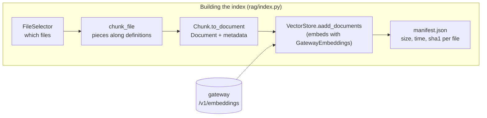
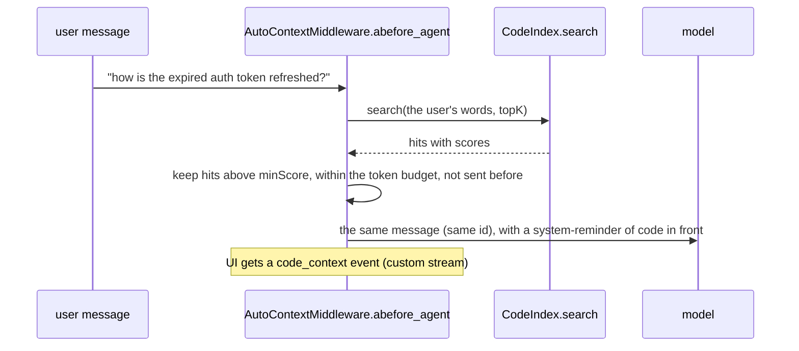
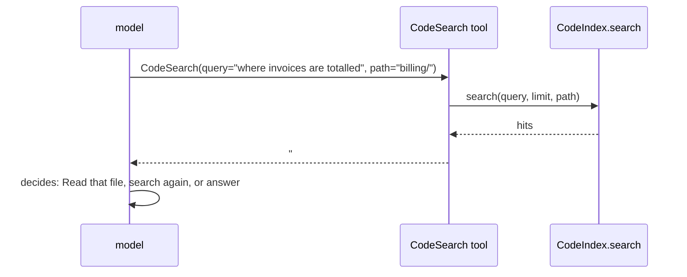

# 13 · Code search (RAG)

[← 12 Many agents](12-multi-agent.md) · [Index](00-index.md) · Next: [14 Production →](14-production.md)

**You will learn:** LangChain's retrieval building blocks (`Embeddings`,
`VectorStore`, `Document`, retrievers) by following how cmcoder indexes a
project, keeps the index current, and feeds code to the model in the two
classic ways: *retrieve, then generate*, and *retrieval as a tool*.

## Why this module exists

A 27B model with a 32K window can't read a whole project. Grep finds exact
words, but a question like *"where is the expired session token renewed?"*
doesn't contain the function's name. **Code search** finds code by meaning:
every piece of the project is turned into a vector, and a question is
answered with the pieces whose vectors are closest.

That is **retrieval-augmented generation (RAG)**: retrieve relevant text,
then let the model generate with it in front of it. `rag/` builds the index;
one middleware and one tool bring it to the model.

## The concepts

### Embeddings: text in, vector out

An embedding model maps a text to a vector (a list of floats) so that texts
with similar meaning get vectors pointing in similar directions. LangChain's
interface is `Embeddings`:

| Method | For |
|---|---|
| `embed_documents(texts)` / `aembed_documents` | what goes into the index |
| `embed_query(text)` / `aembed_query` | the question you search with |

They are separate because some models embed queries and documents
differently. Similarity is usually the **cosine** of the angle between two
vectors: with unit-length vectors that's just their dot product, 1 for
"same direction".

### Documents and vector stores

A **`Document`** is LangChain's unit of retrieval: `page_content` (the text)
plus `metadata` (anything: here path, lines, language, symbol) and an `id`.

A **`VectorStore`** stores Documents with their vectors and searches them:
`aadd_documents(docs, ids=...)` (embeds and stores),
`asimilarity_search_with_score(query, k)` (embeds the query, returns the `k`
closest with scores), `adelete(ids)`. It holds an `Embeddings` and calls it
itself.

### Retrievers, and LCEL

A **retriever** is a Runnable "query in, Documents out". Every `VectorStore`
gives you one for free: `store.as_retriever(search_kwargs={"k": 4})`. Because
it's a Runnable, you can compose it with `|` (**LCEL**, the LangChain
Expression Language) into a chain:

```python
chain = {"context": retriever | format_docs, "question": RunnablePassthrough()} \
        | prompt | model | StrOutputParser()
```

A minimal standalone example, with a toy embedding model and LangChain's own
`InMemoryVectorStore` (no server needed):

```python
import asyncio, hashlib, math
from langchain_core.documents import Document
from langchain_core.embeddings import Embeddings
from langchain_core.vectorstores import InMemoryVectorStore

class WordHashEmbeddings(Embeddings):
    """A toy model: each word adds +1/-1 to one of 64 buckets."""
    def embed_documents(self, texts): return [self.embed_query(t) for t in texts]
    def embed_query(self, text):
        vec = [0.0] * 64
        for word in text.lower().split():
            h = hashlib.sha256(word.encode()).digest()
            vec[h[0] % 64] += 1.0 if h[1] & 1 else -1.0
        norm = math.sqrt(sum(x * x for x in vec)) or 1.0
        return [x / norm for x in vec]

async def main():
    store = InMemoryVectorStore(WordHashEmbeddings())
    await store.aadd_documents([
        Document("def refresh_token(session): renew the auth token", metadata={"path": "auth.py"}),
        Document("def invoice_total(lines): sum the invoice amounts", metadata={"path": "billing.py"}),
    ])
    for doc, score in await store.asimilarity_search_with_score("renew the auth token", k=2):
        print(f"{score:.2f}  {doc.metadata['path']}")
    retriever = store.as_retriever(search_kwargs={"k": 1})
    print((await retriever.ainvoke("sum the invoice"))[0].metadata)

asyncio.run(main())
```

```text
0.82  auth.py
0.25  billing.py
{'path': 'billing.py'}
```

### Two ways to bring retrieval to the model

| Pattern | Who decides what to search | Good at |
|---|---|---|
| **Retrieve, then generate** | your code, with the user's own words | cheap context on every question, even when the model wouldn't think to search |
| **Retrieval as a tool** | the model, with words it chooses | digging further: follow-up searches, narrowing to a folder |

cmcoder does both, on the same index.

## How cmcoder uses it



### 1. Which files: `rag/files.py`

[`FileSelector.wanted`](../../../src/cmcoder/rag/files.py#L72) decides by name
and place: no hidden folders, the `rag.include` / `rag.exclude` patterns, no
generated or lock files (`SKIPPED`), a known language, and never a secret
file: the [same rules as the Read tool](../../../src/cmcoder/rag/files.py#L86)
(`safe_project_file`). [`read`](../../../src/cmcoder/rag/files.py#L93) drops
binaries, empty or oversized files and minified ones, and returns a
`FileState` (time, size, sha1) the manifest keeps.

### 2. Pieces along code structure: `rag/chunker.py`

[`chunk_file`](../../../src/cmcoder/rag/chunker.py#L164) splits a file into
[`Chunk`s](../../../src/cmcoder/rag/chunker.py#L111): path, first and last
line, text, language and the name it defines (`symbol`).

* Python goes through Python's own parser:
  [`_python_spans`](../../../src/cmcoder/rag/chunker.py#L220) makes one span
  per top-level function or class; a large class is split method by method.
* Other languages: [`_generic_spans`](../../../src/cmcoder/rag/chunker.py#L260)
  splits at unindented lines that start a definition (`function`, `class`,
  `fn`, `func`, …), Markdown at headings.
* [`_merge_small`](../../../src/cmcoder/rag/chunker.py#L185) joins tiny
  neighbours (the lab shows two short functions becoming one piece named
  `refresh_auth_token, parse_invoice_total`), and
  [`_limit`](../../../src/cmcoder/rag/chunker.py#L200) cuts long spans into
  windows of at most `MAX_LINES` lines with a small overlap.

Why not LangChain's `RecursiveCharacterTextSplitter.from_language`? It
splits by characters and keeps no line numbers or names; a search result here
must say `auth.py:12-40 (refresh_token)` so the agent can Read exactly that.

A chunk becomes a LangChain `Document` with
[`to_document()`](../../../src/cmcoder/rag/chunker.py#L139) and comes back
with [`from_document()`](../../../src/cmcoder/rag/chunker.py#L145).

### 3. Embeddings through the gateway: `rag/embed.py`

[`GatewayEmbeddings`](../../../src/cmcoder/rag/embed.py#L41) is an
`Embeddings` subclass. It implements
[`aembed_documents`](../../../src/cmcoder/rag/embed.py#L54) and
[`aembed_query`](../../../src/cmcoder/rag/embed.py#L57); the sync versions
[just run them](../../../src/cmcoder/rag/embed.py#L60) (cmcoder is async
everywhere). The work is in [`embed`](../../../src/cmcoder/rag/embed.py#L68):
batches of 32 texts, one HTTP request each
([`_request`](../../../src/cmcoder/rag/embed.py#L87), with retries), then
vectors normalised to unit length so a dot product is the cosine.

Why not `OpenAIEmbeddings`? It counts tokens with OpenAI's tokenizer
(tiktoken) to split long texts, which is wrong for a bge or nomic model, and
only knows OpenAI's error format. This class reuses the chat model's
`Gateway` (same TLS, proxy and API key), works with LiteLLM's
`/v1/embeddings` and Open WebUI's `/api/embeddings`, and
[explains a wrong model](../../../src/cmcoder/rag/embed.py#L107) instead of
showing Open WebUI's bare HTTP 500.

### 4. Two VectorStores: `rag/stores.py`

[`_CodeStore`](../../../src/cmcoder/rag/stores.py#L72) subclasses
`VectorStore` and adds what an index needs on top: `adelete_paths`,
`acount`, `aclear`, `aclose`. Two details:

* It embeds a little more than it stores:
  [`embedding_text`](../../../src/cmcoder/rag/stores.py#L57) puts
  `File: <path>` and `Defines: <symbol>` before the code, which helps find
  it by meaning; the stored `page_content` is the plain code.
* The sync API [raises "use the a... methods"](../../../src/cmcoder/rag/stores.py#L135).
  Retrievers call the async path (`asimilarity_search`) from `ainvoke`, so
  `as_retriever()` still works.

The three stores:

* [`LocalVectorStore`](../../../src/cmcoder/rag/stores.py#L156) (the
  default): a SQLite file under `~/.cmcoder/index/`, the vectors as BLOBs.
  [`aadd_texts`](../../../src/cmcoder/rag/stores.py#L176) embeds and
  upserts; search loads every vector into one numpy matrix and
  [ranks with one matrix product](../../../src/cmcoder/rag/stores.py#L244).
  Nothing to install, so it works in the standalone build; fine up to about
  100k pieces.
* [`LanceVectorStore`](../../../src/cmcoder/rag/lance.py#L147) (`"type":
  "lancedb"`): LanceDB, a database that runs inside cmcoder and keeps its data
  on disk, so the index isn't limited by memory like the built-in one. It is
  our own `VectorStore` over LanceDB's async client, not `langchain-lancedb`:
  that package is sync-only and has no metadata filter, count or delete by
  path, which the index needs. The database applies the
  [path filter](../../../src/cmcoder/rag/lance.py#L94) (`starts_with`, so `_`
  and `%` in a name mean themselves) and [upserts by id](../../../src/cmcoder/rag/lance.py#L257).
  `lancedb` and `pyarrow` are imported on first use, so cmcoder starts as fast
  as before. Nothing in it uses the network. Three things it adds:
  * **Hybrid search.**
    [`asimilarity_search_by_vector_with_score`](../../../src/cmcoder/rag/lance.py#L372)
    searches by meaning (the vectors) and by words (a full-text index) and merges the two
    rankings with [Reciprocal Rank Fusion](../../../src/cmcoder/rag/lance.py#L135):
    a piece's score is the sum of `1 / (60 + rank)` over the rankings it is in. The
    words index also holds [the parts of camelCase names](../../../src/cmcoder/rag/lance.py#L112)
    (`HTTPServerError` is also "http server error"). Scores stay cosine, so thresholds
    mean the same everywhere. This is why the search method takes the question's text
    (`query_text`) as well as its vector; the other stores ignore it.
  * **An ANN index and housekeeping.**
    [`aoptimize`](../../../src/cmcoder/rag/lance.py#L337) runs after a full update
    (`CodeIndex` calls it, and again when the index closes): it builds the words
    index, an IVF-PQ index once there are 10,000 pieces (searches then re-rank its best
    candidates by exact distance, which took recall@10 from 0.14 to 0.86 at 300,000
    pieces), merges small files and removes versions older than an hour.
  * **Moving over.** [`aimport_local`](../../../src/cmcoder/rag/lance.py#L286) copies a
    built-in index's pieces and vectors; `CodeIndex` calls it on the first update after
    the store changed, so nothing is embedded again.
* [`ChromaVectorStore`](../../../src/cmcoder/rag/stores.py#L280): Chroma at a
  URL (on this PC or a team server) through its REST API v2 with cmcoder's own
  HTTP client: a [cosine collection](../../../src/cmcoder/rag/stores.py#L337),
  `upsert` in batches of 100, and [`/query`](../../../src/cmcoder/rag/stores.py#L399)
  for search (distance turned into a similarity, `1 - distance`).
  `langchain-chroma` would pull in the whole `chromadb` package, which the
  standalone program can't include; the REST API needs nothing.

### 5. The index: `rag/index.py`

[`CodeIndex`](../../../src/cmcoder/rag/index.py#L118) is the bookkeeping
around a store. Its [manifest](../../../src/cmcoder/rag/index.py#L179)
(`manifest.json`, per project and embedding model) remembers each file's
time, size and sha1:

* [`_changes`](../../../src/cmcoder/rag/index.py#L227) compares the files
  with it: size and time first, the content hash only when the time moved.
* [`update`](../../../src/cmcoder/rag/index.py#L259) deletes removed files,
  then works in batches of 20 files: chunk, delete the file's old pieces,
  [`aadd_documents(docs, ids=...)`](../../../src/cmcoder/rag/index.py#L309),
  save the manifest. An interrupted update keeps what it did.
* Files the agent writes are [noted as changed](../../../src/cmcoder/rag/index.py#L375)
  (the Write and Edit tools call it) and re-indexed before the next
  [`search`](../../../src/cmcoder/rag/index.py#L404); a hit whose file
  changed since it was indexed is [refreshed](../../../src/cmcoder/rag/index.py#L387)
  and searched again.

LangChain has an `index()` helper with a "record manager" for the same job
(skip unchanged documents). Here the unit is a file, compared by size, time
and content, so the manifest does it directly.

[`open_index`](../../../src/cmcoder/rag/index.py#L494) builds it all from
settings (`rag.embeddingModel`, `rag.store`).
[`open_code_index`](../../../src/cmcoder/rag/session.py#L37) is what the agent
calls: the index only when the project has one, and a
[background update](../../../src/cmcoder/rag/session.py#L54) of changed files
while the session runs. `/index` and `cmcoder index` build it
([`index_command`](../../../src/cmcoder/rag/session.py#L73)).

### 6. Retrieve, then generate: `middleware/code_context.py`



[`AutoContextMiddleware.abefore_agent`](../../../src/cmcoder/middleware/code_context.py#L70)
runs once per graph run, that is once per user turn, and not again when the
run resumes after a permission prompt. It searches with the user's words
(messages of at least [three words](../../../src/cmcoder/middleware/code_context.py#L38),
not slash commands), keeps hits within a [budget](../../../src/cmcoder/middleware/code_context.py#L91)
(at most 8% of the context window), never sends the same piece twice in a
session, and returns the user's message
[with the same id](../../../src/cmcoder/middleware/code_context.py#L129) and
the code in front: the `add_messages` reducer replaces the message instead of
appending one. A failing index is a warning once; the turn goes on.

The agent wires it in only when there is an index:
[`agents/main.py`](../../../src/cmcoder/agents/main.py#L347).

### 7. Retrieval as a tool: `tools/code_search.py`



[`CodeSearchTool`](../../../src/cmcoder/tools/code_search.py#L27) is an
ordinary cmcoder tool (read-only, so no permission prompt). The model writes
the query in its own words and may limit it to a folder;
[`run`](../../../src/cmcoder/tools/code_search.py#L45) calls
[`index.search`](../../../src/cmcoder/tools/code_search.py#L61) and returns
the pieces numbered like Read's output, so the model can Read or Edit those
exact lines. It is added to the tools only
[when there is an index](../../../src/cmcoder/agents/main.py#L311).

## Lab: build, search, keep current, chain

[`labs/13_code_index.py`](labs/13_code_index.py) writes a small project,
chunks it, indexes it in a `LocalVectorStore` with the mock server's fake
embeddings, searches, updates incrementally, and finally uses the store as a
retriever in an LCEL chain. Script: [`labs/13_one_answer.json`](labs/13_one_answer.json)
(the chain's one model reply).

```bash
uv run python -m cmcoder.testing.mock_server --script docs/learn/modules/labs/13_one_answer.json --port 8765
uv run python docs/learn/modules/labs/13_code_index.py http://127.0.0.1:8765/v1 /tmp/lab-project
```

```text
== chunks of auth.py
  auth.py:1-12   symbol='refresh_auth_token, parse_invoice_total'

== update: 2 files, 2 chunks
   store: LocalVectorStore | manifest: manifest.json

== search: 'refresh the expired auth token'
  0.59  auth.py:1-12  (refresh_auth_token, parse_invoice_total)
  -0.27  README.md:1-3  (Billing)

== update again: 0 indexed, 2 unchanged
== after editing README.md: 1 indexed, 1 unchanged

== LCEL chain: retriever | format_docs | prompt | model | parser
   retriever found: auth.py refresh_auth_token, parse_invoice_total
   answer: refresh_auth_token() in auth.py renews the token with the identity provider.
```

Things to notice:

* Two short functions became **one** chunk: `_merge_small` at work.
* `.env` was never indexed: 2 files, not 3.
* The second update embedded nothing; editing one file re-embedded only it.
* The mock server's "embeddings" are word hashes, so scores are rough (one is
  negative). A real embedding model separates meanings far better.
* Start the mock server with `--record requests.jsonl` and look at the chain's
  request: the system message holds the retrieved code.

## Exercises

1. **See the chunks.** Run `chunk_file` on a file of your own project (a long
   class, a TypeScript module, a README). Which symbols come out? Where would
   you cut differently?
2. **Score threshold.** In the lab, print every hit's score for a few
   queries. Then look at `rag.autoContext.minScore` in settings: what would
   you set it to with a real embedding model, and why does it matter more for
   auto-context than for the tool?
3. **A filtered retriever.** `CodeIndex.search` takes a `path` prefix. Write a
   small `BaseRetriever` subclass that calls `index.search(query, k, path=...)`
   and returns `Document`s, and use it in the lab's chain in place of
   `as_retriever()`.
4. **Stretch: compare the two patterns.** Index a real project and ask the
   agent (in `-p` mode against your gateway) the same question with
   `rag.autoContext.enabled` on and off. Count the tool calls with
   `--output-format stream-json`. When does auto-context save a CodeSearch
   call, and when does it add noise?

## Check yourself

1. Why does `Embeddings` have separate methods for documents and queries?
2. What does a `VectorStore` subclass get for free from LangChain?
3. Why does cmcoder write its own `Embeddings` instead of using `OpenAIEmbeddings`?
4. How does the index know a file needs embedding again, and why check size and time before the hash?
5. Why does `AutoContextMiddleware` use `abefore_agent` rather than `abefore_model`?
6. The model already has CodeSearch. Why also add code automatically, and vice versa?

<details><summary>Answers</summary>

1. Some embedding models embed a query differently from a passage (for
   example with an instruction prefix); the interface leaves room for that.
2. `as_retriever()` (a Runnable retriever, usable in LCEL chains), plus
   convenience methods like `asimilarity_search` built on the ones it
   implements.
3. `OpenAIEmbeddings` splits texts with OpenAI's tokenizer (wrong for other
   models) and expects OpenAI's error format; cmcoder's goes through the same
   gateway client as the chat model, handles LiteLLM and Open WebUI, and
   explains a wrong model name.
4. The manifest keeps each file's modification time, size and sha1. Size and
   time are a cheap `stat()`; the hash is computed only when the time
   changed, to catch a file that was touched but not changed.
5. `before_agent` runs once per run (per user turn) and not again on resume
   after a permission prompt; `before_model` runs before *every* model call,
   which would search and add code again and again within one turn.
6. Auto-context gives useful code even when the model wouldn't think to
   search, at the cost of a small, budgeted amount of tokens; the tool lets
   the model look for exactly what it needs next. Together: cheap context
   first, deliberate digging when needed.

</details>

[← 12 Many agents](12-multi-agent.md) · [Index](00-index.md) · Next: [14 Production →](14-production.md)
