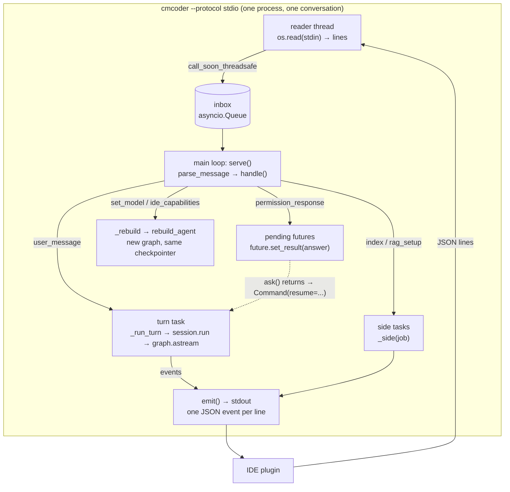

# 14 · Production

[← 13 Code search](13-rag.md) · [Index](00-index.md) · Back to the index: [00 Index →](00-index.md)

**You will learn:** how to serve a LangGraph agent from a long-lived process
(the IDE server), how callback handlers observe a whole run (nested graphs
included) for metrics and tracing, and how cmcoder tests, evaluates,
diagnoses and ships its agent: a scripted model server, evals, `doctor`, and
a standalone build with no Python on the user's PC.

## Why this module exists

An agent that works in a notebook isn't a product yet. cmcoder runs in five
IDEs, on developers' PCs without Python, against company gateways that each
behave a little differently. That needs:

* a **server** that drives the graph while the IDE keeps talking to it;
* **observability** that doesn't touch the agent's logic;
* **tests** that run the real graph without a real model;
* **evals** that measure the agent on real tasks;
* a **doctor** that finds what's wrong on a user's machine;
* a **build** that carries Python and LangChain inside.

## The concepts

### Serving a graph: runs, threads and interrupts over time

A compiled graph with a checkpointer is a *function of a thread*: each run
continues the thread named in `config["configurable"]["thread_id"]`. A
server holding a conversation therefore needs no conversation state of its
own: it starts one run per user message on the same thread.

An `interrupt()` makes it more interesting: the run *ends* (saved in the
checkpoint) and the answer arrives **later**, as another message. Resuming is
a new run with `Command(resume=...)` on the same thread. A minimal "server"
(run it; no model needed):

```python
import asyncio
from typing import TypedDict
from langgraph.checkpoint.memory import InMemorySaver
from langgraph.graph import END, START, StateGraph
from langgraph.types import Command, interrupt

class State(TypedDict):
    action: str
    done: str

def act(state: State) -> dict[str, str]:
    answer = interrupt({"ask": f"May I {state['action']}?"})  # pauses the run
    return {"done": "did it" if answer["allow"] else "skipped"}

builder = StateGraph(State)
builder.add_node("act", act)
builder.add_edge(START, "act")
builder.add_edge("act", END)
graph = builder.compile(checkpointer=InMemorySaver())

async def server(inbox: asyncio.Queue[dict]) -> None:
    config = {"configurable": {"thread_id": "t1"}}
    while (msg := await inbox.get())["type"] != "shutdown":
        if msg["type"] == "user_message":
            graph_input: object = {"action": msg["text"]}
        else:  # permission_response: resume the paused run
            graph_input = Command(resume={"allow": msg["allow"]})
        await graph.ainvoke(graph_input, config)
        state = await graph.aget_state(config)
        if state.interrupts:
            print("-> permission_request:", state.interrupts[0].value)
        else:
            print("-> result:", state.values["done"])

async def main() -> None:
    inbox: asyncio.Queue[dict] = asyncio.Queue()
    task = asyncio.create_task(server(inbox))
    for msg in [{"type": "user_message", "text": "delete build/"},
                {"type": "permission_response", "allow": True},  # arrives later
                {"type": "shutdown"}]:
        await asyncio.sleep(0.1)
        await inbox.put(msg)
    await task

asyncio.run(main())
```

```text
-> permission_request: {'ask': 'May I delete build/?'}
-> result: did it
```

### Callbacks: observe without changing

Middleware changes the agent's behaviour. A **callback handler** only
watches. LangChain calls its methods around every chat model call
(`on_chat_model_start`, `on_llm_end`, `on_llm_error`), tool run
(`on_tool_start`, `on_tool_end`, `on_tool_error`) and chain or graph node
(`on_chain_start`, …). Pass one in the run's config,
`config={"callbacks": [handler]}`, and it sees **the whole run, nested graphs
included** (a subagent running inside a tool). Every call has a `run_id`, and
its start and end carry the same one; `parent_run_id` links it to what
started it. That's how a start is paired with its end, and how nesting is
seen. LangSmith tracing is exactly this: a callback handler.

A standalone example against the mock server, with `bind_tools` for good
measure. **Note `streaming=True`**: the mock server always answers with a
stream, and a plain `ChatOpenAI` without it fails with "Unexpected response
type".

```python
import asyncio
from typing import Any
from uuid import UUID
from langchain_core.callbacks import AsyncCallbackHandler
from langchain_core.tools import tool
from langchain_openai import ChatOpenAI

class Printer(AsyncCallbackHandler):
    async def on_chat_model_start(self, serialized, messages, *, run_id: UUID, **kw: Any) -> None:
        print("start", str(run_id)[:8], kw.get("metadata", {}).get("ls_model_name"))
    async def on_llm_end(self, response, *, run_id: UUID, **kw: Any) -> None:
        msg = response.generations[0][0].message
        print("end  ", str(run_id)[:8], repr(msg.text), msg.usage_metadata)

@tool
def get_weather(city: str) -> str:
    """Get the current weather for a city."""
    return f"Sunny in {city}"

async def main() -> None:
    # streaming=True: the mock server always answers with a stream.
    model = ChatOpenAI(base_url="http://127.0.0.1:8765/v1", api_key="x", model="qwen3-27b",
                       streaming=True, stream_usage=True)
    await model.ainvoke("Say hello", config={"callbacks": [Printer()]})
    reply = await model.bind_tools([get_weather]).ainvoke("Weather in Paris? Use the tool.")
    print("tool_calls:", reply.tool_calls)

asyncio.run(main())
```

With the script `[{"content": "Hello!"}, {"tool_calls": [{"name": "get_weather", "arguments": {"city": "Paris"}}]}]`:

```text
start 01a16f3e qwen3-27b
end   01a16f3e 'Hello!' {'input_tokens': 12, 'output_tokens': 2, 'total_tokens': 14, ...}
tool_calls: [{'name': 'get_weather', 'args': {'city': 'Paris'}, 'id': 'call_…', 'type': 'tool_call'}]
```

(Run ids and call ids differ on every run.)

### Testing an agent: fake the server, not the model

LangChain offers fake chat models (`GenericFakeChatModel`) that replace the
model *object*. cmcoder fakes the **server** instead: an OpenAI-compatible
HTTP server that answers from a script. The real `ChatOpenAI` subclass, the
HTTP client (TLS, auth, retries), streaming and tool-call parsing are all
exercised, and the test can check exactly what the model was sent.

## How cmcoder uses it

### 1. The IDE server: `cli/stdio.py`



* **Reading without blocking the loop.**
  [`_start_reader`](../../../src/cmcoder/cli/stdio.py#L123) reads stdin in a
  daemon thread with `os.read` (asyncio's stdin readers don't work with
  Windows pipes) and hands each line to the event loop with
  [`call_soon_threadsafe`](../../../src/cmcoder/cli/stdio.py#L133), into the
  `inbox` queue.
* **The main loop.** [`serve`](../../../src/cmcoder/cli/stdio.py#L155) opens
  the session store, [builds the agent](../../../src/cmcoder/cli/stdio.py#L169)
  on its checkpointer, then [takes messages from the inbox](../../../src/cmcoder/cli/stdio.py#L195)
  and [handles](../../../src/cmcoder/cli/stdio.py#L223) them. It never waits
  for a turn to finish.
* **A turn is an asyncio task.** A `user_message`
  [starts `_run_turn` as a task](../../../src/cmcoder/cli/stdio.py#L244),
  which [iterates `session.run(...)`](../../../src/cmcoder/cli/stdio.py#L450)
  and emits each event. Because the loop keeps reading, an `interrupt`
  message can [cancel the task](../../../src/cmcoder/cli/stdio.py#L452)
  mid-turn.
* **Permission prompts across time.** When the graph hits `interrupt()`, the
  session reads the [pending interrupts](../../../src/cmcoder/runtime/session.py#L294),
  emits a `permission_request` and [awaits `ask()`](../../../src/cmcoder/runtime/session.py#L320).
  Here [`ask`](../../../src/cmcoder/cli/stdio.py#L594) parks a future under
  the interrupt's id; the client's later `permission_response`
  [sets its result](../../../src/cmcoder/cli/stdio.py#L247), and the session
  [resumes the graph](../../../src/cmcoder/runtime/session.py#L327) with
  `Command(resume=answers)`.
* **When *not* to use an interrupt.** IDE tools (`getDiagnostics`,
  `openFile`) are quick questions to the editor:
  [`ide_call`](../../../src/cmcoder/cli/stdio.py#L609) sends a request and
  awaits the answer inside the tool, with a 30-second timeout. An interrupt is
  for an answer that may take long or must survive a restart: a person's
  decision.
* **Side tasks.** Indexing can take minutes, so `index` and `rag_setup` run
  [beside the conversation](../../../src/cmcoder/cli/stdio.py#L461); a job that
  fails still answers the client, which waits for a reply.
* **A new graph, the same conversation.** `create_agent` compiles one model
  and a fixed tool list, so switching models or adding IDE tools means a new
  graph: [`_rebuild`](../../../src/cmcoder/cli/stdio.py#L328) calls
  [`rebuild_agent`](../../../src/cmcoder/agents/main.py#L182), which builds it
  on the *same checkpointer*; the thread id stays, so the conversation goes on.
* **stdout is the protocol.** [`run_stdio`](../../../src/cmcoder/cli/stdio.py#L663)
  [points `sys.stdout` at stderr](../../../src/cmcoder/cli/stdio.py#L672), so
  a stray `print` can never corrupt the event stream.

### 2. Metrics through a callback handler: `telemetry.py`

[`TelemetryCallback`](../../../src/cmcoder/telemetry.py#L308) is an
`AsyncCallbackHandler`. The session puts it
[in the run's config](../../../src/cmcoder/runtime/session.py#L410), so it
sees the main agent, its subagents and the team's roles alike:

* [`on_chat_model_start`](../../../src/cmcoder/telemetry.py#L320) remembers
  the model name (`ls_model_name` in the metadata) under the `run_id`;
  [`on_llm_end`](../../../src/cmcoder/telemetry.py#L332) finds it again by the
  same `run_id` and adds the tokens from `usage_metadata` (and LiteLLM's cost,
  when the gateway sends it).
* [`on_tool_start`](../../../src/cmcoder/telemetry.py#L362) /
  [`on_tool_end`](../../../src/cmcoder/telemetry.py#L367) count tool calls,
  ok or error.
* What LangChain doesn't see (turns, compactions, calls a permission rule
  stopped before the tool ran) comes from the session's events,
  [`observe`](../../../src/cmcoder/telemetry.py#L158).

It is off by default, and only counts and timings ever leave the machine.
The same rule for LangSmith: at start-up cmcoder
[removes `LANGSMITH_TRACING` / `LANGCHAIN_TRACING_V2`](../../../src/cmcoder/cli/main.py#L460)
unless `CMCODER_ENABLE_LANGSMITH=1`, so a stray environment variable can't
send prompts and code to a tracing service.

### 3. Testing with a scripted server: `testing/mock_server.py`

[`MockState`](../../../src/cmcoder/testing/mock_server.py#L52) holds the
script: a list of replies (`{"content": ...}` or `{"tool_calls": [...]}`),
served in order to chat requests. The handler answers
[chat completions](../../../src/cmcoder/testing/mock_server.py#L246) as an
SSE stream with usage, `/v1/models`, LiteLLM's `/v1/model/info`, and
[`/v1/embeddings`](../../../src/cmcoder/testing/mock_server.py#L312) (fake,
deterministic vectors), and records every request. It can also behave like a
real server under pressure: reject prompts over the context window like vLLM,
act like Open WebUI or an Ollama backend.

A test then runs the real agent and checks the outcome, the events and what
the model was sent:
[`test_fixes_a_bug_end_to_end`](../../../tests/test_agent_e2e.py#L44)
asserts the file was fixed, the tools were `Read` then `Edit`, and that the
model's reasoning was [never sent back](../../../tests/test_agent_e2e.py#L62)
to it.

### 4. Evals: `evals/run.py`

Tests check the harness; **evals** measure the agent. Each of the 26 tasks in
`evals/tasks/` has a prompt, a starting repo, a shell `check` and a
`mock_script.json`. [`run_task`](../../../evals/run.py#L166) copies the repo,
runs `cmcoder` (with `-p`, or [through the IDE protocol](../../../evals/run.py#L110)),
then runs the check, and reports pass/fail, model calls, tokens, time and
the tools used.

* `--mock` [serves the task's script](../../../evals/run.py#L190): a fast,
  model-free check that the harness and every task still work (CI).
* Without `--mock` it runs against your real gateway and model: the numbers
  that matter.
* `--via both` runs each task through the CLI and the IDE protocol and checks
  they agree; `--rag off` compares a task with and without code search.
* Every run also writes a **scorecard** next to its results
  ([`evals/scorecard.py`](../../../evals/scorecard.py)): `scorecard.md` to read and
  `scorecard.json` for machines, with the pass rate and the model calls, tokens and
  seconds per run. `--label qwen3-27b` names the model on it;
  `--baseline <earlier scorecard.json>` adds what changed (which tasks now pass or
  fail, and the change in calls and tokens), and `--fail-on-regression` exits 1 if a
  task that passed before fails now. That is how a change to cmcoder, or to the
  model behind it, is measured instead of felt.

### 5. `cmcoder doctor`: probing the real setup

[`probe_model`](../../../src/cmcoder/cli/doctor.py#L432) checks each model the
way the agent will use it: `astream` (time to first token, usage reported,
reasoning present), the thinking switch on the quick variant of the model,
then tool calling with
[`bind_tools([get_weather])`](../../../src/cmcoder/cli/doctor.py#L490), a
one-tool probe made with [`@tool`](../../../src/cmcoder/cli/doctor.py#L69).
A native `tool_calls` entry means the backend supports tool calling; a
`<tool_call>` tag in the text means it doesn't, but cmcoder can parse it
(chapter 07). Each finding comes with what to change.

### 6. What `ChatOpenAI` doesn't cover: `models/gateway.py`

LangChain's model classes cover inference, not a gateway's admin
endpoints. [`models/gateway.py`](../../../src/cmcoder/models/gateway.py) uses
plain `httpx` (with the same TLS, proxy and auth) for the model list,
LiteLLM's `/model/info`, Open WebUI's `/api/models` and Ollama's trained
context length, and probes a context window when nothing reports it
(chapter 03).

### 6b. When the gateway fails: `fallbackModel`

LangChain has a middleware for "try another model", `ModelFallbackMiddleware`, and
cmcoder does not use it for this. It works per model call: every call of a request
would first wait for the failing model again, everything built around the main
model (the compaction limit, the output budget, tool-call repair) would keep
using *its* window, and the user would never be told. Instead
[`Session._fall_back`](../../../src/cmcoder/runtime/session.py) acts on the
request: when `classify()` says the failure is the gateway's
(`models/errors.py` `worth_fallback`), it rebuilds the agent on `fallbackModel`
with `rebuild_agent` (a full middleware set for that model, on the same
checkpointer, so the same thread), and resumes with `astream(None, config)` from
the last checkpoint: the same mechanism as `/retry`. The first model call that
failed is the only step run again; the message is not sent twice. The next
request puts the main model back (`_restore_primary`), unless you picked another
model in between. It is done once per request: a fallback that fails too ends the
request with the error card.

### 7. Shipping without Python: the standalone build

Developers' PCs have no Python. PyInstaller bundles the interpreter, cmcoder
and LangChain into one folder. Two LangChain-specific points
([packaging/build.py](../../../packaging/build.py)):

* LangChain and LangGraph import some modules **by name at run time**, which
  PyInstaller's import scan can't see, and read their own versions from
  package metadata: [`--collect-submodules` / `--copy-metadata`](../../../packaging/build.py#L101)
  bundle them.
* **Lazy imports** keep start-up fast: LangChain and LangGraph take about a
  second to import, so the CLI [imports the agent only when it runs one](../../../src/cmcoder/cli/main.py#L136),
  and modules like `models/__init__.py` and `rag/common.py` import no
  LangChain at all. `cmcoder --version` stays instant.

[`packaging/no_python.py`](../../../packaging/no_python.py) tests the result
the way users run it: a "trap" folder first on `PATH` holds fake `python`,
`pip`, `uv`, … that record being started and fail, so any hidden dependency
on Python makes the test fail and says what it tried to run.

## Lab 1: be an IDE

[`labs/14_stdio_client.py`](labs/14_stdio_client.py) starts
`cmcoder --protocol stdio`, sends a `user_message`, answers the
`permission_request` and prints the events. Script:
[`labs/14_fix_add.json`](labs/14_fix_add.json) (Read, Edit, answer); the
project needs the buggy `app.py`.

```bash
uv run python -m cmcoder.testing.mock_server --script docs/learn/modules/labs/14_fix_add.json --port 8765
uv run python docs/learn/modules/labs/14_stdio_client.py http://127.0.0.1:8765/v1 /tmp/lab-project allow
```

```text
<< system_init          model=qwen3-27b
>> user_message
<< usage
<< assistant_message    ''
<< tool_use             Read(app.py)
<< tool_result          Read error=False
<< usage
<< assistant_message    ''
<< tool_use             Edit(app.py)
<< permission_request   Edit(app.py) (request_id=b77e372f…)
>> permission_response
<< tool_result          Edit error=False
<< usage
<< assistant_message    'Fixed add().'
<< result               success: 'Fixed add().'
>> shutdown

app.py now: return a + b
```

Restart the mock server, put the bug back, and run it with `deny`:

```text
<< permission_request   Edit(app.py) (request_id=e2c0900e…)
>> permission_response
<< permission_denied
<< tool_result          Edit error=True
<< result               interrupted: 'Stopped: the user denied a tool call.'
>> shutdown

app.py now: return a - b
```

Between `permission_request` and `permission_response`, the graph is paused
in an `interrupt()`: the process is idle, waiting for the next line on stdin.

## Lab 2: a callback handler sees everything

[`labs/14_callbacks.py`](labs/14_callbacks.py) runs the agent with a
`TimingHandler` in the config. The main agent asks an `explore` subagent
(via the Task tool), which runs its own Grep. Script:
[`labs/14_subagent.json`](labs/14_subagent.json).

```bash
uv run python -m cmcoder.testing.mock_server --script docs/learn/modules/labs/14_subagent.json --port 8765
uv run python docs/learn/modules/labs/14_callbacks.py http://127.0.0.1:8765/v1 /tmp/lab-project
```

```text
model start  (main agent, 2 messages)
model end      55.3 ms -> tool calls ['Task']
tool start   Task
  model start  (subagent, 2 messages)
  model end      11.6 ms -> tool calls ['Grep']
  tool start   Grep
  tool end       21.9 ms
  model start  (subagent, 4 messages)
  model end      14.8 ms -> 'add() is in app.py:1 and returns a - b (it subtrac'
tool end      101.5 ms
model start  (main agent, 4 messages)
model end      16.9 ms -> 'The explore subagent found add() in app.py: it sub'

answer: The explore subagent found add() in app.py: it subtracts instead of adding.
```

One handler, passed once, saw the subagent's model calls and tool too. The
nesting comes from `parent_run_id`; timings will differ on your machine.

## Exercises

1. **Interrupt mid-turn.** In lab 1, send `{"type": "interrupt"}` right after
   the `permission_request` instead of answering. Which events come back,
   and what does the next `user_message` see in the conversation?
2. **Token counting.** Extend `TimingHandler` with `on_llm_end` totals of
   `usage_metadata["input_tokens"]` / `["output_tokens"]`, per main agent and
   subagent. That is most of `TelemetryCallback`.
3. **Write an agent test.** Copy `test_fixes_a_bug_end_to_end` and write one
   for a two-file change (Read a.py, Edit b.py). Assert on the files, the tool
   sequence and `server.requests[-1]["messages"]`.
4. **Stretch: an eval task.** Add a task folder to `evals/tasks/` (prompt,
   `repo/`, a `check`, a `mock_script.json`), run
   `uv run python evals/run.py --mock --task <name> --via both`, then against
   your gateway without `--mock`.

## Check yourself

1. Why does the stdio server read stdin in a thread and run each turn as a task?
2. How does a `permission_response` that arrives seconds later resume the graph?
3. Why are IDE tool calls *not* LangGraph interrupts?
4. Switching models builds a new graph. Why doesn't the conversation get lost?
5. Middleware or callback handler: which one for metrics, and why?
6. What does faking the server catch that faking the model object wouldn't?
7. Why does the CLI import the agent inside the command rather than at the top?

<details><summary>Answers</summary>

1. The thread makes reading stdin portable (Windows pipes don't work with
   asyncio's stdin readers) and never blocks the loop; running the turn as a
   task lets the loop keep reading, so an interrupt or a permission answer can
   arrive mid-turn.
2. `ask()` left a future under the interrupt's id; the response sets its
   result, `ask()` returns, and the session runs the graph again with
   `Command(resume=answers)` on the same thread: LangGraph re-runs the paused
   node, where `interrupt()` now returns the answer.
3. They are quick questions the editor answers at once; awaiting inside the
   tool is simpler. An interrupt is for answers that may take long or must
   survive a restart (a person's decision), and it costs a checkpoint and a
   re-run of the node.
4. The new graph uses the same checkpointer and the session keeps its thread
   id, so the next run continues the saved conversation.
5. A callback handler: it only observes, needs no changes to the agent, and
   sees every model call and tool in the run, nested graphs included.
   Middleware is for changing behaviour.
6. The real HTTP path: cmcoder's `ChatOpenAI` subclass, TLS and auth,
   streaming chunks, tool-call parsing, usage reporting, and exactly what was
   sent to the model.
7. LangChain and LangGraph take about a second to import; `--version`,
   `--help` and light subcommands shouldn't pay for it, and the standalone
   build starts faster.

</details>

[← 13 Code search](13-rag.md) · [Index](00-index.md) · Back to the index: [00 Index →](00-index.md)
